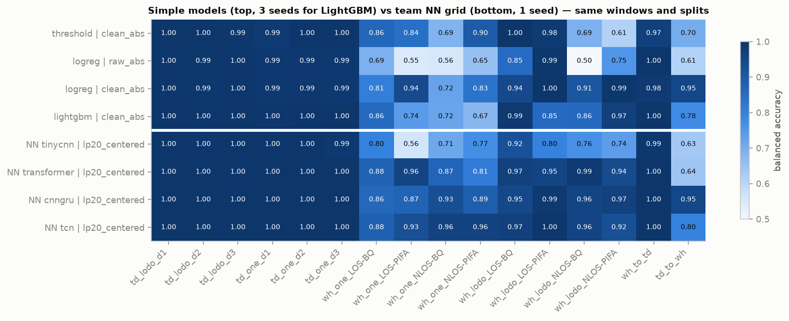
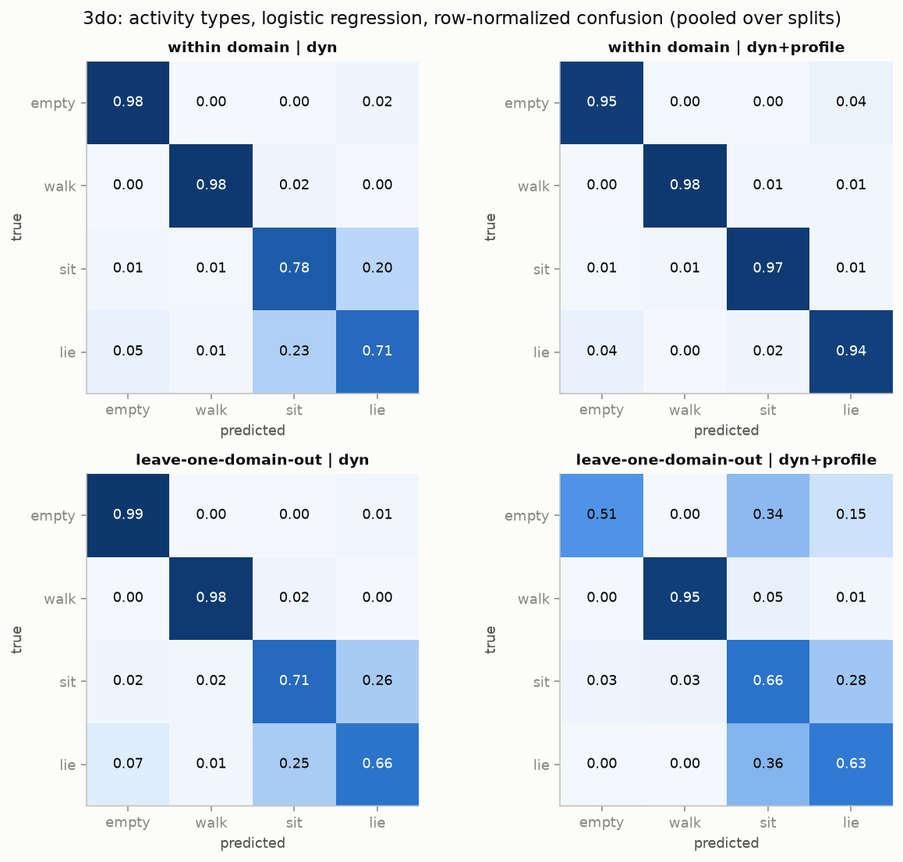
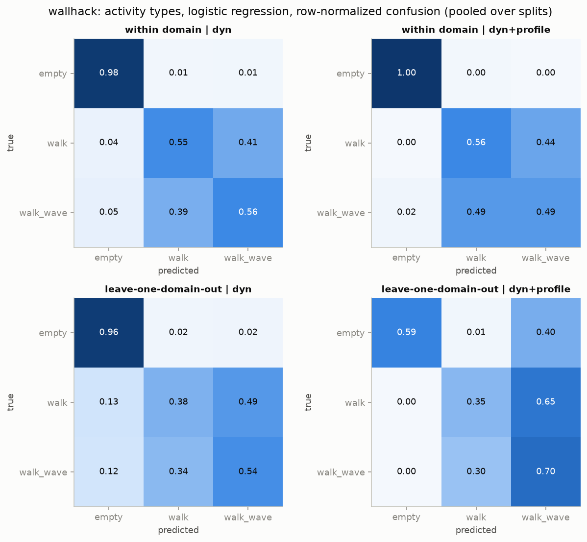
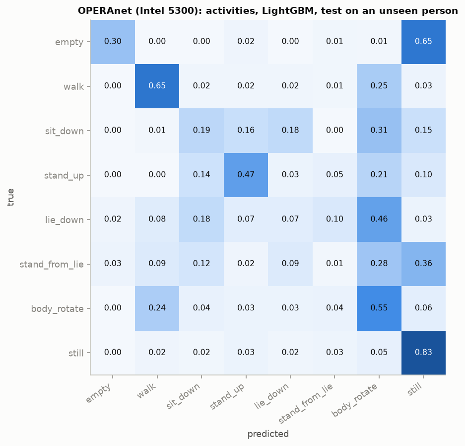

# Классические модели, единый шаблон предобработки и типы движения

Три части:
1. **Бинарная задача «есть движение / нет»:** порог на дисперсии, логистическая регрессия и LightGBM на признаках 4-секундных окон амплитуды CSI (Wallhack1.8k и 3DO). Модели обучались на тех же 16 сценариях переноса и тех же 3045 окнах, что и сетка нейросетей из ветки `baldezh-6.1-sol-xhigh`, поэтому результаты можно сравнивать напрямую.
2. **Типы движения:** Wallhack {empty, walk, walk_wave}, 3DO {empty, walk, sit, lie}, OPERAnet (Intel 5300) — 8 активностей; классические модели и нейросети (TCN, CNN-GRU).
3. **Перенос на другое железо без дообучения:** модель «пусто / ходьба», обученная на ESP32, применяется к Intel 5300 (OPERAnet).

Train и test всегда разделены по записям и доменам.

## 1. Бинарная задача: результаты

Средние по 10 сценариям, где тестовые данные из Wallhack: перенос между доменами Wallhack (1→3, 3→1) и 3DO→Wallhack. На сценариях, где тестовые данные из 3DO, все модели дают ~1.00.

| Модель \| вход | Balanced accuracy | ROC-AUC | Ложные тревоги |
|---|---|---|---|
| Порог на дисперсии \| очистка от импульсов | 0.81 | 0.98 | 25% |
| Логистическая регрессия \| сырая амплитуда | 0.68 | 0.87 | 52% |
| **Логистическая регрессия \| очистка от импульсов** | **0.90** | **0.99** | **12%** |
| **Логистическая регрессия \| единый шаблон `clean_lp_scaled`** | **0.91** | **0.99** | **6%** |
| LightGBM \| очистка от импульсов | 0.83 | 0.97 | 27% |
| NN CNN-GRU \| `lp20_centered` (для сравнения) | 0.93 | 0.97 | 7% |
| NN TCN \| `lp20_centered` (для сравнения) | 0.93 | 0.99 | 10% |



**Выводы**
1. Предобработка важнее модели. Удаление импульсных пакетов и нормализация окна дают +0.2 к balanced accuracy, выбор между логистической регрессией и нейросетью — ±0.03.
2. AUC почти везде выше 0.95, а ложных тревог при переносе много. Модели хорошо упорядочивают окна, но порог решения в новом домене смещается.
3. Перенос 3DO→Wallhack: логистическая регрессия на очищенной амплитуде даёт 0.95 и 3% ложных тревог, на уровне лучшей нейросети. Модели, обученные на чистом 3DO без очистки, принимают импульсные провалы Wallhack (3–5% пакетов) за движение.
4. LightGBM переносится хуже логистической регрессии: подстраивается под домен обучения.

## 2. Типы движения

Признаки окна двух видов:
- **динамика** — дисперсия после нормализации `clean_lp_scaled`, доли энергии первой PCA-компоненты в полосах 0–0.5 / 0.5–1 / 1–2 / 2–3 / 3–5 / 5–8 / 8–12 / 12–20 / 20–50 Гц, спектральный центроид, периодичность (пик автокорреляции на 0.5–3 Гц), доля дисперсии первых PCA-компонент, эксцесс приращений;
- **профиль** — форма средней амплитуды по поднесущим.

Нейросети получают окно `clean_lp_centered` [52, 400]: среднее каждой поднесущей вычтено, статического профиля во входе нет.

Сплиты:
- внутри домена: Wallhack — 5 фолдов (файлы `w_k` + `ww_k` + k-й временной блок `b1`), 3DO — фолды по номеру сессии внутри дня;
- новый домен: leave-one-domain-out (Wallhack) и leave-one-day-out (3DO);
- новый человек: OPERAnet.

### Wallhack и 3DO (macro-F1)

| Задача | Модель \| признаки | Внутри домена | Новый домен / день |
|---|---|---|---|
| Wallhack: empty / walk / walk_wave | LightGBM \| динамика | 0.68 | 0.66 |
| | LogReg \| динамика | 0.67 | 0.60 |
| | LogReg \| динамика + профиль | 0.64 | 0.47 |
| | NN CNN-GRU / TCN | 0.66 / 0.65 | 0.64 / 0.62 |
| 3DO: empty / walk / sit / lie | LightGBM \| динамика | 0.89 | 0.82 |
| | LogReg \| динамика | 0.86 | 0.81 |
| | LogReg \| динамика + профиль | **0.97** | 0.63 |
| | **NN CNN-GRU / TCN** | 0.87 / 0.86 | **0.89 / 0.88** |

У нейросетей на новом домене / дне 3 сида (42, 43, 44), разброс между сидами ±0.01. Полнота на новом дне 3DO: у классических моделей sit 0.72, lie 0.59; у нейросетей sit 0.67–0.77, lie 0.79–0.90.




**Выводы**
1. **Ходьбу и ходьбу с махами руками не различает ни одна модель** (полнота 0.4–0.6, на новом домене около случайной). Спектры этих классов почти совпадают.
2. **Позы различимы, но переносится только динамика.** Профиль по поднесущим поднимает качество внутри дня до 0.97, а на новом дне роняет его до 0.63 и путает пустую комнату с позами: профиль — отпечаток дня и сессии.
3. **На позах нейросети лучше классических моделей при переносе на новый день** (0.88–0.89 против 0.81–0.82), в основном за счёт «лежит». Они используют рисунок мелких колебаний по поднесущим, который наши признаки сворачивают в одну PCA-компоненту.
4. Перенос «пусто / ходьба» между датасетами на динамике: Wallhack→3DO 0.99–1.00, 3DO→Wallhack 0.95–0.97.

## 3. OPERAnet: другое железо

Intel 5300, 3×3 антенны × 30 поднесущих, 5 ГГц, ~1560 пакетов/с. Приёмник NUC1, комната 1: человек One (`exp002–005`), человек Five (`exp020–023`), пустая комната (`exp001`, `exp019`). Все записи проходят через тот же единый шаблон.

### Перенос «пусто / ходьба» без дообучения

Модели обучены только на ESP32 (динамические признаки) и применены к Intel 5300 как есть: другой чип, диапазон, число антенн и поднесущих, частота пакетов и помещение.

| Обучение (ESP32) | Модель | Balanced accuracy | ROC-AUC | Ложные тревоги |
|---|---|---|---|---|
| Wallhack + 3DO | **LogReg** | **0.994** | **1.000** | **1.1%** |
| Wallhack + 3DO | LightGBM | 0.978 | 1.000 | 4.3% |
| только Wallhack | LogReg | 0.994 | 1.000 | 1.1% |
| только 3DO | LogReg | 0.992 | 1.000 | 1.7% |

Динамические признаки безразмерные и усредняются по антеннам и поднесущим, а шаблон сам приводит частоту пакетов к 100 Гц, поэтому модель применима к железу с другой конфигурацией.

### Активности: тест на новом человеке

8 классов: пусто, ходьба, сесть, встать, лечь, встать с пола, поворот корпуса, покой (человек неподвижен). Обучение на одном человеке, тест на другом.

| Модель | macro-F1 | Полнота: пусто / ходьба / покой / поворот / встать / сесть / лечь / встать с пола |
|---|---|---|
| LightGBM | 0.36 | 0.30 / 0.68 / 0.84 / 0.55 / 0.47 / 0.19 / 0.07 / 0.01 |
| LogReg | 0.35 | 0.31 / 0.67 / 0.76 / 0.34 / 0.43 / 0.28 / 0.10 / 0.09 |



**Выводы**
1. **Пустую комнату модель путает с неподвижным человеком в 65% окон** — то же, что в 3DO, на другом датасете и железе. Без движения присутствие по динамике амплитуды не видно.
2. Короткие действия (сесть, лечь, встать) почти не распознаются: они короче окна 4 с, и примеров мало (14–20 окон на человека).
3. Ходьба и поворот корпуса путаются между собой.

Ограничения: два человека, одна комната, один приёмник.

## Единый шаблон предобработки (`src/csi/preprocess.py`)

```
амплитуда → сегменты без разрывов > 50 мс → удаление импульсных пакетов (на исходной частоте)
          → защита от наложения частот + ресемплинг 100 Гц → low-pass 20 Гц → окна 4 с
          → нормализация окна → стандартизация по train
```

Шаблон не зависит от числа антенн, поднесущих и частоты пакетов (каноническая запись `src/csi/recording.py`). Для быстрого железа (Intel 5300 ~1.6 кГц) перед понижением частоты включается фильтр Баттерворта 8-го порядка на 40 Гц, каналы обрабатываются по одному. Признаки `window_features` усредняются по антеннам и поднесущим, поэтому простую модель можно применять к другому железу.

Проверка пресетов (логистическая регрессия, 10 сценариев с тестом на Wallhack):

| Пресет | BA | ROC-AUC | Ложные тревоги |
|---|---|---|---|
| `raw` | 0.75 | 0.86 | 29% |
| `clean` | 0.88 | 0.98 | 9% |
| `clean_lp_centered` | 0.92 | 0.99 | 4.2% |
| `clean_lp_relative` | 0.82 | 0.97 | 21% |
| **`clean_lp_scaled`** (по умолчанию) | **0.91** | **0.99** | **5.6%** |

`scaled` вычитает среднее окна у каждой поднесущей и делит на одно общее среднее окна. Результат не зависит от единиц амплитуды (они разные у ESP32 и Intel/Atheros) и не раздувает шум на поднесущих в глубоком замирании, как `relative`.

## Особенности данных, учтённые в коде

- Байты CSI ESP32 читаются по раскладке ESP-IDF (`imag = buf[2k]`, `real = buf[2k+1]`). Загрузчики и кэши `.npy` авторов датасетов склеивают байты соседних поднесущих; этот режим доступен как `pairing="authors"`.
- 32-битный `local_timestamp` ESP32 переполняется и разворачивается; одиночные испорченные метки времени исправляются.
- Битые строки CSV (7 на ~2.5 млн) отбрасываются.
- В Wallhack 3–5% пакетов — импульсные провалы амплитуды на всех поднесущих сразу, в том числе в пустой комнате. Это артефакт железа или канала.
- OPERAnet: файлы — MATLAB 7.3 `table`, читаются через `mat-io` в режиме `raw_data` по столбцам (целиком таблица не помещается в память). Метки времени с точностью 1 мс при ~1560 пакетах/с: одинаковые метки равномерно распределяются внутри миллисекунды.

## Данные

- Wallhack1.8k: Zenodo 15147388 → `data/raw/wallhack/`
- 3DO: Zenodo 10925351 → `data/raw/3do/`
- OPERAnet: figshare, DOI 10.6084/m9.figshare.c.5551209 (CC0). Нужные эксперименты можно вытащить из архива на 34.8 ГБ без полной загрузки:

```powershell
python -m csi.io.remote_zip https://ndownloader.figshare.com/files/30689729 data\raw\operanet\wificsi1 wificsi1_exp001.mat wificsi1_exp002.mat wificsi1_exp003.mat wificsi1_exp004.mat wificsi1_exp005.mat wificsi1_exp019.mat wificsi1_exp020.mat wificsi1_exp021.mat wificsi1_exp022.mat wificsi1_exp023.mat
```

## Запуск

```powershell
python -m venv .venv
.venv\Scripts\Activate.ps1
pip install torch==2.5.1 --index-url https://download.pytorch.org/whl/cu121
pip install -r requirements.txt
pip install -e .

# бинарная задача
python -m csi.format          # сырые CSV -> data/processed (единый формат)
python -m csi.eda             # признаки окон
python -m csi.eda_plots       # пороговый бейзлайн: ROC и матрицы переноса порога
python -m csi.baselines       # порог / LogReg / LightGBM на 16 сценариях -> results/baselines_team_grid.csv
python -m csi.compare_grid    # сравнение с нейросетями -> results/compare_simple_vs_nn.csv
python -m csi.check_template  # пресеты единого шаблона -> results/template_check.csv

# типы движения
python -m csi.activity                    # LogReg / LightGBM -> results/activity_metrics.csv
python -m csi.nn                          # TCN / CNN-GRU -> results/activity_nn_metrics.csv
python -m csi.nn --seeds 43 44 --families lodo --tag _seeds43_44

# OPERAnet
python -m csi.io.operanet                 # .mat -> data/processed/operanet
python -m csi.operanet_activity           # активности и перенос ESP32 -> Intel 5300
```

## Файлы

| Путь | Что |
|---|---|
| `src/csi/io/` | чтение сырых данных: ESP32 CSV (Wallhack, 3DO), OPERAnet `.mat`, выборочная загрузка из удалённого zip |
| `src/csi/format.py` | единый формат `data/processed`, проверка |
| `src/csi/recording.py`, `src/csi/preprocess.py` | каноническая запись и единый шаблон предобработки |
| `src/csi/features.py` | амплитуда, санитизированная фаза, удаление импульсов, признаки окна |
| `src/csi/baselines.py`, `src/csi/compare_grid.py`, `src/csi/check_template.py` | бинарная задача: простые модели, сравнение с нейросетями, пресеты шаблона |
| `src/csi/activity.py` | типы движения: признаки, сплиты, LogReg / LightGBM |
| `src/csi/nn.py` | типы движения: TCN / CNN-GRU |
| `src/csi/operanet_activity.py` | OPERAnet: активности и перенос с ESP32 |
| `src/csi/eda.py`, `src/csi/eda_plots.py` | признаки окон, пороговый бейзлайн и графики |
| `results/baselines_team_grid.csv`, `compare_simple_vs_nn.csv`, `template_check.csv`, `baseline_threshold_*.csv` | бинарная задача |
| `results/activity_metrics.csv`, `activity_confusions.csv` | типы движения, классические модели |
| `results/activity_nn_metrics*.csv`, `activity_nn_confusions.csv` | типы движения, нейросети |
| `results/operanet_activity_metrics.csv`, `operanet_cross_hardware.csv` | OPERAnet |
| `results/team_grid/` | сценарии и окна сетки нейросетей (`plan.json`, `windows.csv`) и её метрики (`nn_results.csv`) |
| `figures/` | ROC и матрицы переноса порога, сравнение с нейросетями, матрицы ошибок по типам движения |
