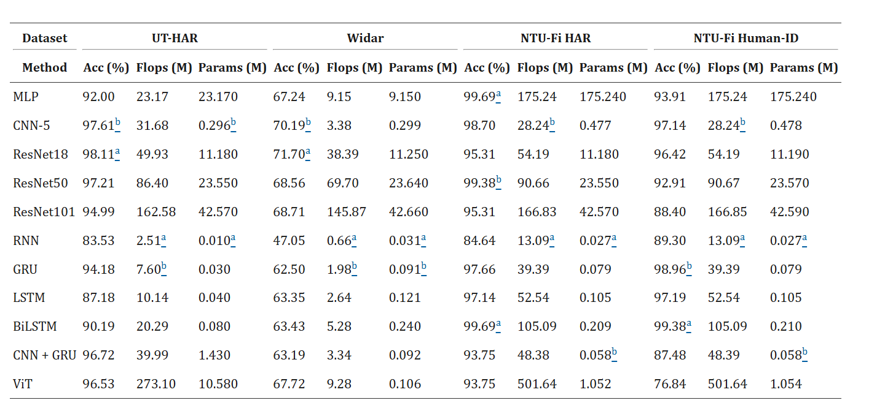
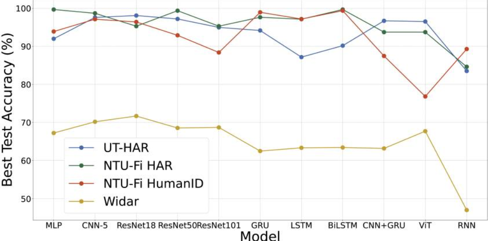

# SenseFi: сравнение моделей на CSI

В работе *SenseFi: A library and benchmark on deep-learning-empowered WiFi human sensing* авторы собрали библиотеку для сравнения нейросетей на данных Wi-Fi. Задачи включают распознавание действий, жестов и идентификацию человека. [Код и описание датасетов](https://github.com/xyanchen/WiFi-CSI-Sensing-Benchmark).

### Данные UT-HAR и NTU-Fi HAR

| Характеристика | UT-HAR | NTU-Fi HAR |
|---|---|---|
| Задача | Распознавание действий | Распознавание действий |
| Число классов | 7 | 6 |
| Обучающих примеров в статье | 3977 | 936 |
| Тестовых примеров в статье | 996 | 264 |
| Оборудование | Intel 5300 NIC | Atheros CSI Tool |
| Вход модели в бенчмарке | `1 × 250 × 90` | `3 × 114 × 500` |
| Классы | Лечь, упасть, идти, поднять предмет, бежать, сесть, встать | Бокс, круг, уборка, падение, бег, ходьба |

По смыслу совпадают падение, бег и ходьба. Отдельного размеченного фона в этих наборах нет, поэтому в текущую задачу «движение / нет движения» они не включены. В локальном UT-HAR тестовые 996 примеров из статьи представлены двумя частями: 496 валидационных и 500 тестовых.

### Входные данные

CSI содержит комплексные коэффициенты канала: амплитуду и фазу для поднесущих. В бенчмарке используются преимущественно амплитудные представления. Формат входа нужно сверять с загрузчиком: форма массива в MAT или NPY может отличаться от тензора после перестановки осей.

### Сравнение архитектур

В статье сравниваются полносвязные и свёрточные сети, ResNet, рекуррентные модели, CNN-GRU и ViT. Результаты авторов приведены в таблицах:

Обозначение `a` соответствует лучшему результату, `b` — второму.

Более глубокие сети не всегда дают более высокую точность. Поэтому для первого эксперимента подходят компактные CNN и GRU. В статье также обсуждается нестабильность отдельных моделей при Adam и использование SGD; выбор оптимизатора зависит от архитектуры и настроек обучения.

Численные таблицы и пояснения к переносу между задачами приведены в [теоретическом конспекте](Теория%20по%20Wi-Fi%20Sensing.md). Модели, обученные в этом репозитории, и их результаты описаны в [README](../README.md).
