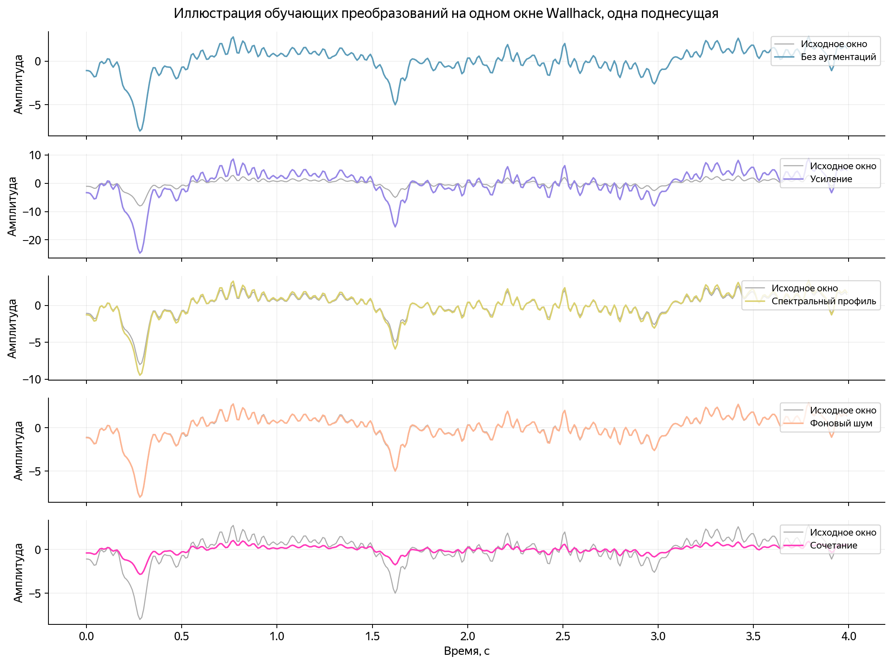
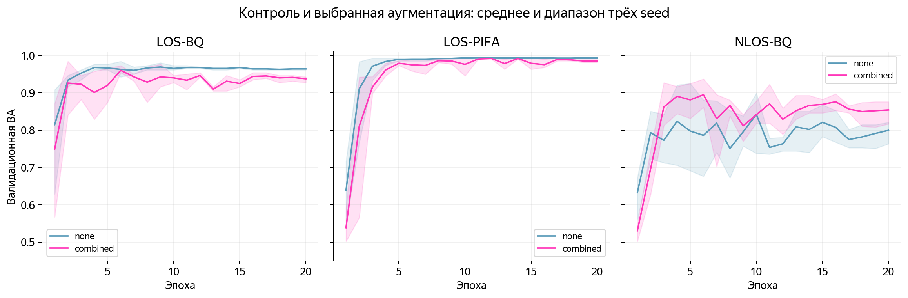
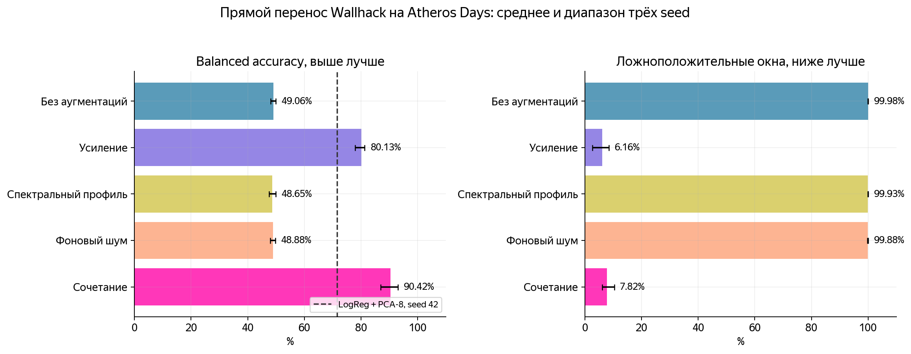
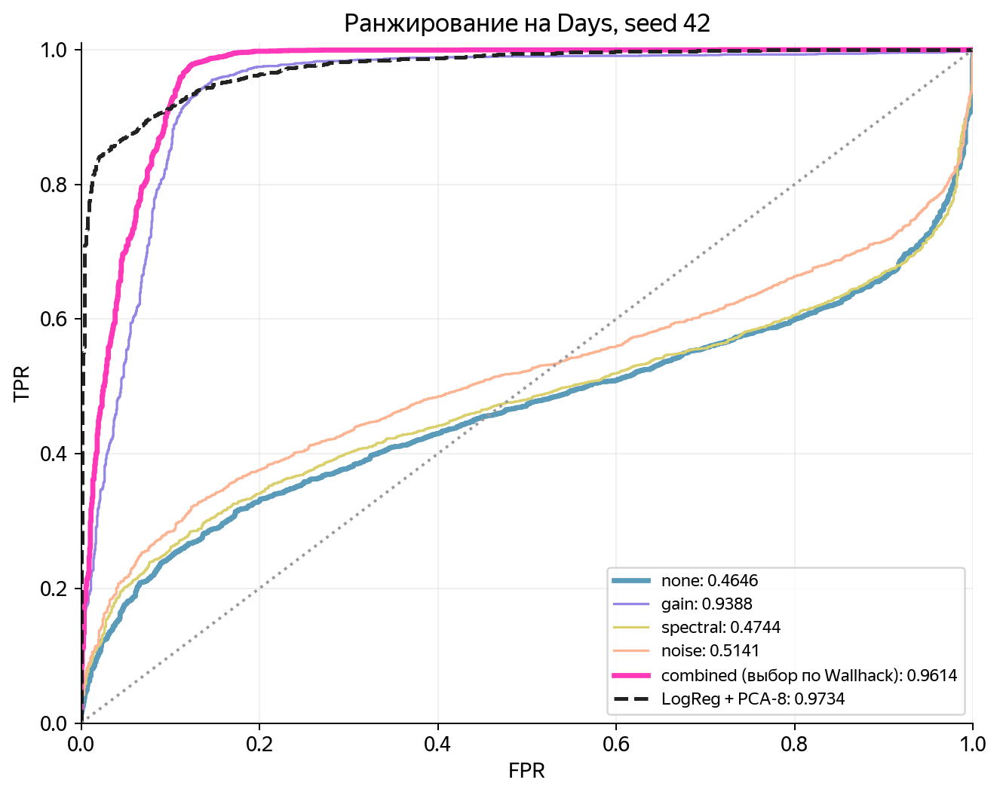
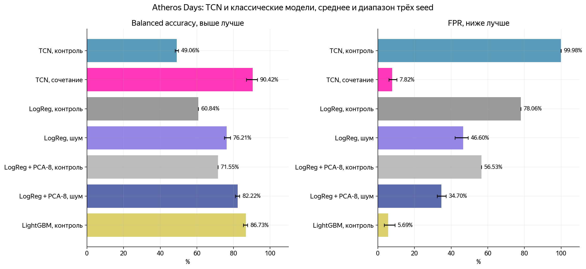
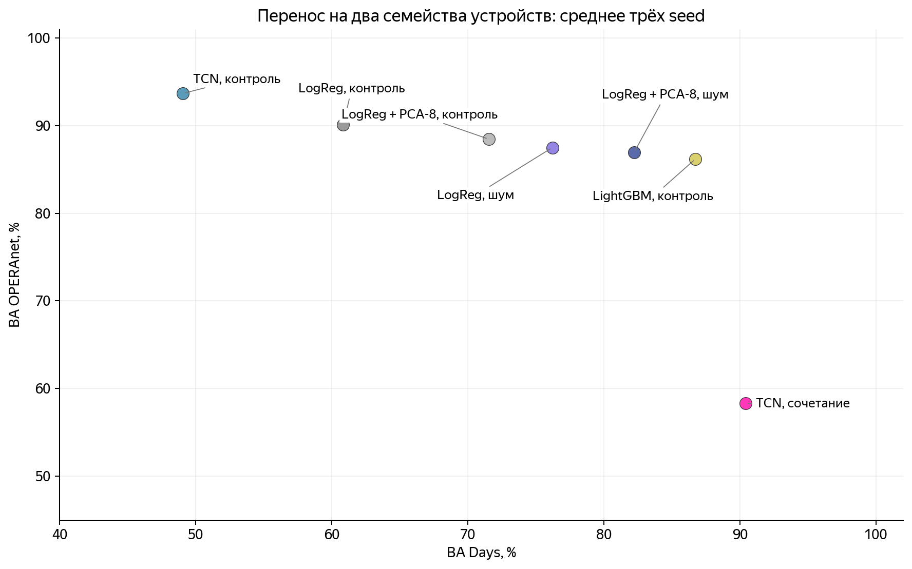
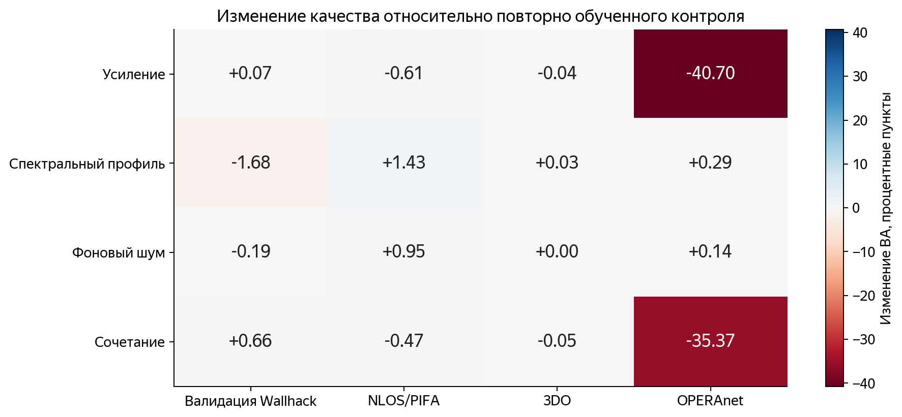

# Аугментации CSI-моделей: перенос на Atheros и сохранение качества в других средах

28 октября 2026 года.

## Результат

Аугментации при обучении только на Wallhack существенно улучшили перенос TCN на Atheros Days. Сочетание изменения усиления, плавного спектрального профиля и фоновых колебаний повысило среднюю balanced accuracy (BA) с 0,4906 до 0,9042. Доля ложноположительных окон снизилась с 0,9998 до 0,0782. На Days не использовались обучение, пересчёт нормализации, адаптация во время инференса или подбор порога.

Одновременно сохранить качество на остальных данных не удалось. На OPERAnet средняя BA выбранной конфигурации снизилась с 0,9367 до 0,5830, а полнота движения — с 0,9429 до 0,2673. На 3DO изменение BA мало: 0,9991 против 0,9987. На исходной доменной валидации средняя BA выросла, но доля ложных срабатываний увеличилась. Ни одна из четырёх проверенных политик TCN не выполнила одновременно критерий улучшения Days и критерий сохранения остальных показателей, даже с заранее заданными инженерными допусками.

Результат подтверждает пригодность аугментаций как отдельного кандидата для Atheros. Оснований заменять ими исходную TCN во всех средах нет. Модель с добавлением только шума сохранила остальные показатели в пределах допусков, однако перенос на Days не улучшила.

Для LogReg шумовая аугментация повысила среднюю BA Days с 0,6084 до 0,7621. Потеря на OPERAnet гораздо меньше, чем у TCN, но сохранение остальных показателей тоже не подтверждено. LogReg + PCA-8 с сочетанием преобразований достигла BA Days 0,8337, а LightGBM без аугментаций — 0,8673. Эти ориентиры не позволяют свести результат к противопоставлению нейросети и одного базового классификатора.

## Данные и условия сравнения

Задача сохраняет прежнюю разметку: класс 0 — пустая сцена, класс 1 — ходьба, включая ходьбу с движениями рук. Окно содержит 52 канала и 400 отсчётов на сетке 100 Гц. Неподвижный человек не становится отрицательным примером. В OPERAnet используются только `background` и `walk`; результаты не относятся ко всем активностям этого набора.

| Проверка | Обучение | Оценка | Назначение |
| --- | --- | --- | --- |
| Development Wallhack | Два домена из LOS/BQ, LOS/PIFA, NLOS/BQ | Третий домен, три прохода | Выбор политики аугментации |
| Контроль NLOS/PIFA | Три development-домена, 1 111 окон | 352 окна NLOS/PIFA | Ретроспективный контроль условий приёма |
| 3DO | Все 44 записи Wallhack, 1 463 окна | 1 589 окон за три дня | Перенос внутри близкого семейства оборудования |
| Days | Те же 44 записи Wallhack | 4 944 окна, 206 записей, 21 день | Перенос на Atheros в LabI, LabII и квартире |
| OPERAnet | Те же 44 записи Wallhack | 1 026 окон двух комнат и двух приёмников | Дополнительный контроль переноса на Intel 5300 |

Отдельно рассчитаны те же 336 окон Room2 OPERAnet. Обучение на Room1 в этой серии не выполнялось: все новые модели обучены исключительно на Wallhack. Подготовка внешних измерений повторяет [протокол проверки устройств](../experiments/robustness/protocol.md), включая адаптеры поднесущих и офлайн-ресемплирование. Для OPERAnet подтверждены 5 ГГц, но ширина канала в MAT-метаданных отсутствует. Проверка не становится строгим подтверждением режима 5/20.

Все прежние внешние результаты уже были известны. Они мотивировали проверку масштаба и фоновых колебаний. Поэтому исследование не является слепым тестом на ранее неизвестных данных. Диапазоны аугментаций, число обучений, критерии и способ выбора зафиксированы в [протоколе](../experiments/augmentation/protocol.md) до новых запусков. Новые внешние метрики не использовались для выбора политики или изменения её параметров.

Для оценки эффекта повторно обучен контроль без аугментаций тем же кодом и с тем же бюджетом. Его значения немного отличаются от прежних весов: средняя BA development-сравнения равна 0,9196, прежняя — 0,9219; на Days при seed 42 получено 0,4808 вместо 0,4825. Оценки не подгонялись для совпадения. Эффект аугментаций ниже рассчитывается относительно нового парного контроля. Прежние LogReg и LogReg + PCA-8 используются как замороженные внешние ориентиры. [Сверка прогнозов контроля](../experiments/augmentation/results/control_agreement.csv) показывает изменения отдельных решений.

## Что моделируют аугментации

Измеряемый комплексный канал зависит от суммы путей распространения:

$$
H_k(t)=\sum_p a_{p,k}(t)e^{-j2\pi f_k\tau_p(t)},\qquad A_k(t)=|H_k(t)|.
$$

Различия усиления приёмника меняют масштаб амплитуды, а частотная характеристика оборудования — относительные уровни поднесущих. Центрирование удаляет постоянный уровень канала, но не устраняет множитель усиления. Поэтому одна и та же физическая динамика может поступать в классификатор с другим размахом.

Предобработка итоговой TCN сохранена: локальная медианная очистка, ФНЧ Баттерворта четвёртого порядка со срезом 20 Гц и центрирование каждого канала. Аугментации действуют на очищенный центрированный сигнал $X$, до стандартизации. Обозначим среднюю исходную амплитуду обучающего окна как $m$. Она используется только для масштаба обучающей помехи и не добавляется к признакам инференса.

| Политика | Преобразование | Проверяемая гипотеза |
| --- | --- | --- |
| Контроль `none` | $X'=X$ | Качество той же TCN без новых преобразований |
| Усиление `gain` | $X'=gX$, $\log g\sim U(\log0{,}25;\log16)$ | Модель может меньше зависеть от общего размаха |
| Профиль `spectral` | $X'_k=s_kX_k$ | Плавные изменения чувствительности поднесущих не должны определять класс |
| Шум `noise` | $X'=X+rmn$, $r\sim U(0;0{,}06)$ | Фоновые колебания могут перестать автоматически означать движение |
| Сочетание `combined` | $X'_k=g(s_kX_k+rmn_k)$ | Совместная устойчивость к масштабу, частотному профилю и фону |

Для профиля интерполируются шесть независимых логарифмических узлов с SD 0,35; среднее логарифма по каналам вычитается. Геометрическое среднее множителя равно единице. Шум строится из общей и независимой компонент с долями мощности 0,8 и 0,2, фильтруется FIR из 41 коэффициента с окном Hann и срезом 10 Гц, центрируется и приводится к RMS=1 внутри окна. Границы отражаются. Измеренная доля энергии характеристики фильтра выше 20 Гц — $7{,}30\times10^{-8}$.

В каждой непустой политике примерно половина окон остаётся без изменений. Параметры выбираются независимо от метки. Порядок времени, длительность окна и метки не меняются; классы не смешиваются. Положительные и отрицательные записи не обмениваются фрагментами.

Это рандомизация амплитудного представления, а не физический симулятор комплексного канала. Изменения многолучевой геометрии, фазы, пакетных ошибок и действий человека она полностью не воспроизводит. Предположение о сохранении метки после добавки шума также ограничено: сильная помеха может скрыть слабое движение. Такая постановка согласуется с исследованиями аугментаций для [переноса Wi-Fi CSI](https://arxiv.org/abs/2401.00964) и с подходом к [аугментациям как приближённым вмешательствам](https://proceedings.mlr.press/v139/ilse21a.html), но их результаты не заменяют проверку на наших данных.

После аугментации используется стандартное преобразование $Z=(X'-\mu_{train})/\max(\sigma_{train},10^{-4})$. Средние и масштабы рассчитаны по неизменённым обучающим окнам. При инференсе $X'=X$: случайные преобразования полностью отключены. Размер сети — 46 081 параметр, входной адаптер, порог 0,5 и состав слоёв не меняются. PCA в этой серии к TCN не добавляется.

## Обучение и выбор конфигурации

Выполнено 75 обучений: пять политик, включая контроль, три seed — 17, 42, 2026 — и пять обучающих разбиений. Три разбиения относятся к development-валидации, одно — к контролю NLOS/PIFA, одно — к обучению на всём Wallhack. Полная архитектурная сетка на крупных внешних данных не запускалась.

Все запуски имеют 20 фиксированных эпох, batch 64, AdamW с lr 0,001 и weight decay 0,0001, косинусное снижение lr до 0,00001, dropout 0,2 и ограничение нормы градиента 1. Взвешенная BCE использует $w_+=N_0/N_1$ только по train. Аугментации имеют отдельный генератор случайных чисел; они не расходуют поток, определяющий порядок батчей и dropout. Обучение выполнено на RTX 3080 Ti Laptop GPU с AMP. Сумма измеренного времени обучения — около 520 секунд; подготовка, оценка и проверки в эту величину не включены.

| Политика | Средняя BA development | Минимальная BA запуска | Средняя ROC-AUC | Средняя FPR |
| --- | ---: | ---: | ---: | ---: |
| Без аугментаций | 0,9196 | 0,7638 | 0,9940 | 0,0266 |
| Усиление | 0,9204 | 0,8149 | 0,9840 | 0,0477 |
| Спектральный профиль | 0,9028 | 0,7085 | 0,9906 | 0,0215 |
| Фоновый шум | 0,9177 | 0,7638 | 0,9953 | 0,0257 |
| Сочетание | 0,9262 | 0,8170 | 0,9909 | 0,0503 |

Среднее включает три доменных прохода и три seed. Девять оценок не равны девяти независимым средам. Среди аугментированных вариантов выбиралась максимальная средняя BA; при разнице до 0,005 предусматривалось предпочтение более простой политики. В допустимый диапазон вошло только сочетание. Этот выбор сохранён [до внешней оценки](../experiments/augmentation/results/locked_selection.json).

Улучшение BA на исходных доменах уже сопровождалось изменением баланса ошибок: полнота движения выросла с 0,8658 до 0,9026, FPR — с 0,0266 до 0,0503. Поэтому выбранная по BA политика заранее не считается сохраняющей все показатели. Последняя, двадцатая эпоха используется во всех случаях; точка на графике не выбирает веса.

## Перенос на Atheros Days

| Политика | BA, среднее | BA, диапазон seed | ROC-AUC, среднее | TPR, среднее | FPR, среднее |
| --- | ---: | --- | ---: | ---: | ---: |
| Без аугментаций | 0,4906 | 0,4808–0,4990 | 0,5780 | 0,9810 | 0,9998 |
| Усиление | 0,8013 | 0,7793–0,8133 | 0,9371 | 0,6642 | 0,0616 |
| Спектральный профиль | 0,4865 | 0,4754–0,4986 | 0,5924 | 0,9723 | 0,9993 |
| Фоновый шум | 0,4888 | 0,4793–0,4976 | 0,5948 | 0,9764 | 0,9988 |
| Сочетание | 0,9042 | 0,8698–0,9300 | 0,9652 | 0,8866 | 0,0782 |

Сочетание даёт прирост средней BA на 41,36 процентного пункта и снижение FPR на 92,15 пункта относительно нового контроля. Улучшилось и ранжирование, поэтому результат нельзя объяснить только перемещением относительно порога. При этом полнота движения снизилась на 9,44 пункта: уменьшение ложных срабатываний сопровождается дополнительными пропусками.

Одно усиление снижает FPR даже сильнее, но TPR падает до 0,6642. Спектральный профиль и шум по отдельности проблему Days не решают. Эти абляции указывают на полезность изменения масштаба в данной серии, однако не определяют единственный механизм переноса: не проверены все парные сочетания и другие диапазоны параметров.

| Среда Days | BA контроля | BA сочетания | FPR сочетания | TPR сочетания |
| --- | ---: | ---: | ---: | ---: |
| LabI | 0,4826 | 0,8615 | 0,2407 | 0,9637 |
| LabII | 0,4899 | 0,9180 | 0,0090 | 0,8451 |
| Apartment | 0,4967 | 0,9839 | 0,0000 | 0,9679 |

Эффект есть во всех трёх средах, но профиль ошибок разный. В LabI почти четверть фоновых окон остаётся положительной. В LabII ложных срабатываний мало, однако пропускается около 15,5% положительных окон. Нулевая FPR в квартире относится лишь к 48 окнам из двух фоновых записей и не устанавливает нулевую ошибку будущего фона.

| Seed сочетания | BA | ROC-AUC | TN | FP | FN | TP |
| --- | ---: | ---: | ---: | ---: | ---: | ---: |
| 17 | 0,8698 | 0,9564 | 1 338 | 102 | 664 | 2 840 |
| 42 | 0,9127 | 0,9614 | 1 291 | 149 | 249 | 3 255 |
| 2026 | 0,9300 | 0,9778 | 1 353 | 87 | 279 | 3 225 |

Для seed 42 разность BA с парным контролем равна +0,4319. Условный 95%-й percentile-интервал по 2 000 повторным выборкам целых записей — [0,3986; 0,4620]. При группировке целыми днями — [0,3624; 0,4787]. Интервалы поддерживают наличие эффекта на доступных днях, но не описывают неизвестное помещение или новое устройство. Выборка сохраняет ограничение до 24 окон на запись; метки Days относятся к целым записям и не гарантируют непрерывное движение во всех окнах.

## Сопоставление с LogReg

В следующей таблице все оценки относятся к тем же 4 944 окнам Days и seed 42. Классические модели берутся из прежнего исследования без изменения весов или порога.

| Модель | BA | ROC-AUC | F1 | TPR | FPR |
| --- | ---: | ---: | ---: | ---: | ---: |
| Повторно обученная TCN без аугментаций | 0,4808 | 0,4646 | 0,8103 | 0,9609 | 0,9993 |
| LogReg scaled | 0,6084 | 0,9507 | 0,8605 | 0,9974 | 0,7806 |
| LogReg + PCA-8 | 0,7155 | 0,9734 | 0,8941 | 0,9963 | 0,5653 |
| TCN, сочетание аугментаций | 0,9127 | 0,9614 | 0,9424 | 0,9289 | 0,1035 |

LogReg действительно переносится на Atheros лучше исходной TCN. После аугментаций TCN превосходит LogReg + PCA-8 по BA и F1 при фиксированном пороге и даёт меньше ложных срабатываний. По ROC-AUC и полноте преимущество остаётся у LogReg + PCA-8. Поэтому формулировка «одна модель лучше переносится» требует указания сравниваемого варианта и метрики. Для задачи с высокой стоимостью пропуска эти различия могут изменить выбор, но стоимость ошибок здесь не оценивалась.

## Аугментации классических моделей и LightGBM

Дополнительная серия охватывает LogReg scaled, LogReg + PCA-8 и контроль LightGBM. Условия зафиксированы в [отдельном протоколе](../experiments/augmentation/classical_protocol.md) после TCN-серии и до расчёта внешних метрик классических моделей. Сохранены 150 обучений LogReg и 15 LightGBM, все только на Wallhack. Три seed у LogReg задают случайные аугментации; повторы контроля детерминированы и не изображают независимые инициализации классификатора.

Для LogReg используются те же семь статистических и спектральных признаков, C=1, StandardScaler признаков и балансировка классов. Для каждого обучающего окна созданы две случайные копии с весом 0,5 каждая. Суммарный вес исходного окна и эффективная регуляризация не увеличиваются из-за удвоения числа строк. PCA и поканальные статистики обучаются на исходном train, затем замораживаются. На целевых данных ничего не пересчитывается.

У классической цепочки есть деление на одно среднее амплитуды окна. Поэтому общее аппаратное усиление g сокращается:

$$
R_k=\frac{F_k-\bar F_k}{\operatorname{mean}_{k,t}F_k},\qquad
\frac{gF_k-\overline{gF_k}}{\operatorname{mean}_{k,t}(gF_k)}=R_k.
$$

Аугментации применяются до этого деления, к очищенной и отфильтрованной амплитуде F. Применять g уже после нормализации означало бы другое воздействие — изменение относительного контраста. Такая подмена не использовалась. Прогнозы вариантов `gain` и `none` совпали с максимальным расхождением 0. У TCN деления на среднее окна нет, поэтому результат политики усиления для неё принципиально другой.

| Модель | Политика | BA development | BA Days | BA 3DO | BA OPERAnet |
| --- | --- | ---: | ---: | ---: | ---: |
| LogReg scaled | Без аугментаций | 0,9132 | 0,6084 | 0,9956 | 0,9012 |
| LogReg scaled | Усиление | 0,9132 | 0,6084 | 0,9956 | 0,9012 |
| LogReg scaled | Профиль | 0,9152 | 0,6157 | 0,9951 | 0,8966 |
| LogReg scaled | Шум | 0,9273 | 0,7621 | 0,9925 | 0,8749 |
| LogReg scaled | Сочетание | 0,9284 | 0,7701 | 0,9926 | 0,8745 |
| LogReg + PCA-8 | Без аугментаций | 0,9026 | 0,7155 | 0,9978 | 0,8846 |
| LogReg + PCA-8 | Усиление | 0,9026 | 0,7155 | 0,9978 | 0,8846 |
| LogReg + PCA-8 | Профиль | 0,9092 | 0,7246 | 0,9978 | 0,8826 |
| LogReg + PCA-8 | Шум | 0,9199 | 0,8222 | 0,9974 | 0,8694 |
| LogReg + PCA-8 | Сочетание | 0,9208 | 0,8337 | 0,9971 | 0,8615 |
| LightGBM scaled | Без аугментаций | 0,8986 | 0,8673 | 0,9994 | 0,8620 |

Для основного сравнения выбрана LogReg scaled с шумом. Её BA development равна 0,9273; абсолютный максимум среди классических аугментированных вариантов, 0,9284, получен сочетанием без PCA. Разница 0,0011 укладывается в заранее заданный допуск 0,005, поэтому предпочтение отдано более простой шумовой политике. [Выбор](../experiments/augmentation/results/classical/locked_selection.json) зафиксирован до внешней оценки; лучшая на Days PCA-конфигурация не подставлялась вместо него.

У выбранной LogReg средняя BA Days выросла на 15,37 процентного пункта, FPR снизилась с 0,7806 до 0,4660, TPR — с 0,9974 до 0,9902. ROC-AUC слегка повысился: 0,9507 против 0,9524. При seed 42 BA равна 0,7494, условный 95%-й интервал парного прироста BA по целым записям — [0,1063; 0,1789], по дням — [0,0848; 0,2074]. Эффект на доступных данных подтверждается, но почти половина пустых окон всё ещё положительна.

Сохранение остальных показателей не пройдено. У LogReg с шумом средняя BA NLOS/PIFA снизилась с 0,8735 до 0,8650, TPR — на 3,33 пункта. BA OPERAnet снизилась с 0,9012 до 0,8749, FPR выросла с 0,0893 до 0,1448. На 3DO BA снизилась с 0,9956 до 0,9925; это укладывается в допуск по BA, но не устраняет потери в других сценариях. У PCA-8 шум и сочетание заметно улучшили BA Days, однако ROC-AUC Days немного снизился, а другие проверки также содержат потери. Ни один вариант LogReg не выполнил одновременный критерий.

LightGBM без аугментаций показал BA Days 0,8673, FPR 0,0569 и TPR 0,7916. Это сильнее исходной LogReg по BA и существенно лучше исходной TCN на Atheros. Его BA OPERAnet равна 0,8620, 3DO — 0,9994. При этом на development Wallhack он уступает выбранной LogReg и TCN. Ранжирование по исходной валидации не воспроизводит ранжирование на другом устройстве. LightGBM следует сохранить в дальнейших сравнениях; единого победителя по всем средам и типам ошибок не установлено.

Условия «заметное улучшение Days» и «сохранение всех остальных показателей» не выполнены одновременно ни для TCN, ни для LogReg с проверенными политиками. У LogReg усиление сохраняет показатели точно потому, что его влияние сокращается предобработкой, и по той же причине не даёт нового выигрыша. Полные [критерии классической серии](../experiments/augmentation/results/classical/assessment.json), [изменения метрик](../experiments/augmentation/results/classical/preservation.csv) и [парные интервалы](../experiments/augmentation/results/classical/paired_intervals.csv) позволяют проверить этот вывод.

## Проверка сохранения остальных результатов TCN

| Политика | BA development | BA NLOS/PIFA | BA 3DO | BA OPERAnet, все окна | BA OPERAnet, Room2 |
| --- | ---: | ---: | ---: | ---: | ---: |
| Без аугментаций | 0,9196 | 0,9541 | 0,9991 | 0,9367 | 0,9641 |
| Усиление | 0,9204 | 0,9480 | 0,9987 | 0,5297 | 0,5359 |
| Спектральный профиль | 0,9028 | 0,9684 | 0,9994 | 0,9397 | 0,9601 |
| Фоновый шум | 0,9177 | 0,9636 | 0,9991 | 0,9381 | 0,9641 |
| Сочетание | 0,9262 | 0,9495 | 0,9987 | 0,5830 | 0,5891 |

Все значения — средние по трём seed, для development также по трём проходам. На OPERAnet сравниваются замороженные модели Wallhack. Общая выборка 1 026 окон и подвыборка Room2 не взаимозаменяемы.

У сочетания снижение BA на OPERAnet составляет 35,37 процентного пункта. FPR выросла с 0,0694 до 0,1012, но основное изменение связано с TPR: 0,9429 против 0,2673. При seed 42 пропущено 713 из 858 окон ходьбы. В Room2 пропущено 227 из 288. Это выраженная потеря обобщения, а не небольшое колебание случайной инициализации.

Для seed 42 парный 95%-й интервал изменения BA по экспериментам OPERAnet составляет [−0,4218; −0,3032]. Фон общей выборки представлен четырьмя независимыми экспериментами; в Room2 — одним. Поэтому интервал условен на доступный состав экспериментов и не подтверждает будущую частоту ложных тревог. Синхронные приёмники объединены в один кластер.

На 3DO сочетание при seed 42 даёт два ложноположительных окна и ни одного пропуска, контроль — ни одного ложноположительного окна и один пропуск. Отличие BA мало, но строгое сохранение всех метрик уже не выполнено. На NLOS/PIFA средняя BA снижается на 0,47 пункта, а FPR растёт на 1,37 пункта.

Практически заметный выигрыш Days заранее определён как рост средней BA минимум на 0,05 и снижение FPR минимум на 0,10 без снижения ROC-AUC. Заранее заданная строгая проверка сохранения требует отсутствия снижения BA, ROC-AUC, average precision, F1, TPR и роста FPR во всех остальных сценариях. Дополнительная проверка допускает снижение BA/AUC/AP/F1 до 0,005, TPR до 0,01 и рост FPR до 0,01. Допуски имеют инженерный смысл и не являются доказательством статистической эквивалентности.

| Политика | Заметный выигрыш Days | Строгое сохранение остальных показателей | Сохранение в пределах допусков | Одновременное выполнение |
| --- | --- | --- | --- | --- |
| Усиление | Да | Нет | Нет | Нет |
| Спектральный профиль | Нет | Нет | Нет | Нет |
| Фоновый шум | Нет | Нет | Да | Нет |
| Сочетание | Да | Нет | Нет | Нет |

Полные изменения шести метрик приведены в [preservation.csv](../experiments/augmentation/results/preservation.csv), итог проверки — в [assessment.json](../experiments/augmentation/results/assessment.json). Улучшение одной BA не подменяет эту проверку.

## Интерпретация и решение

Изменение масштаба во время обучения помогает TCN перестать почти постоянно относить фон Atheros к движению. Сочетание преобразований сохраняет больше полноты Days, чем одно усиление. Одновременно оба варианта, содержащие широкий диапазон усиления, резко ухудшают распознавание ходьбы OPERAnet. Это наблюдаемый результат абляции. Объяснение через конкретную внутреннюю стратегию сети остаётся гипотезой.

Возможная причина компромисса — подавление признаков малого размаха, полезных в другом семействе устройств. Параллельно меняются частота, помещение, участники и характер фонового сигнала; фильтр 20 Гц также сохранён на 5 ГГц. Эксперимент не разделяет эти факторы. Отдельное изучение частотных признаков, диапазона усиления и нескольких обучающих источников требует нового протокола, а не дополнительного подбора на представленном тесте.

Для дальнейшей проверки на Atheros имеет смысл сохранить `combined` как отдельную модель. Для общего применения исходная TCN, LogReg и LightGBM остаются контрольными альтернативами. Автоматически заменять исходные веса новыми нельзя. Требуется новый независимый тест Atheros с несколькими фоновыми сессиями, другими участниками и интервалами движения. Разметка неподвижного человека, тревоги в час и задержка обнаружения по-прежнему не проверены.

Цель «улучшить перенос на Atheros без целевого дообучения» достигнута на доступной выборке. Более сильное условие «при этом сохранить остальные метрики и обобщаемость» не подтверждено ни одной проверенной политикой TCN или LogReg.

## Веса и материалы

| Назначение, seed 42 | Предиктор | Веса TCN |
| --- | --- | --- |
| Контроль, все записи Wallhack | [none.joblib](../experiments/augmentation/results/checkpoints/all_wallhack__none__s42.joblib) | [none.pt](../experiments/augmentation/results/checkpoints/all_wallhack__none__s42.pt) |
| Выбранное сочетание, кандидат для Atheros | [combined.joblib](../experiments/augmentation/results/checkpoints/all_wallhack__combined__s42.joblib) | [combined.pt](../experiments/augmentation/results/checkpoints/all_wallhack__combined__s42.pt) |
| Только изменение усиления | [gain.joblib](../experiments/augmentation/results/checkpoints/all_wallhack__gain__s42.joblib) | [gain.pt](../experiments/augmentation/results/checkpoints/all_wallhack__gain__s42.pt) |
| Шум, сохранение остальных показателей в пределах допусков | [noise.joblib](../experiments/augmentation/results/checkpoints/all_wallhack__noise__s42.joblib) | [noise.pt](../experiments/augmentation/results/checkpoints/all_wallhack__noise__s42.pt) |

Все 75 моделей TCN, включая другие seed и разбиения, перечислены в [манифесте](../experiments/augmentation/results/artifact_manifest.csv). Предикторы содержат веса и неизменяемые обученные статистики стандартизации. Случайные преобразования при загрузке и прогнозе не применяются. Точное время инференса в этой серии повторно не измерялось; состав вычислений и число параметров совпадают с контрольной TCN.

Сохранены 105 файлов прогнозов с идентификаторами и временными границами окон, кривые по 20 эпохам, [сводные метрики](../experiments/augmentation/results/summary.csv), [парные интервалы](../experiments/augmentation/results/paired_intervals.csv), [состав среды](../experiments/augmentation/results/environment.json) и [инструкция применения](../experiments/augmentation/README.md). Проверка всех 75 предикторов подтвердила расчёт статистик только по train, отсутствие пересечения исходных групп, конечность весов и совпадение прогнозов при использовании подготовленного кэша и исходных амплитуд: максимальное расхождение 0. [Результаты проверки](../experiments/augmentation/results/verification.json) доступны отдельно.

Классическая серия включает 165 предикторов и 231 файл прогнозов. [Выбранная LogReg с шумом, seed 42](../experiments/augmentation/results/classical/checkpoints/all_wallhack__logreg_scaled__noise__s42.joblib), [LogReg + PCA-8 с шумом](../experiments/augmentation/results/classical/checkpoints/all_wallhack__logreg_pca8__noise__s42.joblib) и [LightGBM без аугментаций](../experiments/augmentation/results/classical/checkpoints/all_wallhack__lightgbm_scaled__none__s42.joblib) содержат модель, признаки и необходимые обученные преобразования. Контрольные решения LogReg полностью совпали с прежними; максимальное отличие вероятностей не превышает $1{,}2\times10^{-13}$. [Проверка классических моделей](../experiments/augmentation/results/classical/verification.json) подтверждает обучение только на Wallhack и инвариантность к общему усилению. Всего сохранено 240 предикторов и 336 файлов прогнозов двух серий.
