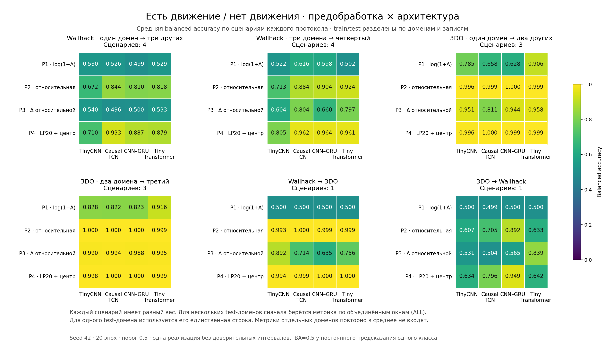
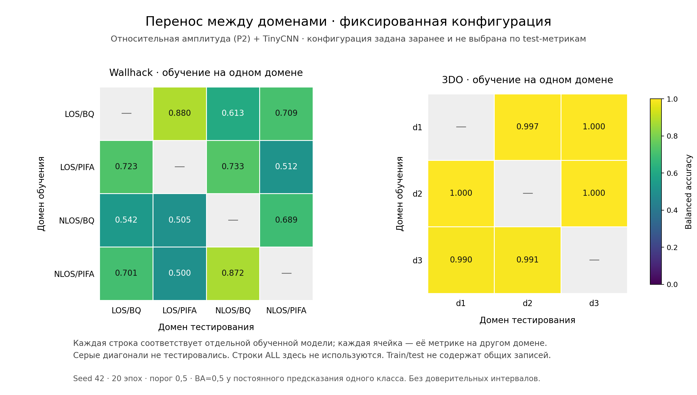

# Эксперименты с CSI

Обновлено 24.10.2026 23:31 МСК.

Для задачи «есть движение / нет движения» проверены четыре архитектуры и четыре варианта предобработки. Каждое сочетание обучалось на 16 разбиениях данных. Завершены все 256 обучений. Сохранены 656 строк метрик по тестовым доменам.

### Данные

В обучении используются 67 полных записей и 3045 окон. Число записей по наборам: 3DO — 23; Wallhack — 44.

В Wallhack к движению относятся ходьба и ходьба с махами руками, к фону — пустое помещение. Исходная метка 0 остаётся нулём, метки 1 и 2 объединяются в класс 1. В 3DO взяты только полные записи фона `b*` и ходьбы `w*`, с метками 0 и 1. Записи сидения и лежания `s*` и `l*` исключены: в них встречаются движения, а точных временных меток для них нет.

Таким образом, текущие результаты описывают различение ходьбы и пустой сцены. Неподвижный человек в отрицательном классе не представлен. Остальные четыре локальных набора — UT-HAR, NTU-Fi HAR, NTU-Fi HumanID и Widar — не содержат подходящего размеченного фона. Выбор наборов описан в [README](../README.md).

### Подготовка данных

CSI читается из исходных CSV. Комплексные отсчёты восстанавливаются как `real=data[2k+1]`, `imag=data[2k]`; готовые массивы 3DO с ошибочным объединением I/Q не используются. Из L-LTF берутся 52 поднесущие `[6:32] + [33:59]`, затем вычисляется амплитуда `A=|H|`.

При чтении исправляются переполнения таймера uint32. Повреждённые пакеты и пакеты с `rx_state≠0` пропускаются. Интервал `Δt≤0` или `Δt>50 мс` начинает новый сегмент. Внутри сегмента данные интерполируются на сетку 100 Гц и делятся на неперекрывающиеся окна по 4 секунды. Одно окно содержит 400 отсчётов; модель получает массив `[52,400]`.

| Предобработка | Преобразование амплитуды | Как применяется |
| --- | --- | --- |
| `logamp` | `log(1 + A)` | Сохраняет средний уровень амплитуды и её изменения |
| `relative` | `R = A / max(mean_time(A), 1) − 1` | Среднее по времени считается для каждой поднесущей текущего окна; дисперсия сохраняется |
| `relative_diff` | `R[t] − R[t−1]` | Первая разность `relative`; первый отсчёт — ноль |
| `lp20_centered` | ФНЧ Баттерворта 4-го порядка, 20 Гц → вычитание среднего окна | Начальное состояние фильтра задаётся по первому отсчёту и сбрасывается перед каждым окном |

После преобразования каждый канал стандартизируется. Среднее и стандартное отклонение считаются по времени и всем окнам обучающей выборки; нижняя граница стандартного отклонения — `1e−4`. К тестовым данным применяются эти же параметры. Среднее внутри `relative` и центрирования вычисляется отдельно для текущего окна. Фильтр `lp20_centered` работает причинно, но модель всё равно выдаёт результат после получения полного четырёхсекундного окна.

### Разделение на обучение и тест

Данные разделяются по полным исходным записям и доменам. Окна одной записи всегда остаются в одной части. Во время обучения перемешивается только порядок окон в уже собранной обучающей выборке.

У Wallhack четыре домена: `LOS/BQ`, `LOS/PIFA`, `NLOS/BQ`, `NLOS/PIFA`. Они описывают сочетания антенны и условий распространения сигнала. Для них проверены схемы «один домен → остальные три» и «три домена → четвёртый». У 3DO три домена — дни `d1`, `d2`, `d3`, поэтому используются схемы «один день → остальные два» и «два дня → третий». Перенос между датасетами проверяется в обе стороны.

Всего получается 16 сценариев. Для каждого выполнены 4 варианта предобработки × 4 архитектуры × 1 seed. Точные списки записей сохранены в [plan.json](../experiments/results/plan.json), а источник и границы каждого окна — в [windows.csv](../experiments/results/windows.csv).

| Сценарий | Схема | Обучение | Тест | Записей для обучения | Записей для теста | Окон для обучения | Окон для теста |
| --- | --- | --- | --- | --- | --- | --- | --- |
| `wh_one_LOS-BQ` | Wallhack 1→3 | Wallhack: LOS/BQ | Wallhack: LOS/PIFA + NLOS/BQ + NLOS/PIFA | 11 | 33 | 368 | 1092 |
| `wh_lodo_LOS-BQ` | Wallhack 3→1 | Wallhack: LOS/PIFA + NLOS/BQ + NLOS/PIFA | Wallhack: LOS/BQ | 33 | 11 | 1092 | 368 |
| `wh_one_LOS-PIFA` | Wallhack 1→3 | Wallhack: LOS/PIFA | Wallhack: LOS/BQ + NLOS/BQ + NLOS/PIFA | 11 | 33 | 369 | 1091 |
| `wh_lodo_LOS-PIFA` | Wallhack 3→1 | Wallhack: LOS/BQ + NLOS/BQ + NLOS/PIFA | Wallhack: LOS/PIFA | 33 | 11 | 1091 | 369 |
| `wh_one_NLOS-BQ` | Wallhack 1→3 | Wallhack: NLOS/BQ | Wallhack: LOS/BQ + LOS/PIFA + NLOS/PIFA | 11 | 33 | 371 | 1089 |
| `wh_lodo_NLOS-BQ` | Wallhack 3→1 | Wallhack: LOS/BQ + LOS/PIFA + NLOS/PIFA | Wallhack: NLOS/BQ | 33 | 11 | 1089 | 371 |
| `wh_one_NLOS-PIFA` | Wallhack 1→3 | Wallhack: NLOS/PIFA | Wallhack: LOS/BQ + LOS/PIFA + NLOS/BQ | 11 | 33 | 352 | 1108 |
| `wh_lodo_NLOS-PIFA` | Wallhack 3→1 | Wallhack: LOS/BQ + LOS/PIFA + NLOS/BQ | Wallhack: NLOS/PIFA | 33 | 11 | 1108 | 352 |
| `td_one_d1` | 3DO 1→2 | 3DO: d1 | 3DO: d2 + d3 | 8 | 15 | 493 | 1092 |
| `td_lodo_d1` | 3DO 2→1 | 3DO: d2 + d3 | 3DO: d1 | 15 | 8 | 1092 | 493 |
| `td_one_d2` | 3DO 1→2 | 3DO: d2 | 3DO: d1 + d3 | 8 | 15 | 498 | 1087 |
| `td_lodo_d2` | 3DO 2→1 | 3DO: d1 + d3 | 3DO: d2 | 15 | 8 | 1087 | 498 |
| `td_one_d3` | 3DO 1→2 | 3DO: d3 | 3DO: d1 + d2 | 7 | 16 | 594 | 991 |
| `td_lodo_d3` | 3DO 2→1 | 3DO: d1 + d2 | 3DO: d3 | 16 | 7 | 991 | 594 |
| `wh_to_td` | Wallhack→3DO | Wallhack: LOS/BQ + LOS/PIFA + NLOS/BQ + NLOS/PIFA | 3DO: d1 + d2 + d3 | 44 | 23 | 1460 | 1585 |
| `td_to_wh` | 3DO→Wallhack | 3DO: d1 + d2 + d3 | Wallhack: LOS/BQ + LOS/PIFA + NLOS/BQ + NLOS/PIFA | 23 | 44 | 1585 | 1460 |

### Обучение моделей

| Архитектура | Идентификатор | Обучаемых параметров |
| --- | --- | --- |
| TinyCNN | `tinycnn` | 26849 |
| Causal TCN | `tcn` | 46081 |
| CNN-GRU | `cnngru` | 43681 |
| Tiny Transformer | `transformer` | 96897 |

Каждая модель обучалась 20 эпох с размером батча 64 и seed 42. Использовался AdamW с weight decay `1e−4`. Начальная скорость обучения — `1e−3` для TinyCNN, TCN и CNN-GRU, `3e−4` для Transformer. По косинусному расписанию она снижалась до 1% начального значения. Dropout равен 0.2, норма градиента ограничена значением 1.0.

Функция потерь — `BCEWithLogitsLoss`. Вес положительного класса рассчитывается как `число фоновых окон / число окон движения` только на обучающих данных; отдельного балансирующего семплера нет. Для оценки берутся веса последней эпохи и порог 0.5.

Отдельная валидационная выборка и ранняя остановка в этой сетке не использовались. В каждом домене Wallhack есть только одна фоновая запись: если отдать её на валидацию целиком, в обучении не останется фона. Поэтому число эпох и порог были выбраны заранее и не подстраивались по тестовым результатам.

Обучения выполнялись на NVIDIA GeForce RTX 3080 Ti Laptop GPU с CUDA autocast float16, GradScaler и разрешённым TF32. Один и тот же seed помогает повторить эксперимент, но не гарантирует побитового совпадения на другой версии GPU или CUDA.

### Сравнение результатов

Лучший средний результат по 16 сценариям показала связка `lp20_centered` и Causal TCN: balanced accuracy 0.9609. У `lp20_centered` и CNN-GRU результат почти такой же — 0.9594. Для дальнейших экспериментов стоит сохранить оба варианта. Обучение проводилось с одним seed, поэтому пока неизвестно, насколько устойчива эта разница.

Следующий шаг — повторить обучения с несколькими seed и проверить выбранные модели на новом домене. В него стоит добавить неподвижного человека и несколько независимых фоновых записей. Это позволит проверить, распознаёт ли модель само движение и сохраняется ли результат за пределами текущих записей.

В таблице каждый сценарий имеет одинаковый вес. Если в нём несколько тестовых доменов, сначала считается метрика по всем их предсказаниям (`ALL`), затем она усредняется с остальными сценариями. Это усреднение по сценариям, а не по всем окнам датасетов сразу.

| Предобработка | Архитектура | Готово сценариев | Средняя balanced accuracy | Средний F1 | Средний ROC-AUC | Средняя AP |
| --- | --- | --- | --- | --- | --- | --- |
| `logamp` | TinyCNN | 16/16 | 0.628 | 0.785 | 0.629 | 0.689 |
| `logamp` | Causal TCN | 16/16 | 0.626 | 0.766 | 0.630 | 0.724 |
| `logamp` | CNN-GRU | 16/16 | 0.609 | 0.759 | 0.721 | 0.800 |
| `logamp` | Tiny Transformer | 16/16 | 0.662 | 0.768 | 0.727 | 0.813 |
| `relative` | TinyCNN | 16/16 | 0.821 | 0.889 | 0.968 | 0.981 |
| `relative` | Causal TCN | 16/16 | 0.913 | 0.951 | 0.968 | 0.979 |
| `relative` | CNN-GRU | 16/16 | 0.921 | 0.945 | 0.971 | 0.985 |
| `relative` | Tiny Transformer | 16/16 | 0.912 | 0.949 | 0.969 | 0.974 |
| `relative_diff` | TinyCNN | 16/16 | 0.739 | 0.841 | 0.800 | 0.847 |
| `relative_diff` | Causal TCN | 16/16 | 0.740 | 0.800 | 0.798 | 0.842 |
| `relative_diff` | CNN-GRU | 16/16 | 0.727 | 0.822 | 0.821 | 0.876 |
| `relative_diff` | Tiny Transformer | 16/16 | 0.799 | 0.876 | 0.889 | 0.925 |
| `lp20_centered` | TinyCNN | 16/16 | 0.854 | 0.908 | 0.969 | 0.982 |
| `lp20_centered` | Causal TCN | 16/16 | 0.961 | 0.973 | 0.992 | 0.995 |
| `lp20_centered` | CNN-GRU | 16/16 | 0.959 | 0.967 | 0.985 | 0.993 |
| `lp20_centered` | Tiny Transformer | 16/16 | 0.937 | 0.964 | 0.980 | 0.981 |

На каждой панели показана одна группа разбиений. Значения усреднены по её сценариям; для проверки на нескольких доменах используется общая метрика `ALL`.

Матрицы показывают, как меняется результат при переносе между доменами. Для этого примера заранее выбрана связка `relative` и TinyCNN. Сравнение всех моделей приведено в таблице выше.

### Результаты каждого обучения

Одна строка соответствует одному обучению. В столбцах с числом записей и окон сначала указана обучающая часть, затем тестовая. Для нескольких тестовых доменов показана общая метрика `ALL`. Отдельные домены и матрицы ошибок приведены в [дополнительной таблице](experiment_results_by_domain.md).

F1, precision и recall относятся к движению. AP означает average precision; при нулевом знаменателе precision, recall и F1 приняты равными нулю. Время в таблице включает только цикл обучения модели.

| Запуск | Предобработка | Архитектура | Обучение | Тест | Записей обучение / тест | Окон обучение / тест | Balanced accuracy | F1 | ROC-AUC | AP | Обучение, с | Статус |
| --- | --- | --- | --- | --- | --- | --- | --- | --- | --- | --- | --- | --- |
| `wh_one_LOS-BQ__logamp__tinycnn__s42` | `logamp` | TinyCNN | Wallhack: LOS/BQ | Wallhack: LOS/PIFA + NLOS/BQ + NLOS/PIFA | 11 / 33 | 368 / 1092 | 0.621 | 0.809 | 0.548 | 0.641 | 1.9 | готово |
| `wh_one_LOS-BQ__logamp__tcn__s42` | `logamp` | Causal TCN | Wallhack: LOS/BQ | Wallhack: LOS/PIFA + NLOS/BQ + NLOS/PIFA | 11 / 33 | 368 / 1092 | 0.500 | 0.797 | 0.541 | 0.660 | 1.6 | готово |
| `wh_one_LOS-BQ__logamp__cnngru__s42` | `logamp` | CNN-GRU | Wallhack: LOS/BQ | Wallhack: LOS/PIFA + NLOS/BQ + NLOS/PIFA | 11 / 33 | 368 / 1092 | 0.500 | 0.797 | 0.549 | 0.686 | 0.5 | готово |
| `wh_one_LOS-BQ__logamp__transformer__s42` | `logamp` | Tiny Transformer | Wallhack: LOS/BQ | Wallhack: LOS/PIFA + NLOS/BQ + NLOS/PIFA | 11 / 33 | 368 / 1092 | 0.506 | 0.795 | 0.637 | 0.755 | 0.7 | готово |
| `wh_one_LOS-BQ__relative__tinycnn__s42` | `relative` | TinyCNN | Wallhack: LOS/BQ | Wallhack: LOS/PIFA + NLOS/BQ + NLOS/PIFA | 11 / 33 | 368 / 1092 | 0.739 | 0.647 | 0.951 | 0.975 | 1.7 | готово |
| `wh_one_LOS-BQ__relative__tcn__s42` | `relative` | Causal TCN | Wallhack: LOS/BQ | Wallhack: LOS/PIFA + NLOS/BQ + NLOS/PIFA | 11 / 33 | 368 / 1092 | 0.893 | 0.884 | 0.978 | 0.990 | 1.7 | готово |
| `wh_one_LOS-BQ__relative__cnngru__s42` | `relative` | CNN-GRU | Wallhack: LOS/BQ | Wallhack: LOS/PIFA + NLOS/BQ + NLOS/PIFA | 11 / 33 | 368 / 1092 | 0.812 | 0.768 | 0.863 | 0.944 | 0.4 | готово |
| `wh_one_LOS-BQ__relative__transformer__s42` | `relative` | Tiny Transformer | Wallhack: LOS/BQ | Wallhack: LOS/PIFA + NLOS/BQ + NLOS/PIFA | 11 / 33 | 368 / 1092 | 0.846 | 0.818 | 0.986 | 0.993 | 0.7 | готово |
| `wh_one_LOS-BQ__relative_diff__tinycnn__s42` | `relative_diff` | TinyCNN | Wallhack: LOS/BQ | Wallhack: LOS/PIFA + NLOS/BQ + NLOS/PIFA | 11 / 33 | 368 / 1092 | 0.656 | 0.765 | 0.693 | 0.753 | 2.1 | готово |
| `wh_one_LOS-BQ__relative_diff__tcn__s42` | `relative_diff` | Causal TCN | Wallhack: LOS/BQ | Wallhack: LOS/PIFA + NLOS/BQ + NLOS/PIFA | 11 / 33 | 368 / 1092 | 0.500 | 0.797 | 0.494 | 0.665 | 2.7 | готово |
| `wh_one_LOS-BQ__relative_diff__cnngru__s42` | `relative_diff` | CNN-GRU | Wallhack: LOS/BQ | Wallhack: LOS/PIFA + NLOS/BQ + NLOS/PIFA | 11 / 33 | 368 / 1092 | 0.499 | 0.795 | 0.521 | 0.683 | 0.7 | готово |
| `wh_one_LOS-BQ__relative_diff__transformer__s42` | `relative_diff` | Tiny Transformer | Wallhack: LOS/BQ | Wallhack: LOS/PIFA + NLOS/BQ + NLOS/PIFA | 11 / 33 | 368 / 1092 | 0.489 | 0.781 | 0.570 | 0.711 | 1.5 | готово |
| `wh_one_LOS-BQ__lp20_centered__tinycnn__s42` | `lp20_centered` | TinyCNN | Wallhack: LOS/BQ | Wallhack: LOS/PIFA + NLOS/BQ + NLOS/PIFA | 11 / 33 | 368 / 1092 | 0.798 | 0.750 | 0.940 | 0.970 | 1.9 | готово |
| `wh_one_LOS-BQ__lp20_centered__tcn__s42` | `lp20_centered` | Causal TCN | Wallhack: LOS/BQ | Wallhack: LOS/PIFA + NLOS/BQ + NLOS/PIFA | 11 / 33 | 368 / 1092 | 0.881 | 0.865 | 0.983 | 0.992 | 2.6 | готово |
| `wh_one_LOS-BQ__lp20_centered__cnngru__s42` | `lp20_centered` | CNN-GRU | Wallhack: LOS/BQ | Wallhack: LOS/PIFA + NLOS/BQ + NLOS/PIFA | 11 / 33 | 368 / 1092 | 0.861 | 0.841 | 0.906 | 0.962 | 0.7 | готово |
| `wh_one_LOS-BQ__lp20_centered__transformer__s42` | `lp20_centered` | Tiny Transformer | Wallhack: LOS/BQ | Wallhack: LOS/PIFA + NLOS/BQ + NLOS/PIFA | 11 / 33 | 368 / 1092 | 0.876 | 0.862 | 0.995 | 0.997 | 1.5 | готово |
| `wh_lodo_LOS-BQ__logamp__tinycnn__s42` | `logamp` | TinyCNN | Wallhack: LOS/PIFA + NLOS/BQ + NLOS/PIFA | Wallhack: LOS/BQ | 33 / 11 | 1092 / 368 | 0.500 | 0.781 | 0.784 | 0.855 | 4.9 | готово |
| `wh_lodo_LOS-BQ__logamp__tcn__s42` | `logamp` | Causal TCN | Wallhack: LOS/PIFA + NLOS/BQ + NLOS/PIFA | Wallhack: LOS/BQ | 33 / 11 | 1092 / 368 | 0.500 | 0.781 | 0.130 | 0.459 | 4.6 | готово |
| `wh_lodo_LOS-BQ__logamp__cnngru__s42` | `logamp` | CNN-GRU | Wallhack: LOS/PIFA + NLOS/BQ + NLOS/PIFA | Wallhack: LOS/BQ | 33 / 11 | 1092 / 368 | 0.500 | 0.781 | 0.518 | 0.784 | 1.3 | готово |
| `wh_lodo_LOS-BQ__logamp__transformer__s42` | `logamp` | Tiny Transformer | Wallhack: LOS/PIFA + NLOS/BQ + NLOS/PIFA | Wallhack: LOS/BQ | 33 / 11 | 1092 / 368 | 0.500 | 0.781 | 1.000 | 1.000 | 2.0 | готово |
| `wh_lodo_LOS-BQ__relative__tinycnn__s42` | `relative` | TinyCNN | Wallhack: LOS/PIFA + NLOS/BQ + NLOS/PIFA | Wallhack: LOS/BQ | 33 / 11 | 1092 / 368 | 0.659 | 0.840 | 0.999 | 1.000 | 4.8 | готово |
| `wh_lodo_LOS-BQ__relative__tcn__s42` | `relative` | Causal TCN | Wallhack: LOS/PIFA + NLOS/BQ + NLOS/PIFA | Wallhack: LOS/BQ | 33 / 11 | 1092 / 368 | 0.689 | 0.852 | 0.930 | 0.955 | 5.5 | готово |
| `wh_lodo_LOS-BQ__relative__cnngru__s42` | `relative` | CNN-GRU | Wallhack: LOS/PIFA + NLOS/BQ + NLOS/PIFA | Wallhack: LOS/BQ | 33 / 11 | 1092 / 368 | 0.765 | 0.884 | 0.998 | 0.999 | 1.0 | готово |
| `wh_lodo_LOS-BQ__relative__transformer__s42` | `relative` | Tiny Transformer | Wallhack: LOS/PIFA + NLOS/BQ + NLOS/PIFA | Wallhack: LOS/BQ | 33 / 11 | 1092 / 368 | 0.830 | 0.913 | 0.984 | 0.984 | 2.1 | готово |
| `wh_lodo_LOS-BQ__relative_diff__tinycnn__s42` | `relative_diff` | TinyCNN | Wallhack: LOS/PIFA + NLOS/BQ + NLOS/PIFA | Wallhack: LOS/BQ | 33 / 11 | 1092 / 368 | 0.736 | 0.845 | 0.876 | 0.935 | 5.3 | готово |
| `wh_lodo_LOS-BQ__relative_diff__tcn__s42` | `relative_diff` | Causal TCN | Wallhack: LOS/PIFA + NLOS/BQ + NLOS/PIFA | Wallhack: LOS/BQ | 33 / 11 | 1092 / 368 | 0.582 | 0.698 | 0.604 | 0.710 | 7.6 | готово |
| `wh_lodo_LOS-BQ__relative_diff__cnngru__s42` | `relative_diff` | CNN-GRU | Wallhack: LOS/PIFA + NLOS/BQ + NLOS/PIFA | Wallhack: LOS/BQ | 33 / 11 | 1092 / 368 | 0.715 | 0.849 | 0.782 | 0.814 | 2.2 | готово |
| `wh_lodo_LOS-BQ__relative_diff__transformer__s42` | `relative_diff` | Tiny Transformer | Wallhack: LOS/PIFA + NLOS/BQ + NLOS/PIFA | Wallhack: LOS/BQ | 33 / 11 | 1092 / 368 | 0.814 | 0.906 | 0.999 | 1.000 | 4.3 | готово |
| `wh_lodo_LOS-BQ__lp20_centered__tinycnn__s42` | `lp20_centered` | TinyCNN | Wallhack: LOS/PIFA + NLOS/BQ + NLOS/PIFA | Wallhack: LOS/BQ | 33 / 11 | 1092 / 368 | 0.920 | 0.957 | 0.994 | 0.995 | 5.2 | готово |
| `wh_lodo_LOS-BQ__lp20_centered__tcn__s42` | `lp20_centered` | Causal TCN | Wallhack: LOS/PIFA + NLOS/BQ + NLOS/PIFA | Wallhack: LOS/BQ | 33 / 11 | 1092 / 368 | 0.970 | 0.983 | 0.995 | 0.997 | 7.6 | готово |
| `wh_lodo_LOS-BQ__lp20_centered__cnngru__s42` | `lp20_centered` | CNN-GRU | Wallhack: LOS/PIFA + NLOS/BQ + NLOS/PIFA | Wallhack: LOS/BQ | 33 / 11 | 1092 / 368 | 0.947 | 0.971 | 1.000 | 1.000 | 2.0 | готово |
| `wh_lodo_LOS-BQ__lp20_centered__transformer__s42` | `lp20_centered` | Tiny Transformer | Wallhack: LOS/PIFA + NLOS/BQ + NLOS/PIFA | Wallhack: LOS/BQ | 33 / 11 | 1092 / 368 | 0.966 | 0.981 | 0.979 | 0.970 | 4.3 | готово |
| `wh_one_LOS-PIFA__logamp__tinycnn__s42` | `logamp` | TinyCNN | Wallhack: LOS/PIFA | Wallhack: LOS/BQ + NLOS/BQ + NLOS/PIFA | 11 / 33 | 369 / 1091 | 0.500 | 0.782 | 0.360 | 0.557 | 1.6 | готово |
| `wh_one_LOS-PIFA__logamp__tcn__s42` | `logamp` | Causal TCN | Wallhack: LOS/PIFA | Wallhack: LOS/BQ + NLOS/BQ + NLOS/PIFA | 11 / 33 | 369 / 1091 | 0.500 | 0.782 | 0.344 | 0.532 | 1.5 | готово |
| `wh_one_LOS-PIFA__logamp__cnngru__s42` | `logamp` | CNN-GRU | Wallhack: LOS/PIFA | Wallhack: LOS/BQ + NLOS/BQ + NLOS/PIFA | 11 / 33 | 369 / 1091 | 0.500 | 0.782 | 0.640 | 0.750 | 0.4 | готово |
| `wh_one_LOS-PIFA__logamp__transformer__s42` | `logamp` | Tiny Transformer | Wallhack: LOS/PIFA | Wallhack: LOS/BQ + NLOS/BQ + NLOS/PIFA | 11 / 33 | 369 / 1091 | 0.500 | 0.782 | 0.703 | 0.810 | 0.7 | готово |
| `wh_one_LOS-PIFA__relative__tinycnn__s42` | `relative` | TinyCNN | Wallhack: LOS/PIFA | Wallhack: LOS/BQ + NLOS/BQ + NLOS/PIFA | 11 / 33 | 369 / 1091 | 0.661 | 0.831 | 0.897 | 0.947 | 1.8 | готово |
| `wh_one_LOS-PIFA__relative__tcn__s42` | `relative` | Causal TCN | Wallhack: LOS/PIFA | Wallhack: LOS/BQ + NLOS/BQ + NLOS/PIFA | 11 / 33 | 369 / 1091 | 0.832 | 0.893 | 0.917 | 0.946 | 1.7 | готово |
| `wh_one_LOS-PIFA__relative__cnngru__s42` | `relative` | CNN-GRU | Wallhack: LOS/PIFA | Wallhack: LOS/BQ + NLOS/BQ + NLOS/PIFA | 11 / 33 | 369 / 1091 | 0.819 | 0.823 | 0.875 | 0.935 | 0.4 | готово |
| `wh_one_LOS-PIFA__relative__transformer__s42` | `relative` | Tiny Transformer | Wallhack: LOS/PIFA | Wallhack: LOS/BQ + NLOS/BQ + NLOS/PIFA | 11 / 33 | 369 / 1091 | 0.940 | 0.955 | 0.984 | 0.990 | 0.7 | готово |
| `wh_one_LOS-PIFA__relative_diff__tinycnn__s42` | `relative_diff` | TinyCNN | Wallhack: LOS/PIFA | Wallhack: LOS/BQ + NLOS/BQ + NLOS/PIFA | 11 / 33 | 369 / 1091 | 0.500 | 0.779 | 0.616 | 0.732 | 1.8 | готово |
| `wh_one_LOS-PIFA__relative_diff__tcn__s42` | `relative_diff` | Causal TCN | Wallhack: LOS/PIFA | Wallhack: LOS/BQ + NLOS/BQ + NLOS/PIFA | 11 / 33 | 369 / 1091 | 0.520 | 0.629 | 0.535 | 0.649 | 2.6 | готово |
| `wh_one_LOS-PIFA__relative_diff__cnngru__s42` | `relative_diff` | CNN-GRU | Wallhack: LOS/PIFA | Wallhack: LOS/BQ + NLOS/BQ + NLOS/PIFA | 11 / 33 | 369 / 1091 | 0.547 | 0.726 | 0.546 | 0.668 | 0.7 | готово |
| `wh_one_LOS-PIFA__relative_diff__transformer__s42` | `relative_diff` | Tiny Transformer | Wallhack: LOS/PIFA | Wallhack: LOS/BQ + NLOS/BQ + NLOS/PIFA | 11 / 33 | 369 / 1091 | 0.609 | 0.744 | 0.655 | 0.754 | 1.5 | готово |
| `wh_one_LOS-PIFA__lp20_centered__tinycnn__s42` | `lp20_centered` | TinyCNN | Wallhack: LOS/PIFA | Wallhack: LOS/BQ + NLOS/BQ + NLOS/PIFA | 11 / 33 | 369 / 1091 | 0.561 | 0.801 | 0.891 | 0.947 | 1.8 | готово |
| `wh_one_LOS-PIFA__lp20_centered__tcn__s42` | `lp20_centered` | Causal TCN | Wallhack: LOS/PIFA | Wallhack: LOS/BQ + NLOS/BQ + NLOS/PIFA | 11 / 33 | 369 / 1091 | 0.927 | 0.950 | 0.984 | 0.990 | 2.6 | готово |
| `wh_one_LOS-PIFA__lp20_centered__cnngru__s42` | `lp20_centered` | CNN-GRU | Wallhack: LOS/PIFA | Wallhack: LOS/BQ + NLOS/BQ + NLOS/PIFA | 11 / 33 | 369 / 1091 | 0.874 | 0.866 | 0.911 | 0.959 | 0.7 | готово |
| `wh_one_LOS-PIFA__lp20_centered__transformer__s42` | `lp20_centered` | Tiny Transformer | Wallhack: LOS/PIFA | Wallhack: LOS/BQ + NLOS/BQ + NLOS/PIFA | 11 / 33 | 369 / 1091 | 0.956 | 0.960 | 0.992 | 0.994 | 1.5 | готово |
| `wh_lodo_LOS-PIFA__logamp__tinycnn__s42` | `logamp` | TinyCNN | Wallhack: LOS/BQ + NLOS/BQ + NLOS/PIFA | Wallhack: LOS/PIFA | 33 / 11 | 1091 / 369 | 0.500 | 0.825 | 0.799 | 0.924 | 5.0 | готово |
| `wh_lodo_LOS-PIFA__logamp__tcn__s42` | `logamp` | Causal TCN | Wallhack: LOS/BQ + NLOS/BQ + NLOS/PIFA | Wallhack: LOS/PIFA | 33 / 11 | 1091 / 369 | 0.964 | 0.985 | 0.982 | 0.984 | 4.4 | готово |
| `wh_lodo_LOS-PIFA__logamp__cnngru__s42` | `logamp` | CNN-GRU | Wallhack: LOS/BQ + NLOS/BQ + NLOS/PIFA | Wallhack: LOS/PIFA | 33 / 11 | 1091 / 369 | 0.892 | 0.954 | 0.992 | 0.996 | 1.0 | готово |
| `wh_lodo_LOS-PIFA__logamp__transformer__s42` | `logamp` | Tiny Transformer | Wallhack: LOS/BQ + NLOS/BQ + NLOS/PIFA | Wallhack: LOS/PIFA | 33 / 11 | 1091 / 369 | 0.510 | 0.038 | 1.000 | 1.000 | 1.9 | готово |
| `wh_lodo_LOS-PIFA__relative__tinycnn__s42` | `relative` | TinyCNN | Wallhack: LOS/BQ + NLOS/BQ + NLOS/PIFA | Wallhack: LOS/PIFA | 33 / 11 | 1091 / 369 | 0.614 | 0.859 | 0.987 | 0.991 | 4.8 | готово |
| `wh_lodo_LOS-PIFA__relative__tcn__s42` | `relative` | Causal TCN | Wallhack: LOS/BQ + NLOS/BQ + NLOS/PIFA | Wallhack: LOS/PIFA | 33 / 11 | 1091 / 369 | 0.977 | 0.990 | 1.000 | 1.000 | 5.6 | готово |
| `wh_lodo_LOS-PIFA__relative__cnngru__s42` | `relative` | CNN-GRU | Wallhack: LOS/BQ + NLOS/BQ + NLOS/PIFA | Wallhack: LOS/PIFA | 33 / 11 | 1091 / 369 | 0.995 | 0.998 | 1.000 | 1.000 | 1.2 | готово |
| `wh_lodo_LOS-PIFA__relative__transformer__s42` | `relative` | Tiny Transformer | Wallhack: LOS/BQ + NLOS/BQ + NLOS/PIFA | Wallhack: LOS/PIFA | 33 / 11 | 1091 / 369 | 0.995 | 0.998 | 1.000 | 1.000 | 2.1 | готово |
| `wh_lodo_LOS-PIFA__relative_diff__tinycnn__s42` | `relative_diff` | TinyCNN | Wallhack: LOS/BQ + NLOS/BQ + NLOS/PIFA | Wallhack: LOS/PIFA | 33 / 11 | 1091 / 369 | 0.500 | 0.825 | 0.701 | 0.775 | 5.4 | готово |
| `wh_lodo_LOS-PIFA__relative_diff__tcn__s42` | `relative_diff` | Causal TCN | Wallhack: LOS/BQ + NLOS/BQ + NLOS/PIFA | Wallhack: LOS/PIFA | 33 / 11 | 1091 / 369 | 0.951 | 0.969 | 0.988 | 0.994 | 7.6 | готово |
| `wh_lodo_LOS-PIFA__relative_diff__cnngru__s42` | `relative_diff` | CNN-GRU | Wallhack: LOS/BQ + NLOS/BQ + NLOS/PIFA | Wallhack: LOS/PIFA | 33 / 11 | 1091 / 369 | 0.509 | 0.827 | 0.737 | 0.870 | 2.0 | готово |
| `wh_lodo_LOS-PIFA__relative_diff__transformer__s42` | `relative_diff` | Tiny Transformer | Wallhack: LOS/BQ + NLOS/BQ + NLOS/PIFA | Wallhack: LOS/PIFA | 33 / 11 | 1091 / 369 | 0.826 | 0.928 | 0.990 | 0.996 | 4.3 | готово |
| `wh_lodo_LOS-PIFA__lp20_centered__tinycnn__s42` | `lp20_centered` | TinyCNN | Wallhack: LOS/BQ + NLOS/BQ + NLOS/PIFA | Wallhack: LOS/PIFA | 33 / 11 | 1091 / 369 | 0.795 | 0.920 | 1.000 | 1.000 | 5.4 | готово |
| `wh_lodo_LOS-PIFA__lp20_centered__tcn__s42` | `lp20_centered` | Causal TCN | Wallhack: LOS/BQ + NLOS/BQ + NLOS/PIFA | Wallhack: LOS/PIFA | 33 / 11 | 1091 / 369 | 0.995 | 0.998 | 1.000 | 1.000 | 7.9 | готово |
| `wh_lodo_LOS-PIFA__lp20_centered__cnngru__s42` | `lp20_centered` | CNN-GRU | Wallhack: LOS/BQ + NLOS/BQ + NLOS/PIFA | Wallhack: LOS/PIFA | 33 / 11 | 1091 / 369 | 0.986 | 0.994 | 0.998 | 0.999 | 2.1 | готово |
| `wh_lodo_LOS-PIFA__lp20_centered__transformer__s42` | `lp20_centered` | Tiny Transformer | Wallhack: LOS/BQ + NLOS/BQ + NLOS/PIFA | Wallhack: LOS/PIFA | 33 / 11 | 1091 / 369 | 0.955 | 0.981 | 1.000 | 1.000 | 4.3 | готово |
| `wh_one_NLOS-BQ__logamp__tinycnn__s42` | `logamp` | TinyCNN | Wallhack: NLOS/BQ | Wallhack: LOS/BQ + LOS/PIFA + NLOS/PIFA | 11 / 33 | 371 / 1089 | 0.500 | 0.799 | 0.225 | 0.538 | 1.6 | готово |
| `wh_one_NLOS-BQ__logamp__tcn__s42` | `logamp` | Causal TCN | Wallhack: NLOS/BQ | Wallhack: LOS/BQ + LOS/PIFA + NLOS/PIFA | 11 / 33 | 371 / 1089 | 0.532 | 0.810 | 0.634 | 0.783 | 1.5 | готово |
| `wh_one_NLOS-BQ__logamp__cnngru__s42` | `logamp` | CNN-GRU | Wallhack: NLOS/BQ | Wallhack: LOS/BQ + LOS/PIFA + NLOS/PIFA | 11 / 33 | 371 / 1089 | 0.495 | 0.795 | 0.556 | 0.735 | 0.4 | готово |
| `wh_one_NLOS-BQ__logamp__transformer__s42` | `logamp` | Tiny Transformer | Wallhack: NLOS/BQ | Wallhack: LOS/BQ + LOS/PIFA + NLOS/PIFA | 11 / 33 | 371 / 1089 | 0.610 | 0.788 | 0.551 | 0.668 | 0.8 | готово |
| `wh_one_NLOS-BQ__relative__tinycnn__s42` | `relative` | TinyCNN | Wallhack: NLOS/BQ | Wallhack: LOS/BQ + LOS/PIFA + NLOS/PIFA | 11 / 33 | 371 / 1089 | 0.580 | 0.826 | 0.984 | 0.988 | 1.8 | готово |
| `wh_one_NLOS-BQ__relative__tcn__s42` | `relative` | Causal TCN | Wallhack: NLOS/BQ | Wallhack: LOS/BQ + LOS/PIFA + NLOS/PIFA | 11 / 33 | 371 / 1089 | 0.838 | 0.915 | 0.917 | 0.949 | 1.7 | готово |
| `wh_one_NLOS-BQ__relative__cnngru__s42` | `relative` | CNN-GRU | Wallhack: NLOS/BQ | Wallhack: LOS/BQ + LOS/PIFA + NLOS/PIFA | 11 / 33 | 371 / 1089 | 0.870 | 0.939 | 0.965 | 0.978 | 0.3 | готово |
| `wh_one_NLOS-BQ__relative__transformer__s42` | `relative` | Tiny Transformer | Wallhack: NLOS/BQ | Wallhack: LOS/BQ + LOS/PIFA + NLOS/PIFA | 11 / 33 | 371 / 1089 | 0.805 | 0.911 | 0.952 | 0.969 | 0.7 | готово |
| `wh_one_NLOS-BQ__relative_diff__tinycnn__s42` | `relative_diff` | TinyCNN | Wallhack: NLOS/BQ | Wallhack: LOS/BQ + LOS/PIFA + NLOS/PIFA | 11 / 33 | 371 / 1089 | 0.485 | 0.772 | 0.383 | 0.576 | 1.9 | готово |
| `wh_one_NLOS-BQ__relative_diff__tcn__s42` | `relative_diff` | Causal TCN | Wallhack: NLOS/BQ | Wallhack: LOS/BQ + LOS/PIFA + NLOS/PIFA | 11 / 33 | 371 / 1089 | 0.441 | 0.392 | 0.427 | 0.616 | 2.7 | готово |
| `wh_one_NLOS-BQ__relative_diff__cnngru__s42` | `relative_diff` | CNN-GRU | Wallhack: NLOS/BQ | Wallhack: LOS/BQ + LOS/PIFA + NLOS/PIFA | 11 / 33 | 371 / 1089 | 0.446 | 0.390 | 0.480 | 0.630 | 1.1 | готово |
| `wh_one_NLOS-BQ__relative_diff__transformer__s42` | `relative_diff` | Tiny Transformer | Wallhack: NLOS/BQ | Wallhack: LOS/BQ + LOS/PIFA + NLOS/PIFA | 11 / 33 | 371 / 1089 | 0.501 | 0.680 | 0.537 | 0.718 | 1.6 | готово |
| `wh_one_NLOS-BQ__lp20_centered__tinycnn__s42` | `lp20_centered` | TinyCNN | Wallhack: NLOS/BQ | Wallhack: LOS/BQ + LOS/PIFA + NLOS/PIFA | 11 / 33 | 371 / 1089 | 0.712 | 0.873 | 0.994 | 0.997 | 1.8 | готово |
| `wh_one_NLOS-BQ__lp20_centered__tcn__s42` | `lp20_centered` | Causal TCN | Wallhack: NLOS/BQ | Wallhack: LOS/BQ + LOS/PIFA + NLOS/PIFA | 11 / 33 | 371 / 1089 | 0.962 | 0.981 | 0.996 | 0.997 | 2.6 | готово |
| `wh_one_NLOS-BQ__lp20_centered__cnngru__s42` | `lp20_centered` | CNN-GRU | Wallhack: NLOS/BQ | Wallhack: LOS/BQ + LOS/PIFA + NLOS/PIFA | 11 / 33 | 371 / 1089 | 0.929 | 0.965 | 0.992 | 0.996 | 0.7 | готово |
| `wh_one_NLOS-BQ__lp20_centered__transformer__s42` | `lp20_centered` | Tiny Transformer | Wallhack: NLOS/BQ | Wallhack: LOS/BQ + LOS/PIFA + NLOS/PIFA | 11 / 33 | 371 / 1089 | 0.870 | 0.939 | 0.965 | 0.962 | 1.5 | готово |
| `wh_lodo_NLOS-BQ__logamp__tinycnn__s42` | `logamp` | TinyCNN | Wallhack: LOS/BQ + LOS/PIFA + NLOS/PIFA | Wallhack: NLOS/BQ | 33 / 11 | 1089 / 371 | 0.500 | 0.774 | 0.256 | 0.515 | 4.9 | готово |
| `wh_lodo_NLOS-BQ__logamp__tcn__s42` | `logamp` | Causal TCN | Wallhack: LOS/BQ + LOS/PIFA + NLOS/PIFA | Wallhack: NLOS/BQ | 33 / 11 | 1089 / 371 | 0.500 | 0.774 | 0.527 | 0.707 | 4.5 | готово |
| `wh_lodo_NLOS-BQ__logamp__cnngru__s42` | `logamp` | CNN-GRU | Wallhack: LOS/BQ + LOS/PIFA + NLOS/PIFA | Wallhack: NLOS/BQ | 33 / 11 | 1089 / 371 | 0.500 | 0.774 | 0.461 | 0.680 | 1.1 | готово |
| `wh_lodo_NLOS-BQ__logamp__transformer__s42` | `logamp` | Tiny Transformer | Wallhack: LOS/BQ + LOS/PIFA + NLOS/PIFA | Wallhack: NLOS/BQ | 33 / 11 | 1089 / 371 | 0.500 | 0.774 | 0.469 | 0.672 | 2.0 | готово |
| `wh_lodo_NLOS-BQ__relative__tinycnn__s42` | `relative` | TinyCNN | Wallhack: LOS/BQ + LOS/PIFA + NLOS/PIFA | Wallhack: NLOS/BQ | 33 / 11 | 1089 / 371 | 0.753 | 0.676 | 0.993 | 0.995 | 5.4 | готово |
| `wh_lodo_NLOS-BQ__relative__tcn__s42` | `relative` | Causal TCN | Wallhack: LOS/BQ + LOS/PIFA + NLOS/PIFA | Wallhack: NLOS/BQ | 33 / 11 | 1089 / 371 | 0.955 | 0.953 | 0.999 | 1.000 | 5.3 | готово |
| `wh_lodo_NLOS-BQ__relative__cnngru__s42` | `relative` | CNN-GRU | Wallhack: LOS/BQ + LOS/PIFA + NLOS/PIFA | Wallhack: NLOS/BQ | 33 / 11 | 1089 / 371 | 0.937 | 0.934 | 0.967 | 0.984 | 1.0 | готово |
| `wh_lodo_NLOS-BQ__relative__transformer__s42` | `relative` | Tiny Transformer | Wallhack: LOS/BQ + LOS/PIFA + NLOS/PIFA | Wallhack: NLOS/BQ | 33 / 11 | 1089 / 371 | 0.955 | 0.953 | 1.000 | 1.000 | 2.1 | готово |
| `wh_lodo_NLOS-BQ__relative_diff__tinycnn__s42` | `relative_diff` | TinyCNN | Wallhack: LOS/BQ + LOS/PIFA + NLOS/PIFA | Wallhack: NLOS/BQ | 33 / 11 | 1089 / 371 | 0.571 | 0.446 | 0.623 | 0.714 | 5.3 | готово |
| `wh_lodo_NLOS-BQ__relative_diff__tcn__s42` | `relative_diff` | Causal TCN | Wallhack: LOS/BQ + LOS/PIFA + NLOS/PIFA | Wallhack: NLOS/BQ | 33 / 11 | 1089 / 371 | 0.894 | 0.894 | 0.943 | 0.972 | 7.7 | готово |
| `wh_lodo_NLOS-BQ__relative_diff__cnngru__s42` | `relative_diff` | CNN-GRU | Wallhack: LOS/BQ + LOS/PIFA + NLOS/PIFA | Wallhack: NLOS/BQ | 33 / 11 | 1089 / 371 | 0.736 | 0.790 | 0.842 | 0.918 | 2.1 | готово |
| `wh_lodo_NLOS-BQ__relative_diff__transformer__s42` | `relative_diff` | Tiny Transformer | Wallhack: LOS/BQ + LOS/PIFA + NLOS/PIFA | Wallhack: NLOS/BQ | 33 / 11 | 1089 / 371 | 0.852 | 0.891 | 0.950 | 0.972 | 4.3 | готово |
| `wh_lodo_NLOS-BQ__lp20_centered__tinycnn__s42` | `lp20_centered` | TinyCNN | Wallhack: LOS/BQ + LOS/PIFA + NLOS/PIFA | Wallhack: NLOS/BQ | 33 / 11 | 1089 / 371 | 0.765 | 0.693 | 0.994 | 0.996 | 5.1 | готово |
| `wh_lodo_NLOS-BQ__lp20_centered__tcn__s42` | `lp20_centered` | Causal TCN | Wallhack: LOS/BQ + LOS/PIFA + NLOS/PIFA | Wallhack: NLOS/BQ | 33 / 11 | 1089 / 371 | 0.959 | 0.958 | 1.000 | 1.000 | 8.3 | готово |
| `wh_lodo_NLOS-BQ__lp20_centered__cnngru__s42` | `lp20_centered` | CNN-GRU | Wallhack: LOS/BQ + LOS/PIFA + NLOS/PIFA | Wallhack: NLOS/BQ | 33 / 11 | 1089 / 371 | 0.955 | 0.953 | 0.993 | 0.996 | 2.1 | готово |
| `wh_lodo_NLOS-BQ__lp20_centered__transformer__s42` | `lp20_centered` | Tiny Transformer | Wallhack: LOS/BQ + LOS/PIFA + NLOS/PIFA | Wallhack: NLOS/BQ | 33 / 11 | 1089 / 371 | 0.986 | 0.987 | 1.000 | 1.000 | 4.3 | готово |
| `wh_one_NLOS-PIFA__logamp__tinycnn__s42` | `logamp` | TinyCNN | Wallhack: NLOS/PIFA | Wallhack: LOS/BQ + LOS/PIFA + NLOS/BQ | 11 / 33 | 352 / 1108 | 0.500 | 0.794 | 0.569 | 0.636 | 1.6 | готово |
| `wh_one_NLOS-PIFA__logamp__tcn__s42` | `logamp` | Causal TCN | Wallhack: NLOS/PIFA | Wallhack: LOS/BQ + LOS/PIFA + NLOS/BQ | 11 / 33 | 352 / 1108 | 0.573 | 0.816 | 0.353 | 0.539 | 1.6 | готово |
| `wh_one_NLOS-PIFA__logamp__cnngru__s42` | `logamp` | CNN-GRU | Wallhack: NLOS/PIFA | Wallhack: LOS/BQ + LOS/PIFA + NLOS/BQ | 11 / 33 | 352 / 1108 | 0.501 | 0.792 | 0.593 | 0.740 | 0.4 | готово |
| `wh_one_NLOS-PIFA__logamp__transformer__s42` | `logamp` | Tiny Transformer | Wallhack: NLOS/PIFA | Wallhack: LOS/BQ + LOS/PIFA + NLOS/BQ | 11 / 33 | 352 / 1108 | 0.498 | 0.792 | 0.322 | 0.537 | 0.7 | готово |
| `wh_one_NLOS-PIFA__relative__tinycnn__s42` | `relative` | TinyCNN | Wallhack: NLOS/PIFA | Wallhack: LOS/BQ + LOS/PIFA + NLOS/BQ | 11 / 33 | 352 / 1108 | 0.710 | 0.844 | 0.865 | 0.908 | 1.6 | готово |
| `wh_one_NLOS-PIFA__relative__tcn__s42` | `relative` | Causal TCN | Wallhack: NLOS/PIFA | Wallhack: LOS/BQ + LOS/PIFA + NLOS/BQ | 11 / 33 | 352 / 1108 | 0.812 | 0.907 | 0.897 | 0.927 | 2.4 | готово |
| `wh_one_NLOS-PIFA__relative__cnngru__s42` | `relative` | CNN-GRU | Wallhack: NLOS/PIFA | Wallhack: LOS/BQ + LOS/PIFA + NLOS/BQ | 11 / 33 | 352 / 1108 | 0.738 | 0.876 | 0.925 | 0.958 | 0.3 | готово |
| `wh_one_NLOS-PIFA__relative__transformer__s42` | `relative` | Tiny Transformer | Wallhack: NLOS/PIFA | Wallhack: LOS/BQ + LOS/PIFA + NLOS/BQ | 11 / 33 | 352 / 1108 | 0.680 | 0.853 | 0.636 | 0.668 | 0.7 | готово |
| `wh_one_NLOS-PIFA__relative_diff__tinycnn__s42` | `relative_diff` | TinyCNN | Wallhack: NLOS/PIFA | Wallhack: LOS/BQ + LOS/PIFA + NLOS/BQ | 11 / 33 | 352 / 1108 | 0.521 | 0.747 | 0.562 | 0.663 | 1.8 | готово |
| `wh_one_NLOS-PIFA__relative_diff__tcn__s42` | `relative_diff` | Causal TCN | Wallhack: NLOS/PIFA | Wallhack: LOS/BQ + LOS/PIFA + NLOS/BQ | 11 / 33 | 352 / 1108 | 0.525 | 0.782 | 0.570 | 0.705 | 2.6 | готово |
| `wh_one_NLOS-PIFA__relative_diff__cnngru__s42` | `relative_diff` | CNN-GRU | Wallhack: NLOS/PIFA | Wallhack: LOS/BQ + LOS/PIFA + NLOS/BQ | 11 / 33 | 352 / 1108 | 0.510 | 0.744 | 0.564 | 0.692 | 0.7 | готово |
| `wh_one_NLOS-PIFA__relative_diff__transformer__s42` | `relative_diff` | Tiny Transformer | Wallhack: NLOS/PIFA | Wallhack: LOS/BQ + LOS/PIFA + NLOS/BQ | 11 / 33 | 352 / 1108 | 0.535 | 0.763 | 0.622 | 0.740 | 1.5 | готово |
| `wh_one_NLOS-PIFA__lp20_centered__tinycnn__s42` | `lp20_centered` | TinyCNN | Wallhack: NLOS/PIFA | Wallhack: LOS/BQ + LOS/PIFA + NLOS/BQ | 11 / 33 | 352 / 1108 | 0.769 | 0.869 | 0.900 | 0.933 | 1.7 | готово |
| `wh_one_NLOS-PIFA__lp20_centered__tcn__s42` | `lp20_centered` | Causal TCN | Wallhack: NLOS/PIFA | Wallhack: LOS/BQ + LOS/PIFA + NLOS/BQ | 11 / 33 | 352 / 1108 | 0.962 | 0.978 | 0.992 | 0.995 | 2.6 | готово |
| `wh_one_NLOS-PIFA__lp20_centered__cnngru__s42` | `lp20_centered` | CNN-GRU | Wallhack: NLOS/PIFA | Wallhack: LOS/BQ + LOS/PIFA + NLOS/BQ | 11 / 33 | 352 / 1108 | 0.886 | 0.943 | 0.985 | 0.991 | 0.7 | готово |
| `wh_one_NLOS-PIFA__lp20_centered__transformer__s42` | `lp20_centered` | Tiny Transformer | Wallhack: NLOS/PIFA | Wallhack: LOS/BQ + LOS/PIFA + NLOS/BQ | 11 / 33 | 352 / 1108 | 0.814 | 0.909 | 0.796 | 0.796 | 1.5 | готово |
| `wh_lodo_NLOS-PIFA__logamp__tinycnn__s42` | `logamp` | TinyCNN | Wallhack: LOS/BQ + LOS/PIFA + NLOS/BQ | Wallhack: NLOS/PIFA | 33 / 11 | 1108 / 352 | 0.589 | 0.813 | 0.875 | 0.944 | 5.0 | готово |
| `wh_lodo_NLOS-PIFA__logamp__tcn__s42` | `logamp` | Causal TCN | Wallhack: LOS/BQ + LOS/PIFA + NLOS/BQ | Wallhack: NLOS/PIFA | 33 / 11 | 1108 / 352 | 0.500 | 0.790 | 0.661 | 0.821 | 4.6 | готово |
| `wh_lodo_NLOS-PIFA__logamp__cnngru__s42` | `logamp` | CNN-GRU | Wallhack: LOS/BQ + LOS/PIFA + NLOS/BQ | Wallhack: NLOS/PIFA | 33 / 11 | 1108 / 352 | 0.500 | 0.790 | 0.836 | 0.932 | 1.1 | готово |
| `wh_lodo_NLOS-PIFA__logamp__transformer__s42` | `logamp` | Tiny Transformer | Wallhack: LOS/BQ + LOS/PIFA + NLOS/BQ | Wallhack: NLOS/PIFA | 33 / 11 | 1108 / 352 | 0.500 | 0.790 | 0.762 | 0.901 | 1.9 | готово |
| `wh_lodo_NLOS-PIFA__relative__tinycnn__s42` | `relative` | TinyCNN | Wallhack: LOS/BQ + LOS/PIFA + NLOS/BQ | Wallhack: NLOS/PIFA | 33 / 11 | 1108 / 352 | 0.826 | 0.893 | 0.949 | 0.976 | 4.9 | готово |
| `wh_lodo_NLOS-PIFA__relative__tcn__s42` | `relative` | Causal TCN | Wallhack: LOS/BQ + LOS/PIFA + NLOS/BQ | Wallhack: NLOS/PIFA | 33 / 11 | 1108 / 352 | 0.914 | 0.956 | 0.969 | 0.976 | 5.7 | готово |
| `wh_lodo_NLOS-PIFA__relative__cnngru__s42` | `relative` | CNN-GRU | Wallhack: LOS/BQ + LOS/PIFA + NLOS/BQ | Wallhack: NLOS/PIFA | 33 / 11 | 1108 / 352 | 0.918 | 0.958 | 0.986 | 0.992 | 1.2 | готово |
| `wh_lodo_NLOS-PIFA__relative__transformer__s42` | `relative` | Tiny Transformer | Wallhack: LOS/BQ + LOS/PIFA + NLOS/BQ | Wallhack: NLOS/PIFA | 33 / 11 | 1108 / 352 | 0.914 | 0.956 | 0.989 | 0.994 | 2.3 | готово |
| `wh_lodo_NLOS-PIFA__relative_diff__tinycnn__s42` | `relative_diff` | TinyCNN | Wallhack: LOS/BQ + LOS/PIFA + NLOS/BQ | Wallhack: NLOS/PIFA | 33 / 11 | 1108 / 352 | 0.610 | 0.826 | 0.865 | 0.927 | 5.3 | готово |
| `wh_lodo_NLOS-PIFA__relative_diff__tcn__s42` | `relative_diff` | Causal TCN | Wallhack: LOS/BQ + LOS/PIFA + NLOS/BQ | Wallhack: NLOS/PIFA | 33 / 11 | 1108 / 352 | 0.788 | 0.893 | 0.924 | 0.956 | 7.6 | готово |
| `wh_lodo_NLOS-PIFA__relative_diff__cnngru__s42` | `relative_diff` | CNN-GRU | Wallhack: LOS/BQ + LOS/PIFA + NLOS/BQ | Wallhack: NLOS/PIFA | 33 / 11 | 1108 / 352 | 0.678 | 0.847 | 0.929 | 0.962 | 2.1 | готово |
| `wh_lodo_NLOS-PIFA__relative_diff__transformer__s42` | `relative_diff` | Tiny Transformer | Wallhack: LOS/BQ + LOS/PIFA + NLOS/BQ | Wallhack: NLOS/PIFA | 33 / 11 | 1108 / 352 | 0.697 | 0.861 | 0.972 | 0.985 | 4.3 | готово |
| `wh_lodo_NLOS-PIFA__lp20_centered__tinycnn__s42` | `lp20_centered` | TinyCNN | Wallhack: LOS/BQ + LOS/PIFA + NLOS/BQ | Wallhack: NLOS/PIFA | 33 / 11 | 1108 / 352 | 0.738 | 0.858 | 0.927 | 0.965 | 5.0 | готово |
| `wh_lodo_NLOS-PIFA__lp20_centered__tcn__s42` | `lp20_centered` | Causal TCN | Wallhack: LOS/BQ + LOS/PIFA + NLOS/BQ | Wallhack: NLOS/PIFA | 33 / 11 | 1108 / 352 | 0.924 | 0.960 | 0.986 | 0.991 | 7.6 | готово |
| `wh_lodo_NLOS-PIFA__lp20_centered__cnngru__s42` | `lp20_centered` | CNN-GRU | Wallhack: LOS/BQ + LOS/PIFA + NLOS/BQ | Wallhack: NLOS/PIFA | 33 / 11 | 1108 / 352 | 0.967 | 0.978 | 0.990 | 0.994 | 2.1 | готово |
| `wh_lodo_NLOS-PIFA__lp20_centered__transformer__s42` | `lp20_centered` | Tiny Transformer | Wallhack: LOS/BQ + LOS/PIFA + NLOS/BQ | Wallhack: NLOS/PIFA | 33 / 11 | 1108 / 352 | 0.939 | 0.968 | 0.998 | 0.999 | 4.3 | готово |
| `td_one_d1__logamp__tinycnn__s42` | `logamp` | TinyCNN | 3DO: d1 | 3DO: d2 + d3 | 8 / 15 | 493 / 1092 | 0.666 | 0.653 | 0.532 | 0.369 | 2.0 | готово |
| `td_one_d1__logamp__tcn__s42` | `logamp` | Causal TCN | 3DO: d1 | 3DO: d2 + d3 | 8 / 15 | 493 / 1092 | 0.648 | 0.641 | 0.843 | 0.824 | 2.0 | готово |
| `td_one_d1__logamp__cnngru__s42` | `logamp` | CNN-GRU | 3DO: d1 | 3DO: d2 + d3 | 8 / 15 | 493 / 1092 | 0.641 | 0.636 | 0.798 | 0.771 | 0.5 | готово |
| `td_one_d1__logamp__transformer__s42` | `logamp` | Tiny Transformer | 3DO: d1 | 3DO: d2 + d3 | 8 / 15 | 493 / 1092 | 0.744 | 0.711 | 0.985 | 0.983 | 1.0 | готово |
| `td_one_d1__relative__tinycnn__s42` | `relative` | TinyCNN | 3DO: d1 | 3DO: d2 + d3 | 8 / 15 | 493 / 1092 | 0.999 | 0.999 | 1.000 | 1.000 | 2.4 | готово |
| `td_one_d1__relative__tcn__s42` | `relative` | Causal TCN | 3DO: d1 | 3DO: d2 + d3 | 8 / 15 | 493 / 1092 | 0.999 | 0.999 | 1.000 | 1.000 | 2.3 | готово |
| `td_one_d1__relative__cnngru__s42` | `relative` | CNN-GRU | 3DO: d1 | 3DO: d2 + d3 | 8 / 15 | 493 / 1092 | 0.999 | 0.999 | 1.000 | 1.000 | 0.5 | готово |
| `td_one_d1__relative__transformer__s42` | `relative` | Tiny Transformer | 3DO: d1 | 3DO: d2 + d3 | 8 / 15 | 493 / 1092 | 0.999 | 0.998 | 1.000 | 1.000 | 1.1 | готово |
| `td_one_d1__relative_diff__tinycnn__s42` | `relative_diff` | TinyCNN | 3DO: d1 | 3DO: d2 + d3 | 8 / 15 | 493 / 1092 | 0.991 | 0.990 | 1.000 | 1.000 | 2.4 | готово |
| `td_one_d1__relative_diff__tcn__s42` | `relative_diff` | Causal TCN | 3DO: d1 | 3DO: d2 + d3 | 8 / 15 | 493 / 1092 | 0.630 | 0.533 | 0.689 | 0.585 | 3.7 | готово |
| `td_one_d1__relative_diff__cnngru__s42` | `relative_diff` | CNN-GRU | 3DO: d1 | 3DO: d2 + d3 | 8 / 15 | 493 / 1092 | 0.975 | 0.962 | 0.998 | 0.996 | 0.9 | готово |
| `td_one_d1__relative_diff__transformer__s42` | `relative_diff` | Tiny Transformer | 3DO: d1 | 3DO: d2 + d3 | 8 / 15 | 493 / 1092 | 0.950 | 0.937 | 0.990 | 0.987 | 2.0 | готово |
| `td_one_d1__lp20_centered__tinycnn__s42` | `lp20_centered` | TinyCNN | 3DO: d1 | 3DO: d2 + d3 | 8 / 15 | 493 / 1092 | 0.998 | 0.996 | 1.000 | 1.000 | 2.2 | готово |
| `td_one_d1__lp20_centered__tcn__s42` | `lp20_centered` | Causal TCN | 3DO: d1 | 3DO: d2 + d3 | 8 / 15 | 493 / 1092 | 0.999 | 0.999 | 1.000 | 1.000 | 3.4 | готово |
| `td_one_d1__lp20_centered__cnngru__s42` | `lp20_centered` | CNN-GRU | 3DO: d1 | 3DO: d2 + d3 | 8 / 15 | 493 / 1092 | 0.999 | 0.999 | 1.000 | 1.000 | 0.9 | готово |
| `td_one_d1__lp20_centered__transformer__s42` | `lp20_centered` | Tiny Transformer | 3DO: d1 | 3DO: d2 + d3 | 8 / 15 | 493 / 1092 | 0.999 | 0.998 | 1.000 | 1.000 | 2.0 | готово |
| `td_lodo_d1__logamp__tinycnn__s42` | `logamp` | TinyCNN | 3DO: d2 + d3 | 3DO: d1 | 15 / 8 | 1092 / 493 | 0.983 | 0.971 | 0.999 | 0.999 | 5.0 | готово |
| `td_lodo_d1__logamp__tcn__s42` | `logamp` | Causal TCN | 3DO: d2 + d3 | 3DO: d1 | 15 / 8 | 1092 / 493 | 0.967 | 0.934 | 0.992 | 0.982 | 4.6 | готово |
| `td_lodo_d1__logamp__cnngru__s42` | `logamp` | CNN-GRU | 3DO: d2 + d3 | 3DO: d1 | 15 / 8 | 1092 / 493 | 0.969 | 0.937 | 0.997 | 0.994 | 1.2 | готово |
| `td_lodo_d1__logamp__transformer__s42` | `logamp` | Tiny Transformer | 3DO: d2 + d3 | 3DO: d1 | 15 / 8 | 1092 / 493 | 1.000 | 1.000 | 1.000 | 1.000 | 2.0 | готово |
| `td_lodo_d1__relative__tinycnn__s42` | `relative` | TinyCNN | 3DO: d2 + d3 | 3DO: d1 | 15 / 8 | 1092 / 493 | 1.000 | 1.000 | 1.000 | 1.000 | 4.8 | готово |
| `td_lodo_d1__relative__tcn__s42` | `relative` | Causal TCN | 3DO: d2 + d3 | 3DO: d1 | 15 / 8 | 1092 / 493 | 1.000 | 1.000 | 1.000 | 1.000 | 5.6 | готово |
| `td_lodo_d1__relative__cnngru__s42` | `relative` | CNN-GRU | 3DO: d2 + d3 | 3DO: d1 | 15 / 8 | 1092 / 493 | 1.000 | 1.000 | 1.000 | 1.000 | 1.2 | готово |
| `td_lodo_d1__relative__transformer__s42` | `relative` | Tiny Transformer | 3DO: d2 + d3 | 3DO: d1 | 15 / 8 | 1092 / 493 | 1.000 | 1.000 | 1.000 | 1.000 | 2.1 | готово |
| `td_lodo_d1__relative_diff__tinycnn__s42` | `relative_diff` | TinyCNN | 3DO: d2 + d3 | 3DO: d1 | 15 / 8 | 1092 / 493 | 0.971 | 0.970 | 1.000 | 0.999 | 5.4 | готово |
| `td_lodo_d1__relative_diff__tcn__s42` | `relative_diff` | Causal TCN | 3DO: d2 + d3 | 3DO: d1 | 15 / 8 | 1092 / 493 | 0.984 | 0.984 | 1.000 | 1.000 | 7.6 | готово |
| `td_lodo_d1__relative_diff__cnngru__s42` | `relative_diff` | CNN-GRU | 3DO: d2 + d3 | 3DO: d1 | 15 / 8 | 1092 / 493 | 0.973 | 0.970 | 0.985 | 0.984 | 2.1 | готово |
| `td_lodo_d1__relative_diff__transformer__s42` | `relative_diff` | Tiny Transformer | 3DO: d2 + d3 | 3DO: d1 | 15 / 8 | 1092 / 493 | 0.984 | 0.984 | 0.999 | 0.998 | 4.3 | готово |
| `td_lodo_d1__lp20_centered__tinycnn__s42` | `lp20_centered` | TinyCNN | 3DO: d2 + d3 | 3DO: d1 | 15 / 8 | 1092 / 493 | 1.000 | 1.000 | 1.000 | 1.000 | 6.6 | готово |
| `td_lodo_d1__lp20_centered__tcn__s42` | `lp20_centered` | Causal TCN | 3DO: d2 + d3 | 3DO: d1 | 15 / 8 | 1092 / 493 | 1.000 | 1.000 | 1.000 | 1.000 | 8.0 | готово |
| `td_lodo_d1__lp20_centered__cnngru__s42` | `lp20_centered` | CNN-GRU | 3DO: d2 + d3 | 3DO: d1 | 15 / 8 | 1092 / 493 | 1.000 | 1.000 | 1.000 | 1.000 | 2.1 | готово |
| `td_lodo_d1__lp20_centered__transformer__s42` | `lp20_centered` | Tiny Transformer | 3DO: d2 + d3 | 3DO: d1 | 15 / 8 | 1092 / 493 | 1.000 | 1.000 | 1.000 | 1.000 | 4.3 | готово |
| `td_one_d2__logamp__tinycnn__s42` | `logamp` | TinyCNN | 3DO: d2 | 3DO: d1 + d3 | 8 / 15 | 498 / 1087 | 0.748 | 0.706 | 0.835 | 0.637 | 2.2 | готово |
| `td_one_d2__logamp__tcn__s42` | `logamp` | Causal TCN | 3DO: d2 | 3DO: d1 + d3 | 8 / 15 | 498 / 1087 | 0.743 | 0.702 | 0.924 | 0.913 | 2.2 | готово |
| `td_one_d2__logamp__cnngru__s42` | `logamp` | CNN-GRU | 3DO: d2 | 3DO: d1 + d3 | 8 / 15 | 498 / 1087 | 0.694 | 0.665 | 0.963 | 0.953 | 0.6 | готово |
| `td_one_d2__logamp__transformer__s42` | `logamp` | Tiny Transformer | 3DO: d2 | 3DO: d1 + d3 | 8 / 15 | 498 / 1087 | 0.991 | 0.987 | 0.999 | 0.999 | 0.9 | готово |
| `td_one_d2__relative__tinycnn__s42` | `relative` | TinyCNN | 3DO: d2 | 3DO: d1 + d3 | 8 / 15 | 498 / 1087 | 1.000 | 1.000 | 1.000 | 1.000 | 2.8 | готово |
| `td_one_d2__relative__tcn__s42` | `relative` | Causal TCN | 3DO: d2 | 3DO: d1 + d3 | 8 / 15 | 498 / 1087 | 1.000 | 1.000 | 1.000 | 1.000 | 2.4 | готово |
| `td_one_d2__relative__cnngru__s42` | `relative` | CNN-GRU | 3DO: d2 | 3DO: d1 + d3 | 8 / 15 | 498 / 1087 | 0.999 | 0.999 | 1.000 | 1.000 | 0.5 | готово |
| `td_one_d2__relative__transformer__s42` | `relative` | Tiny Transformer | 3DO: d2 | 3DO: d1 + d3 | 8 / 15 | 498 / 1087 | 0.999 | 0.998 | 1.000 | 1.000 | 0.9 | готово |
| `td_one_d2__relative_diff__tinycnn__s42` | `relative_diff` | TinyCNN | 3DO: d2 | 3DO: d1 + d3 | 8 / 15 | 498 / 1087 | 0.929 | 0.905 | 0.975 | 0.944 | 2.5 | готово |
| `td_one_d2__relative_diff__tcn__s42` | `relative_diff` | Causal TCN | 3DO: d2 | 3DO: d1 + d3 | 8 / 15 | 498 / 1087 | 0.933 | 0.928 | 0.989 | 0.990 | 4.2 | готово |
| `td_one_d2__relative_diff__cnngru__s42` | `relative_diff` | CNN-GRU | 3DO: d2 | 3DO: d1 + d3 | 8 / 15 | 498 / 1087 | 0.972 | 0.965 | 0.986 | 0.989 | 1.1 | готово |
| `td_one_d2__relative_diff__transformer__s42` | `relative_diff` | Tiny Transformer | 3DO: d2 | 3DO: d1 + d3 | 8 / 15 | 498 / 1087 | 0.957 | 0.947 | 0.990 | 0.989 | 2.2 | готово |
| `td_one_d2__lp20_centered__tinycnn__s42` | `lp20_centered` | TinyCNN | 3DO: d2 | 3DO: d1 + d3 | 8 / 15 | 498 / 1087 | 1.000 | 1.000 | 1.000 | 1.000 | 2.5 | готово |
| `td_one_d2__lp20_centered__tcn__s42` | `lp20_centered` | Causal TCN | 3DO: d2 | 3DO: d1 + d3 | 8 / 15 | 498 / 1087 | 0.999 | 0.999 | 1.000 | 1.000 | 3.4 | готово |
| `td_one_d2__lp20_centered__cnngru__s42` | `lp20_centered` | CNN-GRU | 3DO: d2 | 3DO: d1 + d3 | 8 / 15 | 498 / 1087 | 0.999 | 0.998 | 1.000 | 1.000 | 0.9 | готово |
| `td_one_d2__lp20_centered__transformer__s42` | `lp20_centered` | Tiny Transformer | 3DO: d2 | 3DO: d1 + d3 | 8 / 15 | 498 / 1087 | 0.999 | 0.998 | 1.000 | 1.000 | 2.1 | готово |
| `td_lodo_d2__logamp__tinycnn__s42` | `logamp` | TinyCNN | 3DO: d1 + d3 | 3DO: d2 | 15 / 8 | 1087 / 498 | 1.000 | 1.000 | 1.000 | 1.000 | 4.7 | готово |
| `td_lodo_d2__logamp__tcn__s42` | `logamp` | Causal TCN | 3DO: d1 + d3 | 3DO: d2 | 15 / 8 | 1087 / 498 | 1.000 | 1.000 | 1.000 | 1.000 | 4.6 | готово |
| `td_lodo_d2__logamp__cnngru__s42` | `logamp` | CNN-GRU | 3DO: d1 + d3 | 3DO: d2 | 15 / 8 | 1087 / 498 | 1.000 | 1.000 | 1.000 | 1.000 | 0.9 | готово |
| `td_lodo_d2__logamp__transformer__s42` | `logamp` | Tiny Transformer | 3DO: d1 + d3 | 3DO: d2 | 15 / 8 | 1087 / 498 | 0.988 | 0.988 | 1.000 | 1.000 | 1.9 | готово |
| `td_lodo_d2__relative__tinycnn__s42` | `relative` | TinyCNN | 3DO: d1 + d3 | 3DO: d2 | 15 / 8 | 1087 / 498 | 1.000 | 1.000 | 1.000 | 1.000 | 4.8 | готово |
| `td_lodo_d2__relative__tcn__s42` | `relative` | Causal TCN | 3DO: d1 + d3 | 3DO: d2 | 15 / 8 | 1087 / 498 | 1.000 | 1.000 | 1.000 | 1.000 | 5.3 | готово |
| `td_lodo_d2__relative__cnngru__s42` | `relative` | CNN-GRU | 3DO: d1 + d3 | 3DO: d2 | 15 / 8 | 1087 / 498 | 1.000 | 1.000 | 1.000 | 1.000 | 1.0 | готово |
| `td_lodo_d2__relative__transformer__s42` | `relative` | Tiny Transformer | 3DO: d1 + d3 | 3DO: d2 | 15 / 8 | 1087 / 498 | 1.000 | 1.000 | 1.000 | 1.000 | 2.0 | готово |
| `td_lodo_d2__relative_diff__tinycnn__s42` | `relative_diff` | TinyCNN | 3DO: d1 + d3 | 3DO: d2 | 15 / 8 | 1087 / 498 | 1.000 | 1.000 | 1.000 | 1.000 | 5.6 | готово |
| `td_lodo_d2__relative_diff__tcn__s42` | `relative_diff` | Causal TCN | 3DO: d1 + d3 | 3DO: d2 | 15 / 8 | 1087 / 498 | 0.997 | 0.997 | 1.000 | 1.000 | 5.6 | готово |
| `td_lodo_d2__relative_diff__cnngru__s42` | `relative_diff` | CNN-GRU | 3DO: d1 + d3 | 3DO: d2 | 15 / 8 | 1087 / 498 | 0.997 | 0.994 | 1.000 | 1.000 | 1.1 | готово |
| `td_lodo_d2__relative_diff__transformer__s42` | `relative_diff` | Tiny Transformer | 3DO: d1 + d3 | 3DO: d2 | 15 / 8 | 1087 / 498 | 1.000 | 1.000 | 1.000 | 1.000 | 2.1 | готово |
| `td_lodo_d2__lp20_centered__tinycnn__s42` | `lp20_centered` | TinyCNN | 3DO: d1 + d3 | 3DO: d2 | 15 / 8 | 1087 / 498 | 0.995 | 0.994 | 1.000 | 1.000 | 5.0 | готово |
| `td_lodo_d2__lp20_centered__tcn__s42` | `lp20_centered` | Causal TCN | 3DO: d1 + d3 | 3DO: d2 | 15 / 8 | 1087 / 498 | 1.000 | 1.000 | 1.000 | 1.000 | 7.3 | готово |
| `td_lodo_d2__lp20_centered__cnngru__s42` | `lp20_centered` | CNN-GRU | 3DO: d1 + d3 | 3DO: d2 | 15 / 8 | 1087 / 498 | 1.000 | 1.000 | 1.000 | 1.000 | 2.0 | готово |
| `td_lodo_d2__lp20_centered__transformer__s42` | `lp20_centered` | Tiny Transformer | 3DO: d1 + d3 | 3DO: d2 | 15 / 8 | 1087 / 498 | 1.000 | 1.000 | 1.000 | 1.000 | 4.0 | готово |
| `td_one_d3__logamp__tinycnn__s42` | `logamp` | TinyCNN | 3DO: d3 | 3DO: d1 + d2 | 7 / 16 | 594 / 991 | 0.941 | 0.917 | 0.982 | 0.975 | 2.8 | готово |
| `td_one_d3__logamp__tcn__s42` | `logamp` | Causal TCN | 3DO: d3 | 3DO: d1 + d2 | 7 / 16 | 594 / 991 | 0.583 | 0.536 | 0.690 | 0.643 | 2.7 | готово |
| `td_one_d3__logamp__cnngru__s42` | `logamp` | CNN-GRU | 3DO: d3 | 3DO: d1 + d2 | 7 / 16 | 594 / 991 | 0.549 | 0.516 | 0.705 | 0.660 | 0.6 | готово |
| `td_one_d3__logamp__transformer__s42` | `logamp` | Tiny Transformer | 3DO: d3 | 3DO: d1 + d2 | 7 / 16 | 594 / 991 | 0.984 | 0.977 | 0.999 | 0.998 | 1.2 | готово |
| `td_one_d3__relative__tinycnn__s42` | `relative` | TinyCNN | 3DO: d3 | 3DO: d1 + d2 | 7 / 16 | 594 / 991 | 0.991 | 0.991 | 1.000 | 1.000 | 2.8 | готово |
| `td_one_d3__relative__tcn__s42` | `relative` | Causal TCN | 3DO: d3 | 3DO: d1 + d2 | 7 / 16 | 594 / 991 | 0.998 | 0.998 | 1.000 | 1.000 | 3.1 | готово |
| `td_one_d3__relative__cnngru__s42` | `relative` | CNN-GRU | 3DO: d3 | 3DO: d1 + d2 | 7 / 16 | 594 / 991 | 1.000 | 1.000 | 1.000 | 1.000 | 0.7 | готово |
| `td_one_d3__relative__transformer__s42` | `relative` | Tiny Transformer | 3DO: d3 | 3DO: d1 + d2 | 7 / 16 | 594 / 991 | 1.000 | 1.000 | 1.000 | 1.000 | 1.3 | готово |
| `td_one_d3__relative_diff__tinycnn__s42` | `relative_diff` | TinyCNN | 3DO: d3 | 3DO: d1 + d2 | 7 / 16 | 594 / 991 | 0.933 | 0.927 | 0.986 | 0.979 | 2.8 | готово |
| `td_one_d3__relative_diff__tcn__s42` | `relative_diff` | Causal TCN | 3DO: d3 | 3DO: d1 + d2 | 7 / 16 | 594 / 991 | 0.870 | 0.850 | 0.983 | 0.981 | 3.9 | готово |
| `td_one_d3__relative_diff__cnngru__s42` | `relative_diff` | CNN-GRU | 3DO: d3 | 3DO: d1 + d2 | 7 / 16 | 594 / 991 | 0.884 | 0.869 | 0.950 | 0.948 | 1.3 | готово |
| `td_one_d3__relative_diff__transformer__s42` | `relative_diff` | Tiny Transformer | 3DO: d3 | 3DO: d1 + d2 | 7 / 16 | 594 / 991 | 0.967 | 0.966 | 0.994 | 0.993 | 2.6 | готово |
| `td_one_d3__lp20_centered__tinycnn__s42` | `lp20_centered` | TinyCNN | 3DO: d3 | 3DO: d1 + d2 | 7 / 16 | 594 / 991 | 0.989 | 0.989 | 1.000 | 1.000 | 3.0 | готово |
| `td_one_d3__lp20_centered__tcn__s42` | `lp20_centered` | Causal TCN | 3DO: d3 | 3DO: d1 + d2 | 7 / 16 | 594 / 991 | 1.000 | 1.000 | 1.000 | 1.000 | 4.3 | готово |
| `td_one_d3__lp20_centered__cnngru__s42` | `lp20_centered` | CNN-GRU | 3DO: d3 | 3DO: d1 + d2 | 7 / 16 | 594 / 991 | 1.000 | 1.000 | 1.000 | 1.000 | 1.1 | готово |
| `td_one_d3__lp20_centered__transformer__s42` | `lp20_centered` | Tiny Transformer | 3DO: d3 | 3DO: d1 + d2 | 7 / 16 | 594 / 991 | 1.000 | 1.000 | 1.000 | 1.000 | 2.6 | готово |
| `td_lodo_d3__logamp__tinycnn__s42` | `logamp` | TinyCNN | 3DO: d1 + d2 | 3DO: d3 | 16 / 7 | 991 / 594 | 0.500 | 0.601 | 0.691 | 0.508 | 4.5 | готово |
| `td_lodo_d3__logamp__tcn__s42` | `logamp` | Causal TCN | 3DO: d1 + d2 | 3DO: d3 | 16 / 7 | 991 / 594 | 0.500 | 0.601 | 0.877 | 0.894 | 4.5 | готово |
| `td_lodo_d3__logamp__cnngru__s42` | `logamp` | CNN-GRU | 3DO: d1 + d2 | 3DO: d3 | 16 / 7 | 991 / 594 | 0.500 | 0.601 | 0.959 | 0.962 | 0.9 | готово |
| `td_lodo_d3__logamp__transformer__s42` | `logamp` | Tiny Transformer | 3DO: d1 + d2 | 3DO: d3 | 16 / 7 | 991 / 594 | 0.759 | 0.756 | 0.994 | 0.995 | 1.8 | готово |
| `td_lodo_d3__relative__tinycnn__s42` | `relative` | TinyCNN | 3DO: d1 + d2 | 3DO: d3 | 16 / 7 | 991 / 594 | 1.000 | 1.000 | 1.000 | 1.000 | 4.0 | готово |
| `td_lodo_d3__relative__tcn__s42` | `relative` | Causal TCN | 3DO: d1 + d2 | 3DO: d3 | 16 / 7 | 991 / 594 | 0.999 | 0.998 | 1.000 | 1.000 | 4.0 | готово |
| `td_lodo_d3__relative__cnngru__s42` | `relative` | CNN-GRU | 3DO: d1 + d2 | 3DO: d3 | 16 / 7 | 991 / 594 | 1.000 | 1.000 | 1.000 | 1.000 | 0.9 | готово |
| `td_lodo_d3__relative__transformer__s42` | `relative` | Tiny Transformer | 3DO: d1 + d2 | 3DO: d3 | 16 / 7 | 991 / 594 | 0.997 | 0.996 | 1.000 | 1.000 | 1.7 | готово |
| `td_lodo_d3__relative_diff__tinycnn__s42` | `relative_diff` | TinyCNN | 3DO: d1 + d2 | 3DO: d3 | 16 / 7 | 991 / 594 | 1.000 | 1.000 | 1.000 | 1.000 | 4.9 | готово |
| `td_lodo_d3__relative_diff__tcn__s42` | `relative_diff` | Causal TCN | 3DO: d1 + d2 | 3DO: d3 | 16 / 7 | 991 / 594 | 1.000 | 1.000 | 1.000 | 1.000 | 6.8 | готово |
| `td_lodo_d3__relative_diff__cnngru__s42` | `relative_diff` | CNN-GRU | 3DO: d1 + d2 | 3DO: d3 | 16 / 7 | 991 / 594 | 0.996 | 0.994 | 1.000 | 1.000 | 1.8 | готово |
| `td_lodo_d3__relative_diff__transformer__s42` | `relative_diff` | Tiny Transformer | 3DO: d1 + d2 | 3DO: d3 | 16 / 7 | 991 / 594 | 1.000 | 1.000 | 1.000 | 1.000 | 3.9 | готово |
| `td_lodo_d3__lp20_centered__tinycnn__s42` | `lp20_centered` | TinyCNN | 3DO: d1 + d2 | 3DO: d3 | 16 / 7 | 991 / 594 | 1.000 | 1.000 | 1.000 | 1.000 | 4.9 | готово |
| `td_lodo_d3__lp20_centered__tcn__s42` | `lp20_centered` | Causal TCN | 3DO: d1 + d2 | 3DO: d3 | 16 / 7 | 991 / 594 | 1.000 | 1.000 | 1.000 | 1.000 | 6.7 | готово |
| `td_lodo_d3__lp20_centered__cnngru__s42` | `lp20_centered` | CNN-GRU | 3DO: d1 + d2 | 3DO: d3 | 16 / 7 | 991 / 594 | 0.999 | 0.998 | 1.000 | 1.000 | 2.0 | готово |
| `td_lodo_d3__lp20_centered__transformer__s42` | `lp20_centered` | Tiny Transformer | 3DO: d1 + d2 | 3DO: d3 | 16 / 7 | 991 / 594 | 0.997 | 0.996 | 1.000 | 1.000 | 3.9 | готово |
| `wh_to_td__logamp__tinycnn__s42` | `logamp` | TinyCNN | Wallhack: LOS/BQ + LOS/PIFA + NLOS/BQ + NLOS/PIFA | 3DO: d1 + d2 + d3 | 44 / 23 | 1460 / 1585 | 0.500 | 0.534 | 0.055 | 0.215 | 6.5 | готово |
| `wh_to_td__logamp__tcn__s42` | `logamp` | Causal TCN | Wallhack: LOS/BQ + LOS/PIFA + NLOS/BQ + NLOS/PIFA | 3DO: d1 + d2 + d3 | 44 / 23 | 1460 / 1585 | 0.500 | 0.534 | 0.245 | 0.296 | 6.8 | готово |
| `wh_to_td__logamp__cnngru__s42` | `logamp` | CNN-GRU | Wallhack: LOS/BQ + LOS/PIFA + NLOS/BQ + NLOS/PIFA | 3DO: d1 + d2 + d3 | 44 / 23 | 1460 / 1585 | 0.500 | 0.534 | 0.143 | 0.242 | 1.4 | готово |
| `wh_to_td__logamp__transformer__s42` | `logamp` | Tiny Transformer | Wallhack: LOS/BQ + LOS/PIFA + NLOS/BQ + NLOS/PIFA | 3DO: d1 + d2 + d3 | 44 / 23 | 1460 / 1585 | 0.500 | 0.534 | 0.085 | 0.220 | 2.6 | готово |
| `wh_to_td__relative__tinycnn__s42` | `relative` | TinyCNN | Wallhack: LOS/BQ + LOS/PIFA + NLOS/BQ + NLOS/PIFA | 3DO: d1 + d2 + d3 | 44 / 23 | 1460 / 1585 | 0.993 | 0.987 | 1.000 | 1.000 | 6.5 | готово |
| `wh_to_td__relative__tcn__s42` | `relative` | Causal TCN | Wallhack: LOS/BQ + LOS/PIFA + NLOS/BQ + NLOS/PIFA | 3DO: d1 + d2 + d3 | 44 / 23 | 1460 / 1585 | 1.000 | 0.999 | 1.000 | 1.000 | 5.9 | готово |
| `wh_to_td__relative__cnngru__s42` | `relative` | CNN-GRU | Wallhack: LOS/BQ + LOS/PIFA + NLOS/BQ + NLOS/PIFA | 3DO: d1 + d2 + d3 | 44 / 23 | 1460 / 1585 | 0.999 | 0.998 | 1.000 | 1.000 | 3.7 | готово |
| `wh_to_td__relative__transformer__s42` | `relative` | Tiny Transformer | Wallhack: LOS/BQ + LOS/PIFA + NLOS/BQ + NLOS/PIFA | 3DO: d1 + d2 + d3 | 44 / 23 | 1460 / 1585 | 0.999 | 0.998 | 1.000 | 1.000 | 5.4 | готово |
| `wh_to_td__relative_diff__tinycnn__s42` | `relative_diff` | TinyCNN | Wallhack: LOS/BQ + LOS/PIFA + NLOS/BQ + NLOS/PIFA | 3DO: d1 + d2 + d3 | 44 / 23 | 1460 / 1585 | 0.892 | 0.847 | 0.940 | 0.828 | 6.6 | готово |
| `wh_to_td__relative_diff__tcn__s42` | `relative_diff` | Causal TCN | Wallhack: LOS/BQ + LOS/PIFA + NLOS/BQ + NLOS/PIFA | 3DO: d1 + d2 + d3 | 44 / 23 | 1460 / 1585 | 0.714 | 0.667 | 0.936 | 0.889 | 9.9 | готово |
| `wh_to_td__relative_diff__cnngru__s42` | `relative_diff` | CNN-GRU | Wallhack: LOS/BQ + LOS/PIFA + NLOS/BQ + NLOS/PIFA | 3DO: d1 + d2 + d3 | 44 / 23 | 1460 / 1585 | 0.635 | 0.611 | 0.961 | 0.951 | 2.6 | готово |
| `wh_to_td__relative_diff__transformer__s42` | `relative_diff` | Tiny Transformer | Wallhack: LOS/BQ + LOS/PIFA + NLOS/BQ + NLOS/PIFA | 3DO: d1 + d2 + d3 | 44 / 23 | 1460 / 1585 | 0.756 | 0.702 | 0.976 | 0.955 | 5.5 | готово |
| `wh_to_td__lp20_centered__tinycnn__s42` | `lp20_centered` | TinyCNN | Wallhack: LOS/BQ + LOS/PIFA + NLOS/BQ + NLOS/PIFA | 3DO: d1 + d2 + d3 | 44 / 23 | 1460 / 1585 | 0.994 | 0.989 | 1.000 | 1.000 | 6.9 | готово |
| `wh_to_td__lp20_centered__tcn__s42` | `lp20_centered` | Causal TCN | Wallhack: LOS/BQ + LOS/PIFA + NLOS/BQ + NLOS/PIFA | 3DO: d1 + d2 + d3 | 44 / 23 | 1460 / 1585 | 0.999 | 0.999 | 1.000 | 1.000 | 9.6 | готово |
| `wh_to_td__lp20_centered__cnngru__s42` | `lp20_centered` | CNN-GRU | Wallhack: LOS/BQ + LOS/PIFA + NLOS/BQ + NLOS/PIFA | 3DO: d1 + d2 + d3 | 44 / 23 | 1460 / 1585 | 1.000 | 1.000 | 1.000 | 1.000 | 2.6 | готово |
| `wh_to_td__lp20_centered__transformer__s42` | `lp20_centered` | Tiny Transformer | Wallhack: LOS/BQ + LOS/PIFA + NLOS/BQ + NLOS/PIFA | 3DO: d1 + d2 + d3 | 44 / 23 | 1460 / 1585 | 1.000 | 0.999 | 1.000 | 1.000 | 5.5 | готово |
| `td_to_wh__logamp__tinycnn__s42` | `logamp` | TinyCNN | 3DO: d1 + d2 + d3 | Wallhack: LOS/BQ + LOS/PIFA + NLOS/BQ + NLOS/PIFA | 23 / 44 | 1585 / 1460 | 0.500 | 0.793 | 0.562 | 0.712 | 7.8 | готово |
| `td_to_wh__logamp__tcn__s42` | `logamp` | Causal TCN | 3DO: d1 + d2 + d3 | Wallhack: LOS/BQ + LOS/PIFA + NLOS/BQ + NLOS/PIFA | 23 / 44 | 1585 / 1460 | 0.499 | 0.782 | 0.329 | 0.543 | 7.6 | готово |
| `td_to_wh__logamp__cnngru__s42` | `logamp` | CNN-GRU | 3DO: d1 + d2 + d3 | Wallhack: LOS/BQ + LOS/PIFA + NLOS/BQ + NLOS/PIFA | 23 / 44 | 1585 / 1460 | 0.500 | 0.793 | 0.819 | 0.907 | 1.5 | готово |
| `td_to_wh__logamp__transformer__s42` | `logamp` | Tiny Transformer | 3DO: d1 + d2 + d3 | Wallhack: LOS/BQ + LOS/PIFA + NLOS/BQ + NLOS/PIFA | 23 / 44 | 1585 / 1460 | 0.500 | 0.793 | 0.125 | 0.474 | 2.9 | готово |
| `td_to_wh__relative__tinycnn__s42` | `relative` | TinyCNN | 3DO: d1 + d2 + d3 | Wallhack: LOS/BQ + LOS/PIFA + NLOS/BQ + NLOS/PIFA | 23 / 44 | 1585 / 1460 | 0.607 | 0.830 | 0.864 | 0.912 | 7.5 | готово |
| `td_to_wh__relative__tcn__s42` | `relative` | Causal TCN | 3DO: d1 + d2 + d3 | Wallhack: LOS/BQ + LOS/PIFA + NLOS/BQ + NLOS/PIFA | 23 / 44 | 1585 / 1460 | 0.705 | 0.866 | 0.886 | 0.924 | 8.8 | готово |
| `td_to_wh__relative__cnngru__s42` | `relative` | CNN-GRU | 3DO: d1 + d2 + d3 | Wallhack: LOS/BQ + LOS/PIFA + NLOS/BQ + NLOS/PIFA | 23 / 44 | 1585 / 1460 | 0.892 | 0.938 | 0.959 | 0.975 | 2.9 | готово |
| `td_to_wh__relative__transformer__s42` | `relative` | Tiny Transformer | 3DO: d1 + d2 + d3 | Wallhack: LOS/BQ + LOS/PIFA + NLOS/BQ + NLOS/PIFA | 23 / 44 | 1585 / 1460 | 0.633 | 0.839 | 0.981 | 0.989 | 6.5 | готово |
| `td_to_wh__relative_diff__tinycnn__s42` | `relative_diff` | TinyCNN | 3DO: d1 + d2 + d3 | Wallhack: LOS/BQ + LOS/PIFA + NLOS/BQ + NLOS/PIFA | 23 / 44 | 1585 / 1460 | 0.531 | 0.803 | 0.588 | 0.725 | 7.2 | готово |
| `td_to_wh__relative_diff__tcn__s42` | `relative_diff` | Causal TCN | 3DO: d1 + d2 + d3 | Wallhack: LOS/BQ + LOS/PIFA + NLOS/BQ + NLOS/PIFA | 23 / 44 | 1585 / 1460 | 0.504 | 0.794 | 0.687 | 0.765 | 10.7 | готово |
| `td_to_wh__relative_diff__cnngru__s42` | `relative_diff` | CNN-GRU | 3DO: d1 + d2 + d3 | Wallhack: LOS/BQ + LOS/PIFA + NLOS/BQ + NLOS/PIFA | 23 / 44 | 1585 / 1460 | 0.565 | 0.814 | 0.848 | 0.910 | 2.8 | готово |
| `td_to_wh__relative_diff__transformer__s42` | `relative_diff` | Tiny Transformer | 3DO: d1 + d2 + d3 | Wallhack: LOS/BQ + LOS/PIFA + NLOS/BQ + NLOS/PIFA | 23 / 44 | 1585 / 1460 | 0.839 | 0.920 | 0.987 | 0.994 | 6.0 | готово |
| `td_to_wh__lp20_centered__tinycnn__s42` | `lp20_centered` | TinyCNN | 3DO: d1 + d2 + d3 | Wallhack: LOS/BQ + LOS/PIFA + NLOS/BQ + NLOS/PIFA | 23 / 44 | 1585 / 1460 | 0.634 | 0.839 | 0.869 | 0.913 | 7.3 | готово |
| `td_to_wh__lp20_centered__tcn__s42` | `lp20_centered` | Causal TCN | 3DO: d1 + d2 + d3 | Wallhack: LOS/BQ + LOS/PIFA + NLOS/BQ + NLOS/PIFA | 23 / 44 | 1585 / 1460 | 0.796 | 0.904 | 0.931 | 0.957 | 11.0 | готово |
| `td_to_wh__lp20_centered__cnngru__s42` | `lp20_centered` | CNN-GRU | 3DO: d1 + d2 + d3 | Wallhack: LOS/BQ + LOS/PIFA + NLOS/BQ + NLOS/PIFA | 23 / 44 | 1585 / 1460 | 0.949 | 0.969 | 0.985 | 0.991 | 2.8 | готово |
| `td_to_wh__lp20_centered__transformer__s42` | `lp20_centered` | Tiny Transformer | 3DO: d1 + d2 + d3 | Wallhack: LOS/BQ + LOS/PIFA + NLOS/BQ + NLOS/PIFA | 23 / 44 | 1585 / 1460 | 0.642 | 0.842 | 0.950 | 0.972 | 6.0 | готово |

### Что ещё нужно проверить

Высокие оценки, включая округлённые значения 1.000, получены на конкретных записях фона и ходьбы. Окна одной сессии зависимы, поэтому большое число окон не заменяет новые независимые записи. По этим экспериментам пока нельзя оценить обнаружение начала движения, остановку человека или задержку непрерывного детектора. Доля ложных срабатываний по окнам также не даёт число тревог в час.

Текущая сетка помогает выбрать кандидатов для следующего эксперимента. После выбора по этим таблицам окончательную оценку нужно проводить на новых данных. Повторы с несколькими seed и дополнительные фоновые сессии позволят оценить разброс результатов.

### Файлы и повторный запуск

Исходные значения находятся в [runs.csv](../experiments/results/runs.csv) и [results.csv](../experiments/results/results.csv). Список записей — в [recordings.csv](../experiments/results/recordings.csv), параметры подготовки — в [data_manifest.json](../experiments/results/data_manifest.json). В `runs.csv` также сохранены время обучения, первая и последняя ошибка, число параметров и путь к весам.

Код находится в `experiments/`, веса и обработанные массивы — в `experiments/results/`. Команды подготовки, обучения и проверки описаны в [README](../README.md). Чтобы обновить этот отчёт по сохранённым результатам, выполните из корня проекта `python experiments/report.py`.
