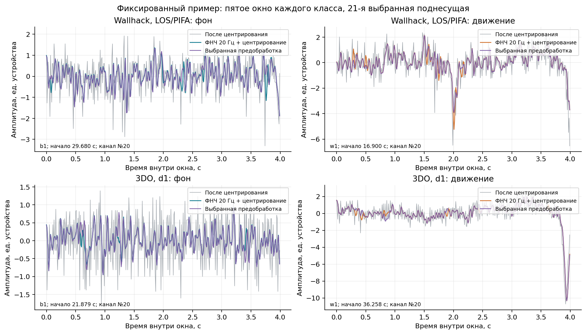
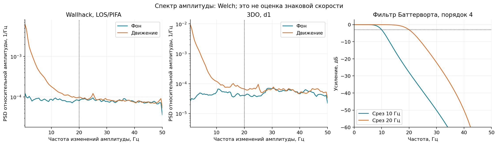
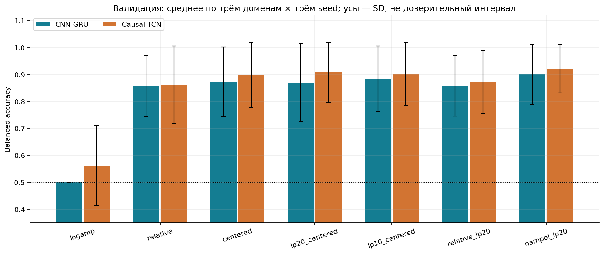
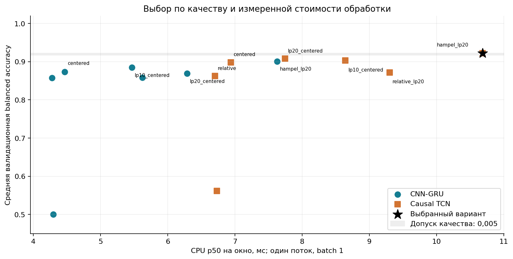
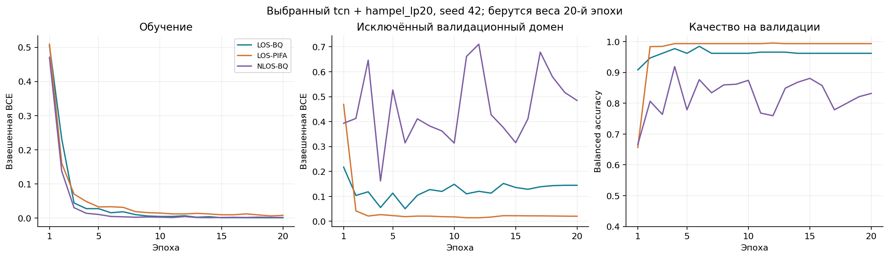
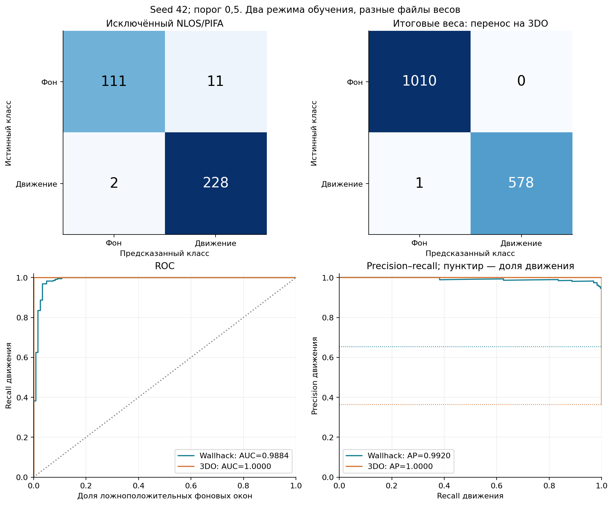
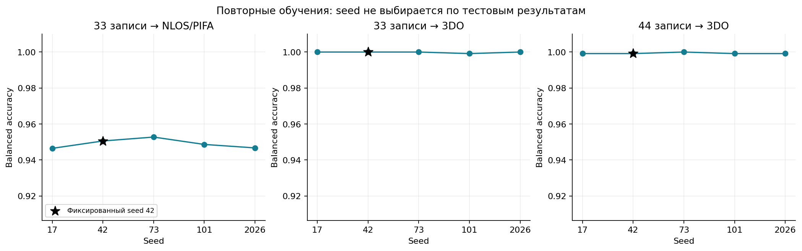

# Детектор движения по Wi-Fi CSI

Детектор определяет движение по изменениям радиоканала между Wi-Fi-устройствами. Его вход — четыре секунды амплитуды CSI на 52 поднесущих. На выходе модель дает оценку движения и бинарное решение с порогом 0,5. В основе детектора — Causal TCN с 46 081 обучаемым параметром и предобработка `hampel_lp20`: подавление локальных выбросов, фильтр низких частот 20 Гц и центрирование.

Текущая версия различает ходьбу, в том числе с махами руками, и пустую сцену. Это ограничение связано с разметкой: неподвижный человек не представлен в отрицательном классе, а записи сидения и лежания содержат переходы и мелкие движения без подходящих интервальных меток. Для них нельзя достоверно задать бинарную метку «нет движения».

Итоговые веса [deployment.pt](../experiments/motion_results/deployment.pt) обучены на 44 записях Wallhack. На 1589 окнах 3DO balanced accuracy и F1 составляют 0.9991: одно окно движения пропущено, ложноположительных окон нет. При переносе между условиями приема результат заметно меняется, поэтому эта оценка не описывает качество в произвольном помещении.

## Как движение отражается в CSI

Wi-Fi-сигнал приходит к приемнику несколькими путями: напрямую и после отражений от окружающих объектов. Движение человека меняет длины и амплитуды части этих путей. Их сумма меняется из-за интерференции, поэтому движение может сопровождаться и ростом, и снижением принимаемой амплитуды. Для детектора полезны изменения сигнала во времени; один средний уровень не отделяет движение от различий антенн, усиления или обстановки.

$$
H_k(t)=H_{s,k}+\sum_{p} a_{p,k}(t)\exp\left(-j\,2\pi L_p(t)/\lambda_k\right),
\qquad A_k(t)=|H_k(t)|.
$$

Здесь $H_{s,k}$ — статическая составляющая канала, $L_p(t)$ — длина отраженного пути, а $A_k(t)$ — наблюдаемая амплитуда поднесущей. Такая модель объясняет выбор временных признаков, но по одной амплитуде нельзя однозначно разделить движение человека, аппаратные искажения и помехи.

Для отдельного пути $f_{D,p}=-(1/\lambda_k)\,dL_p/dt$. В бистатической геометрии $|dL_p/dt|\leq2|v|$, откуда $|f_D|\leq2|v|/\lambda$. Например, при 2,4 ГГц и скорости 1 м/с верхняя граница — около 16 Гц. Это ориентир для выбора полосы фильтра, а не универсальная граница полезного сигнала: влияют геометрия, движение конечностей и переход от комплексного канала к его модулю. Спектр изменений амплитуды не является калиброванным знаковым доплеровским спектром и не переводится напрямую в скорость.

## Данные и предобработка

Основной набор — [Wallhack](https://zenodo.org/records/15147388), в котором сочетаются прямая и непрямая видимость (LOS/NLOS), а также антенны BQ и PIFA. [3DO](https://zenodo.org/records/10925351) содержит записи за три дня и служит для проверки переноса между датасетами. В обоих наборах есть отдельно размеченная пустая сцена. В доступных UT-HAR, NTU-Fi HAR, NTU-Fi HumanID и подготовленном Widar подходящего отрицательного класса нет: активные действия и жесты не могут заменять отсутствие движения.

В набор входят 67 полных записей и 3052 неперекрывающихся окна: 1463 из Wallhack и 1589 из 3DO. Длина и шаг окна — четыре секунды, частота сетки — 100 Гц. Каждое окно имеет форму `[52,400]`; между его первым и последним отсчетом проходит 3,99 с. Окна одной записи всегда остаются в одной части разбиения.

Амплитуда восстанавливается из исходных I/Q-компонент как $H_k=q_{2k+1}+j q_{2k}$, затем берется $|H_k|$. Порядок «мнимая, действительная» соответствует [ESP-IDF](https://docs.espressif.com/projects/esp-idf/en/v5.2.3/esp32/api-guides/wifi.html#wi-fi-channel-state-information). Используются 52 L-LTF поднесущие с индексами [6:32] + [33:59]; первые недостоверные байты ESP32 в этот диапазон не входят. Поставляемые кэши 3DO имеют смещенное спаривание I/Q-компонент, поэтому источником служат CSV. Это различие отражено в [таблице аудита кэша](analysis/cache_audit.csv) и связано с индексной формулой [авторского загрузчика](https://github.com/StrohmayerJ/3DO/blob/main/datasets.py).

Временная шкала учитывает переполнения таймера uint32. Разрыв с `Δt <= 0` или `Δt > 50000` микросекунд начинает новый сегмент. Внутри него амплитуда линейно интерполируется на сетку с шагом 10 000 мкс; длинные пропуски не заполняются. Сегменты короче 3,99 с или с менее чем 400 валидными пакетами исключаются, неполный остаток окна не используется. Для Wallhack с передачей около 100 пакетов/с это выравнивание времени. Источнику с существенно более высокой частотой перед понижением частоты понадобится отдельная антиалиасинговая фильтрация.

Предобработка сначала заменяет локальные выбросы медианой, затем подавляет высокочастотную составляющую и вычитает среднее каждого канала за окно. Центрирование убирает постоянный уровень, сохраняя величину колебаний. Деления каждого окна на собственное стандартное отклонение нет: оно могло бы стереть различие между спокойным фоном и движением.

После преобразования каждый канал стандартизируется по обучающей выборке: $Z_k=(X_k-\mu_k)/\max(\sigma_k,10^{-4})$. Значения $\mu_k$ и $\sigma_k$ рассчитываются по обучающим окнам и времени, затем применяются к валидационным и контрольным данным без пересчета. Статистики накапливаются в float64, вход сети и сохраненные параметры имеют тип float32.

ФНЧ работает причинно, но центрирование использует все окно, а медианный детектор — соседние отсчеты внутри него. Поэтому результат относится к готовому четырехсекундному фрагменту. Причинность отдельных сверток и фильтра не означает выдачу решения по каждому новому отсчету.





## Почему используется TCN

TCN обрабатывает последовательность остаточными временными свертками. Дилатации расширяют доступный временной контекст без увеличения ядра каждой свертки; выход последнего состояния сводится к одному логиту. Рецептивное поле в 509 отсчетов охватывает все входное окно из 400 отсчетов. Точная конфигурация сети и параметры обучения приведены в справочной части.

В [исходном сравнении моделей](experiment_results.md) лучшие средние оценки давали TCN и CNN-GRU с `lp20_centered`: balanced accuracy 0,9609 и 0,9594. Поэтому дальнейшее сравнение охватывает эти две архитектуры и семь вариантов обработки амплитуды. TinyCNN и Transformer в этой серии повторно не обучались; выбор относится к двум кандидатам, а не ко всем возможным архитектурам.

Валидация использует домены `LOS/BQ`, `LOS/PIFA` и `NLOS/BQ`: один домен исключается из обучения, два остальных служат источником данных. Каждый цикл повторяется с seed 17, 42 и 2026. Всего это 126 обучений — 2 архитектуры × 7 преобразований × 3 домена × 3 seed. Порог 0,5 и веса последней, 20-й эпохи одинаковы для всех вариантов.

Критерий выбора сочетает качество и время обработки. Сначала сравнивается средняя balanced accuracy по девяти валидационным запускам. Если отставание от лучшего значения не превышает 0,005, предпочтение получает вариант с меньшим медианным временем на CPU; следующий критерий — число параметров. Допуск 0,5 процентного пункта — инженерное условие, а не доказательство статистической эквивалентности. Правило и разбиения находятся в [plan.json](../experiments/motion_results/plan.json).

TCN с `hampel_lp20` имеет лучшую среднюю BA — 0.9219. Для той же архитектуры `logamp` дает 0.5619, одно центрирование — 0.8983, а ФНЧ 20 Гц с центрированием — 0.9080. Разница между выбранным представлением и `logamp` составляет 36.01 процентного пункта на одинаковых разбиениях. Здесь выделение временной динамики заметно полезнее сохранения среднего уровня, а подавление выбросов дополняет фильтрацию. Это наблюдение относится к выбранным данным и бюджету обучения; оно не устанавливает единственную физическую причину ошибок.





Наиболее сложный случай — `NLOS/BQ`, когда обучение использует только два LOS-домена. Средняя BA здесь составляет 0.8057, полнота движения — 0.6113; от 79 до 110 окон движения пропускаются в каждом запуске, ложноположительных окон нет. Малой обучающей ошибки недостаточно для такого переноса: валидационная ошибка остается заметно выше. Добавление других NLOS-записей меняет состав обучения и требует отдельной проверки.



## Точность и границы применения

Для оценки переноса используются два режима обучения. В первом модель получает 33 записи Wallhack из трех доменов; `NLOS/PIFA` целиком остается за пределами обучения. Контроль включает этот домен и 3DO. Во втором режиме модель получает все 44 записи Wallhack, а контроль остается на 3DO. Именно второму режиму соответствует `deployment.pt`; оценки исключенного `NLOS/PIFA` относятся к другому файлу весов.

Каждый режим содержит пять обучений с seed 17, 42, 73, 101 и 2026. Итоговый файл соответствует заранее заданному seed 42, без выбора seed по контрольным результатам. Ни порог, ни число эпох не подстраиваются под эти результаты.

| Обучение | Контроль | Окон | Accuracy | BA | Precision | Recall | F1 | ROC-AUC | AP | FP | FN |
| --- | --- | --- | --- | --- | --- | --- | --- | --- | --- | --- | --- |
| 33 записи Wallhack | Wallhack | 352 | 0.9631 | 0.9506 | 0.9540 | 0.9913 | 0.9723 | 0.9884 | 0.9920 | 11 | 2 |
| 33 записи Wallhack | 3DO | 1589 | 1.0000 | 1.0000 | 1.0000 | 1.0000 | 1.0000 | 1.0000 | 1.0000 | 0 | 0 |
| 44 записи Wallhack; итоговые веса | 3DO | 1589 | 0.9994 | 0.9991 | 1.0000 | 0.9983 | 0.9991 | 1.0000 | 1.0000 | 0 | 1 |

Таблица показывает seed 42. Precision, recall, F1 и AP относятся к движению. В исключенном домене Wallhack матрица ошибок — TN=111, FP=11, FN=2, TP=228. У итоговых весов на 3DO — TN=1010, FP=0, FN=1, TP=578. Доля положительных окон на 3DO равна 0.3644; она служит ориентиром для AP. ROC-AUC и AP характеризуют ранжирование оценок, тогда как число ложных срабатываний зависит и от порога 0,5.

Balanced accuracy и F1 определяются как $BA=\tfrac12\left(\frac{TP}{TP+FN}+\frac{TN}{TN+FP}\right)$ и $F1=\frac{2TP}{2TP+FP+FN}$. BA одинаково учитывает полноту движения и полноту фона, даже когда число окон двух классов различается.





Условный 95%-й percentile-интервал BA итоговой модели на 3DO — [0.9975; 1.0000]. Он основан на 5000 bootstrap-повторах по полным записям со стратификацией по дню и классу. Такой интервал описывает различия между доступными записями при фиксированных днях и одном исполнителе. Он не отражает неопределенность переноса в другое помещение или на другого человека. Для `NLOS/PIFA` фон представлен одной независимой сессией, поэтому надежного интервала ошибки на новых фоновых сессиях здесь нет.

Контрольные домены уже входят в прежнюю исследовательскую сетку. В соответствующих разбиениях они не участвуют в обновлении весов или расчете нормализации, но на уровне всего исследования проверка остается ретроспективной. Высокие значения на 3DO не заменяют оценку на ранее не просмотренных записях.

Область подтвержденного применения ограничена ходьбой и пустой сценой. Для более широкого детектора нужны неподвижные люди, независимые фоновые сессии, другие участники и помещения, интервальные метки начала и конца движения. Доступные данные не дают оценки пропусков медленного движения или дыхания. Общие авторы, близкая аппаратная платформа и ограниченный состав участников Wallhack и 3DO также сужают область обобщения.

## Использование модели

Модель содержит 46 081 параметр. Ее тензоры занимают 184 324 байта, а файл [deployment.pt](../experiments/motion_results/deployment.pt) вместе с нормализацией и метаданными — 210 722 байта. На CPU `Intel64 Family 6 Model 151 Stepping 2, GenuineIntel`, при одном потоке и batch 1, медианное время обработки готового амплитудного окна составляет 10.52 мс, p95 — 11.39 мс. Эти значения включают предобработку, стандартизацию, сеть и sigmoid; условия замера — 20 прогревов и 100 измерений.

Чтение CSV, восстановление I/Q, ресемплирование, дисковый ввод и накопление четырех секунд сигнала в это время не входят. Результат относится к указанному компьютеру; работа на микроконтроллере не проверена. При неперекрывающихся окнах новое решение доступно раз в четыре секунды. Задержка реакции на начало движения зависит от его положения внутри окна и необходимой модели длительности движения; ее оценки пока нет.

Доля ложноположительных окон не равна числу тревог в час. Для событийной оценки нужны непрерывная разметка и правило объединения срабатываний. Выход sigmoid также не калиброван как вероятность движения в условиях эксплуатации.

Загрузка на CPU:

```python
import numpy as np
import torch
from experiments.final_motion.pipeline import MotionDetector

torch.set_num_threads(1)
detector = MotionDetector("experiments/motion_results/deployment.pt", device="cpu")
# amplitudes: неотрицательный float32 [N, 52, 400], сетка 100 Гц,
# поднесущие L-LTF [6:32] + [33:59], до любой нормализации.
probability = detector.predict(amplitudes)
movement = probability >= detector.threshold
```

Командный интерфейс принимает `.npy` с таким же представлением амплитуд:

```powershell
python -m experiments.final_motion.pipeline windows.npy --output predictions.npz
```

Веса, параметры нормализации и порог загружаются вместе. `.pt` также содержит архитектуру, предобработку, seed, частоту, размер окна, поднесущие, индексы обучающих окон, идентификаторы записей, параметры обучения и контрольные суммы кода. SHA-256 итогового файла — `c90de68eeabb6661c7eb956da5ea3371bdb5aa85b2be909fee8e93f1e5f09e6e`.

Полный набор результатов находится в [experiments/motion_results](../experiments/motion_results): 126 валидационных и 10 контрольных файлов весов в `checkpoints/`, прогнозы в `predictions/`, потери по 20 эпохам в `curves/`. В `.npz` поля `indices`, `truth` и `probability` связывают прогноз с исходным окном. [test_metrics.csv](../experiments/motion_results/test_metrics.csv) и [seed_summary.csv](../experiments/motion_results/seed_summary.csv) содержат результаты всех контрольных seed.

## Справочные параметры

### Состав данных и варианты обработки

| Набор | Домен | Полных записей | Окон | Фон, 0 | Движение, 1 |
| --- | --- | --- | --- | --- | --- |
| 3DO | d1 | 8 | 493 | 338 | 155 |
| 3DO | d2 | 8 | 499 | 332 | 167 |
| 3DO | d3 | 7 | 597 | 340 | 257 |
| Wallhack | LOS/BQ | 11 | 369 | 132 | 237 |
| Wallhack | LOS/PIFA | 11 | 370 | 111 | 259 |
| Wallhack | NLOS/BQ | 11 | 372 | 137 | 235 |
| Wallhack | NLOS/PIFA | 11 | 352 | 122 | 230 |

В каждом домене Wallhack есть только одна фоновая запись. Число окон характеризует объем сигнала, но не число независимых условий наблюдения.

| Вариант | Преобразование и назначение |
| --- | --- |
| `logamp` | $\log(1+A)$; контроль с сохранением среднего уровня канала |
| `relative` | $A/\max(\bar A,1)-1$; относительные изменения каждой поднесущей |
| `centered` | $A-\bar A$; удаление постоянной составляющей без фильтра |
| `lp20_centered` | ФНЧ Баттерворта 4-го порядка, 20 Гц; затем вычитание среднего окна |
| `lp10_centered` | То же при срезе 10 Гц; проверка более сильного подавления высоких частот |
| `relative_lp20` | ФНЧ 20 Гц; центрирование и деление на $\max(\bar A_{filtered},1)$ |
| `hampel_lp20` | Замена выбросов локальной медианой, затем ФНЧ 20 Гц и центрирование |

Фильтры Баттерворта имеют порядок 4 и SOS-реализацию. Начальное состояние соответствует первому отсчету каждой поднесущей и сбрасывается перед окном. В медианном детекторе $m_t=\operatorname{med}_{r=-2,\ldots,2} A_{t+r}$ и $d_t=\operatorname{med}_{r=-2,\ldots,2}|A_{t+r}-m_{t+r}|$. При $|A_t-m_t|>3\max(1.4826\,d_t,0.5)$ отсчет заменяется на $m_t$; границы отражаются. Это приближенный вариант Hampel с локальным масштабом по отклонениям от скользящей медианы; он использует соседние отсчеты внутри готового окна и может удалить не только выброс, но и полезный краткий сигнал.

Для контрольного постоянного сигнала остаток после центрирования не превышает 1.78e-15. Совместная и отдельная обработка окон дают одинаковые значения; изолированный выброс на постоянном сигнале удаляется. Измеренный коэффициент передачи на частоте среза обоих ФНЧ — 0,7071069, то есть $1/\sqrt2$ и −3,01 дБ. Эти свойства преобразований зафиксированы в [signal_validation.json](../experiments/motion_results/signal_validation.json).

| Набор | Домен | Класс | Медиана RMS относительных изменений | Медиана доли PSD выше 20 Гц |
| --- | --- | --- | --- | --- |
| 3DO | d1 | Фон | 0.0494 | 75.0% |
| 3DO | d1 | Движение | 0.1573 | 9.5% |
| 3DO | d2 | Фон | 0.0507 | 76.5% |
| 3DO | d2 | Движение | 0.1556 | 9.9% |
| 3DO | d3 | Фон | 0.0514 | 66.8% |
| 3DO | d3 | Движение | 0.1784 | 5.7% |
| Wallhack | LOS/BQ | Фон | 0.1656 | 61.1% |
| Wallhack | LOS/BQ | Движение | 0.3071 | 10.6% |
| Wallhack | LOS/PIFA | Фон | 0.0643 | 59.8% |
| Wallhack | LOS/PIFA | Движение | 0.1254 | 16.9% |
| Wallhack | NLOS/BQ | Фон | 0.1412 | 53.7% |
| Wallhack | NLOS/BQ | Движение | 0.1784 | 48.2% |
| Wallhack | NLOS/PIFA | Фон | 0.1919 | 56.2% |
| Wallhack | NLOS/PIFA | Движение | 0.2020 | 39.1% |

PSD рассчитана методом Welch по относительной амплитуде: окно Hann, 200 отсчетов, перекрытие 100, частота 100 Гц, усреднение по 52 поднесущим. Значения показывают неодинаковую различимость классов в разных доменах. По высокочастотной составляющей фона нельзя установить конкретный источник помех; величина дисперсии сама по себе также не дает единого правила переноса.

### Полное сравнение конфигураций

| Предобработка | Архитектура | Средняя BA | SD по 9 запускам | Минимальная BA | Средний F1 | CPU p50, мс |
| --- | --- | --- | --- | --- | --- | --- |
| `centered` | CNN-GRU | 0.8733 | 0.1298 | 0.6766 | 0.8447 | 4.47 |
| `centered` | Causal TCN | 0.8983 | 0.1215 | 0.7213 | 0.8735 | 6.94 |
| `hampel_lp20` | CNN-GRU | 0.9008 | 0.1111 | 0.7170 | 0.8831 | 7.63 |
| `hampel_lp20` | Causal TCN | 0.9219 | 0.0898 | 0.7660 | 0.9118 | 10.69 |
| `logamp` | CNN-GRU | 0.5000 | 0.0000 | 0.5000 | 0.7933 | 4.30 |
| `logamp` | Causal TCN | 0.5619 | 0.1478 | 0.5000 | 0.8187 | 6.73 |
| `lp10_centered` | CNN-GRU | 0.8846 | 0.1212 | 0.6894 | 0.8612 | 5.47 |
| `lp10_centered` | Causal TCN | 0.9026 | 0.1173 | 0.7191 | 0.8800 | 8.64 |
| `lp20_centered` | CNN-GRU | 0.8692 | 0.1446 | 0.6340 | 0.8291 | 6.29 |
| `lp20_centered` | Causal TCN | 0.9080 | 0.1120 | 0.7426 | 0.8878 | 7.74 |
| `relative` | CNN-GRU | 0.8575 | 0.1144 | 0.6957 | 0.8574 | 4.28 |
| `relative` | Causal TCN | 0.8624 | 0.1433 | 0.6250 | 0.9163 | 6.70 |
| `relative_lp20` | CNN-GRU | 0.8583 | 0.1125 | 0.7008 | 0.8828 | 5.62 |
| `relative_lp20` | Causal TCN | 0.8715 | 0.1171 | 0.6477 | 0.9069 | 9.30 |

Средняя BA и SD относятся к трем доменам и трем seed вместе. Девять значений зависимы: домены повторяются между циклами. Поэтому SD — описание разброса, а не доверительный интервал генерального качества. Подробные значения находятся в [cv_runs.csv](../experiments/motion_results/cv_runs.csv), выбор и измеренные затраты — в [selection.csv](../experiments/motion_results/selection.csv).

| Режим | Набор | Средняя BA | SD BA | Минимум BA | Максимум BA | Средний F1 | Диапазон FP | Диапазон FN |
| --- | --- | --- | --- | --- | --- | --- | --- | --- |
| all_wallhack | 3DO | 0.9993 | 0.0004 | 0.9991 | 1.0000 | 0.9993 | 0–0 | 0–1 |
| domain_holdout | 3DO | 0.9998 | 0.0004 | 0.9991 | 1.0000 | 0.9998 | 0–0 | 0–1 |
| domain_holdout | Wallhack | 0.9490 | 0.0027 | 0.9465 | 0.9527 | 0.9724 | 11–13 | 0–2 |

Разброс между seed характеризует обучение на фиксированных данных. Он не заменяет оценку новых фоновых сессий и условий приема.

| День 3DO, итоговая модель | Окон | BA | F1 | TN | FP | FN | TP |
| --- | --- | --- | --- | --- | --- | --- | --- |
| d1 | 493 | 1.0000 | 1.0000 | 338 | 0 | 0 | 155 |
| d2 | 499 | 0.9970 | 0.9970 | 332 | 0 | 1 | 166 |
| d3 | 597 | 1.0000 | 1.0000 | 340 | 0 | 0 | 257 |

### Архитектура и обучение

Входная Conv1d(52,32,1) переводит 52 поднесущие в 32 канала. Семь остаточных блоков содержат по две причинные свертки с ядром 3 и дилатациями 1, 2, 4, 8, 16, 32, 64. LayerNorm применяется по каналам в каждой временной позиции, dropout равен 0,2. Linear(32,1) получает последнее состояние. Рецептивное поле: 1 + 4(1+2+4+8+16+32+64) = 509 отсчетов.

Для TCN и CNN-GRU параметры обучения одинаковы: AdamW, начальный learning rate `0.001`, weight decay `0.0001`, косинусное снижение до `0.00001`, batch size 64, dropout 0,2 и ограничение нормы градиента 1,0. Функция потерь — взвешенная BCE:

$$
\mathcal L=-\frac1N\sum_i\left[w_+ y_i\log\sigma(z_i)+(1-y_i)\log(1-\sigma(z_i))\right],
\qquad w_+=N_0/N_1.
$$

Вес положительного класса — отношение числа фоновых окон к числу окон движения только в обучающей части. Дополнительного балансирующего семплера нет. Обучение использует CUDA AMP float16, сохраненные веса и контрольный инференс — float32, TF32 разрешен. Фиксированные seed не гарантируют побитового совпадения обучения на другой программной или аппаратной конфигурации.

Окружение: Python 3.12.10, PyTorch 2.5.1+cu121, NumPy 2.4.2, SciPy 1.17.1, scikit-learn 1.8.0; GPU — NVIDIA GeForce RTX 3080 Ti Laptop GPU.

Оценка матричных multiply–accumulate операций на окно: CNN-GRU — 5 145 664, TCN — 17 868 832. В нее входят Conv1d, матрицы GRU и Linear, но не нормализация, нелинейности, фильтрация, работа с памятью и накладные расходы. MAC не приравнивается к одной универсальной операции процессора и не заменяет измерение времени.

### Целостность данных и воспроизведение

Исходные CSV содержат 1 569 769 пакетов, из которых четыре поврежденных исключаются. Временная шкала включает шесть переполнений uint32. Сравнение разрывов в целых микросекундах устраняет 12 пограничных случаев, когда дробное представление интервала ровно 50 мс приводило к ложному превышению порога. Поэтому текущий набор содержит 3052 окна вместо прежних 3045; начала 3029 окон совпадают. Разница между старыми и текущими метриками включает изменение состава окон и не является чистой оценкой эффекта предобработки. Девять пробных обучений на прежнем наборе находятся [в отдельном архиве](../experiments/motion_pilot_float_timing/README.md) и не входят в текущие оценки.

Независимое восстановление всех 3052 окон из ZIP через расчет амплитуды `hypot` отличается от подготовленного массива не более чем на 3.8146973e-06 в единицах устройства. [source_audit.csv](../experiments/motion_results/source_audit.csv) содержит сверку по записям, [data_manifest.json](../experiments/motion_results/data_manifest.json) — контрольные суммы архивов и массива. [materials.csv](../experiments/motion_results/materials.csv) связывает исходные материалы с их контрольными суммами. Предыдущая сетка включает 256 обучений и 656 строк метрик; повторные расчеты подтверждают ее метрики и сохраненные прогнозы четырех архитектур.

Проверка текущих артефактов охватывает инференс 136 файлов весов, 176 строк метрик, статистики нормализации только по обучающим окнам, отсутствие пересечения записей между обучением и соответствующим контролем, неперекрывающиеся окна, метки и конечность весов. Максимальное расхождение повторных вероятностей на GPU — 0, между итоговой моделью на CPU и GPU — 6.377697e-06. Решения на 3DO совпадают. Условия замеров CPU и GPU доступны в [validation.json](../experiments/motion_results/validation.json).

Последовательность команд из корня проекта:

```powershell
python -m experiments.final_motion.prepare_data
python -m experiments.final_motion.audit_data
python -m experiments.final_motion.verify_signal
python -m experiments.final_motion.train
python -m experiments.final_motion.validate
python -m experiments.final_motion.analyze
python -m experiments.final_motion.write_report
python -m experiments.final_motion.verify_artifacts
```

`train` проверяет неизменность плана и кода и пропускает готовые запуски. Изменение параметров требует другой папки результатов. Для подготовки нужны `wallhack1.8k.zip` и `3DO.zip` в `datasets/`; для загрузки готовой модели архивы не требуются. Восстанавливаемый кэш `amplitudes.npy` хранится локально и исключен из Git. В репозиторий входят код, веса, прогнозы, таблицы и готовые PNG.

Условия публикации обоих наборов предусматривают некоммерческое исследовательское использование и сами по себе не подтверждают право на коммерческое применение данных или производных моделей. Экономический эффект, стоимость ложной тревоги и допустимый риск пропуска здесь не оцениваются.
