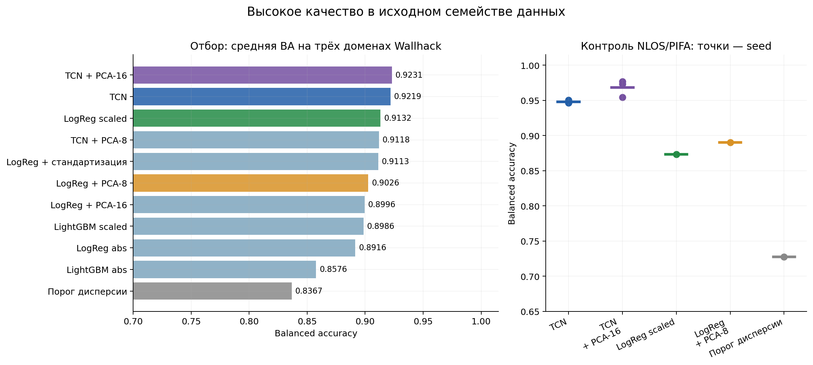
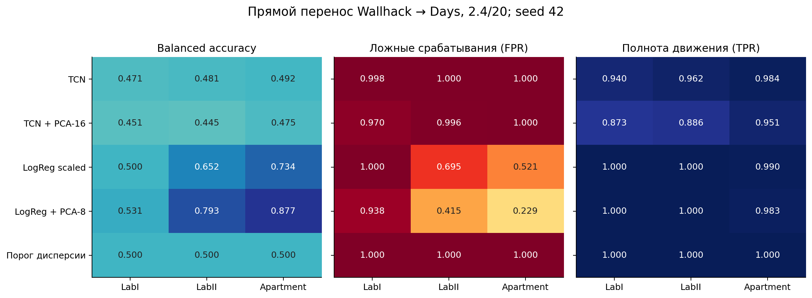
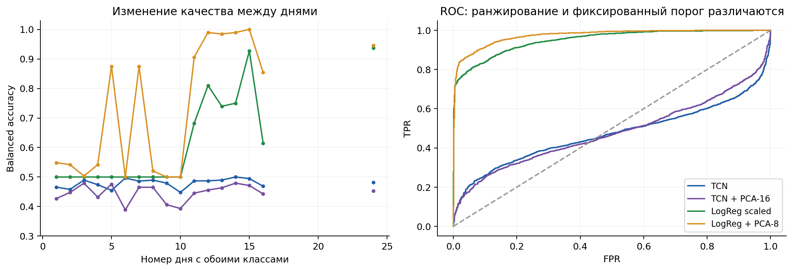
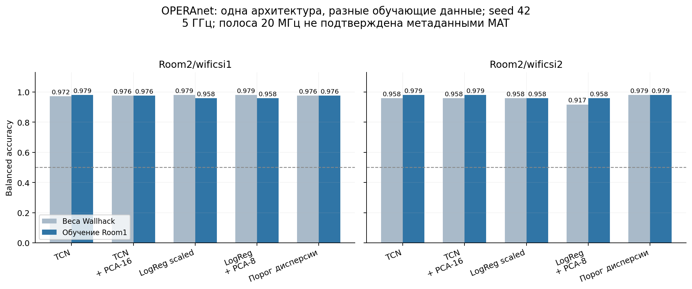
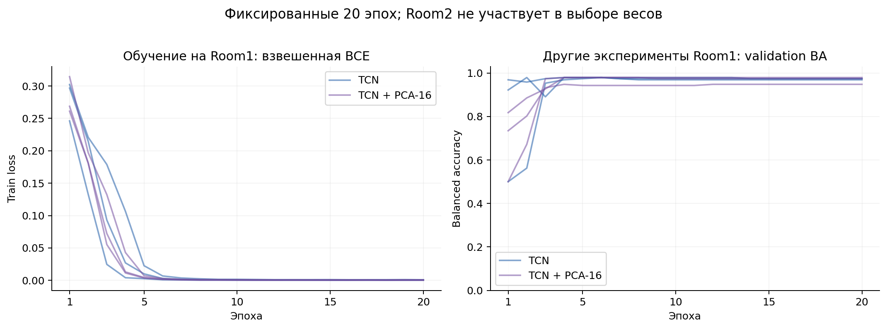
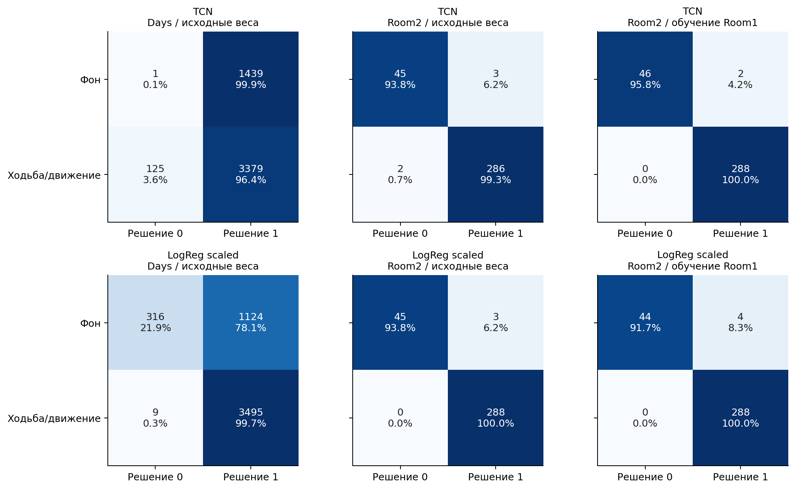
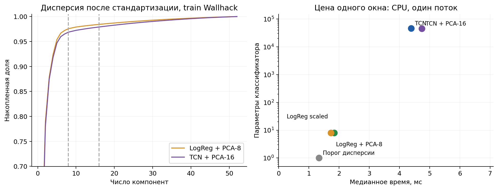

# PCA и устойчивость детектора движения при смене оборудования и среды

Дата исследования: 28 октября 2026 года.

## Что установлено

TCN сохраняет высокое качество в исходном семействе данных, но не переносится без адаптации на Atheros из архивов Days. На 4 944 внешних окнах её balanced accuracy (BA) при seed 42 составила 0,4825; ложные срабатывания возникли в 1 439 из 1 440 пустых окон. Добавление PCA-16 эту проблему не устранило. Логистическая регрессия с безразмерной предобработкой перенеслась лучше, а PCA-8 подняла её BA с 0,6084 до 0,7155. При этом 56,5% пустых окон всё ещё классифицировались как движение.

На OPERAnet результат другой. Замороженная TCN, обученная на Wallhack, получила BA 0,9653 на 336 окнах второй комнаты. Та же архитектура после обучения на первой комнате получила 0,9792. Для логистической регрессии повторное обучение не дало выигрыша: 0,9688 до него и 0,9583 после. Эти значения относятся к seed 42 и одной и той же тестовой выборке.

PCA полезна как проверяемый вариант обработки, но оснований включать её в итоговую TCN по умолчанию нет. На development-доменах прирост BA составил 0,0011, на Days качество снизилось, а время обработки окна выросло. У лёгкой модели PCA улучшила перенос на Days, несмотря на более слабый результат внутреннего отбора. Эффект зависит от источника и среды.

Строгое утверждение о переносе именно в **5/20** сделать нельзя: OPERAnet подтверждён как набор 5 ГГц, но ширина канала отсутствует в доступных MAT-метаданных. Ниже приведена выполненная проверка на 5 ГГц с явно заданным адаптером для предполагаемой полосы 20 МГц. Неопределённость полосы сохранена в результатах.

## Исходные модели и правила сравнения

Исследование сопоставляет временную нейросеть TCN, логистическую регрессию, градиентный бустинг LightGBM и пороговый детектор дисперсии. Для всех методов используются единые исходные записи, границы окон и разбиения. Физическая модель сигнала, выбор исходной TCN и подробное сравнение фильтров приведены в [отчёте о детекторе движения](motion_model_report.md).

Основная выборка содержит 3 052 окна: 1 463 окна и 44 записи Wallhack, 1 589 окон и 23 записи 3DO. Ранняя серия экспериментов использовала 3 045 окон. Различие вызвано обработкой пограничных временных интервалов, поэтому её оценки не включены в прямое сравнение текущей серии. Для отбора использованы три development-домена Wallhack: `LOS/BQ`, `LOS/PIFA`, `NLOS/BQ`. В каждом проходе один домен исключался из обучения. `NLOS/PIFA` использован для контрольной проверки, затем модели обучены на всех 44 записях Wallhack для переноса на внешние данные.

Сопоставлялись исходная TCN `hampel_lp20`, TCN с 8 и 16 главными компонентами, порог дисперсии, логистическая регрессия и LightGBM. Параметры классических классификаторов: LogReg с `C=1`, балансировкой классов и стандартизацией признаков; LightGBM — 200 деревьев, `learning_rate=0.05`, `num_leaves=15`, `min_child_samples=10`, выборки строк и признаков по 0,8. Проверены абсолютная очищенная амплитуда и безразмерный вариант `clean_lp_scaled`.

Классическая предобработка адаптирована к тем же готовым четырёхсекундным окнам, что получает TCN. Очистка импульсов и инициализация фильтра выполняются внутри окна. В раннем сравнении часть операций выполнялась на непрерывной записи. Результаты настоящей серии относятся к согласованному оконному протоколу и не эквивалентны оценкам при непрерывной обработке. Сравниваются законченные цепочки «предобработка + модель», а не изолированный вклад архитектуры.

Для нейросетей и LightGBM использованы seed 17, 42 и 2026; детерминированные классические модели рассчитаны один раз. TCN обучалась фиксированные 20 эпох: AdamW, `lr=0.001`, `weight_decay=0.0001`, cosine schedule до `0.00001`, batch 64, ограничение нормы градиента 1, взвешенная BCE с `pos_weight=n0/n1`. Порог решения — 0,5. На целевых тестовых данных порог, PCA и архитектура не подбирались.

Основная метрика $BA=\tfrac12[TP/(TP+FN)+TN/(TN+FP)]$ одинаково учитывает оба класса. Доля ложных срабатываний $FPR=FP/(TN+FP)$ и полнота $TPR=TP/(TP+FN)$ приводятся отдельно: высокая полнота при почти постоянном положительном решении не считается успешным переносом. Все числа ошибок рассчитаны по сохранённым решениям отдельных окон.

Эксперимент охватывает заранее выбранные конфигурации, три случайные инициализации нейросетей и фиксированные разбиения. На внешних наборах проверяются эти конфигурации без полного перебора архитектур. Условия оценки зафиксированы в [протоколе исследования](../experiments/robustness/protocol.md).

## Пригодность новых данных и подготовка сигнала

### Days: три среды на Atheros, 2.4/20

Проверен 21 архив с 245 файлами: дни 1–16 и 20–24. Отсутствие дней 17–19 соответствует [описанию авторов](https://github.com/bigtreeyanger/presence_detection_cnn): в эти дни CSI не сохранялся. Количество файлов по категориям совпало с `day_conf.json`. Файл `day13/mixed3.data` имеет нулевую длину. Все 39 смешанных записей исключены из основной задачи; их последовательности состояний без отдельной проверки временных границ не использовались как интервальная разметка.

Декодировано 9 740 769 кадров, принято 9 731 320 пакетов с пригодным CSI выбранной антенной пары. Заголовки прочитаны без принудительного поиска нового положения в повреждённом потоке. В выборку допускаются только пакеты с частотой 2437 МГц, кодом полосы 0 и 56 тонами. Пакеты без CSI с признаком 40 МГц не превращались в измерения; единичный пакет на 2422 МГц исключён. Из каждой записи удалены первые и последние пять секунд, затем выбрано не более 24 равномерно распределённых неперекрывающихся окон.

| Среда | Записи в проверке | Пустые окна | Положительные окна | Независимые фоновые записи |
| --- | ---: | ---: | ---: | ---: |
| LabI, дни 1–3 | 36 | 432 | 432 | 18 |
| LabII, дни 4–16 | 136 | 960 | 2 304 | 40 |
| Apartment, дни 20–24 | 34 | 48 | 768 | 2 |
| Всего | 206 | 1 440 | 3 504 | 60 |

Набор пригоден для проверки переноса на другие помещение и оборудование. Метки в нём назначены целым записям: `empty`, `motion` либо название комнаты квартиры. Положительная метка не гарантирует непрерывного физического движения в каждом четырёхсекундном окне. Поэтому результат оценивает согласие с авторской разметкой записей, а не точность определения момента начала и окончания движения. Для квартиры особенно ограничена оценка фона: доступны только две такие записи.

### OPERAnet: две комнаты и два приёмника, 5 ГГц

В `wificsi1.zip` находится 40 MAT-файлов, в `wificsi2.zip` — 63. Инвентаризация охватила все 103 файла и 82 897 724 строки. Во всех таблицах имеется по 270 комплексных столбцов CSI. [Публикация OPERAnet](https://doi.org/10.1038/s41597-022-01573-2) описывает Intel 5300, канал 149 диапазона 5 ГГц, конфигурацию 3×3 и 30 измеряемых групп поднесущих. MAT-таблицы не содержат поля ширины канала. Само наличие 30 групп не различает 20 и 40 МГц, что следует из [описания Intel CSI Tool](https://dhalperi.github.io/linux-80211n-csitool/).

В основную задачу вошли только `background` и `walk`: 1 026 окон из 43 файлов. `noactivity` означает неподвижного человека, поэтому эта метка не использовалась как пустая сцена. Переходы сидя/стоя, укладывание, вращения тела, подсчёт людей и локализационные эксперименты сохранены в инвентаризации, но не смешаны с задачей «пустая комната / ходьба». Между границей активности и окном оставлена секунда; окна не пересекают смену метки.

Семь разных индивидуальных строк `person_id` — `One`…`Seven` — не совпадают с описанием шести участников в статье. Также присутствуют групповой идентификатор `All Six People` и отсутствие участника на фоне. Это расхождение метаданных сохранено; идентификаторы не объединялись по предположению. В обучении Room1 участвуют `One`, `Two`, `Three`, `Four`; в тесте Room2 — `One`, `Seven`, `Two`, `Six`, `Three`, `Five`. Проверка Room2 одновременно меняет среду и состав участников. Отдельного эффекта только помещения она не оценивает.

### Согласование входа и физические ограничения

Заранее выбрана одна антенная пара Tx1–Rx1. Для Atheros из 56 тонов удалены по два крайних с каждой стороны: остаются позиции −26…−1 и 1…26, соответствующие 52 входным каналам TCN. Для Intel 30 групп интерполируются до 52 позиций отдельно на отрицательной и положительной половинах спектра. Поскольку точные индексы групп не сохранены в MAT, использованы равномерные порядковые позиции внутри каждой половины. Интерполяция согласует размер входа, но не создаёт недостающую частотную информацию. Использование всех девяти антенных пар и подбор лучшей пары не проводились.

Ресемплирование выполняется по временным меткам до 100 Гц. Разрывы более 50 мс и нерастущее время разделяют фрагменты. У Intel несколько пакетов могут иметь одну миллисекундную метку: их амплитуды усредняются. При понижении высокой частоты используется промежуточная сетка 1 кГц и ФНЧ 40 Гц до перехода к 100 Гц. Эта антиалиасная подготовка выполняется офлайн с двусторонним фильтром; она не является проверенной потоковой реализацией. Точность исходных временных меток ограничивает восстановление сигнала между пакетами.

Связь канала с движением описывается суммой путей распространения:

$$H(f_k,t)=\sum_p a_p(t)\exp[-j2\pi f_k\tau_p(t)].$$

Движение меняет задержки $\tau_p(t)$ и амплитуды $a_p(t)$; аппаратный коэффициент усиления также меняет измеряемый масштаб. Центрирование окна убирает постоянную составляющую, но сохраняет зависимость размаха колебаний от усиления. Поэтому оно не делает TCN автоматически независимой от устройства. В `clean_lp_scaled` центрированная амплитуда делится на одно среднее окна, что убирает общий множитель усиления без деления на почти нулевое среднее отдельного тона.

Различие масштабов наблюдается в данных: медиана средней амплитуды на фоне Wallhack лежит в пределах 11,6–12,6, на Days — 103,9–130,0, на OPERAnet — 14,2–27,6. Это единицы устройств, а не сопоставимая мощность в дБм. На диагностической выборке относительное стандартное отклонение фона OPERAnet составляет 0,0053–0,0152, Days — 0,1037–0,1743. Значения рассчитаны до модельной очистки на не более чем 64 окнах каждой комбинации «среда × класс»; [таблица диагностики](../experiments/robustness/results/signal_summary.csv) содержит точный состав. Эти наблюдения согласуются с чувствительностью к масштабу и фоновым колебаниям, но не доказывают единственную причину ошибок: устройство, помещение и режим записи изменены одновременно.

Для отражённого пути доплеровская частота ограничена $|f_D|\leq2v/\lambda$. При $v=1$ м/с верхняя граница составляет около 16,3 Гц на 2,437 ГГц и 38,3 Гц на 5,745 ГГц. Сохранённый ФНЧ 20 Гц подавляет часть возможной динамики 5 ГГц. В выполненном сравнении он оставлен неизменным, чтобы проверить исходную конфигурацию. Его пригодность для быстрых движений рук и других классов здесь не подтверждена.

## PCA и сравнение с классическими моделями

Для каждой обучающей выборки по её временным отсчётам рассчитаны поканальные $\mu$ и $\sigma$. PCA строится по ковариации стандартизованного сигнала $Z=(X-\mu)/\max(\sigma,10^{-4})$; преобразование имеет вид $U=V_K^TZ$. Контрольные записи не участвуют в расчёте этих величин. Знак компоненты фиксируется по наибольшей по модулю нагрузке. Для TCN меняется только число входов первого слоя; остальные блоки сохранены.

Лёгкая модель получает семь статистических и спектральных признаков. Вариант без общего PCA уже использует первую компоненту, вычисленную внутри отдельного окна, для спектральных признаков. Проверяемое добавление PCA — отдельная общая проекция, обученная на train. Контроль `LogReg + стандартизация` отделяет её эффект от предварительного изменения масштаба каналов.

| Конфигурация | Средняя BA на development-доменах | Минимальная BA отдельного запуска |
| --- | ---: | ---: |
| Порог дисперсии, очищенная амплитуда | 0,8367 | 0,7067 |
| LogReg, очищенная абсолютная амплитуда | 0,8916 | 0,8149 |
| LightGBM, очищенная абсолютная амплитуда | 0,8576 | 0,7483 |
| LightGBM, `clean_lp_scaled` | 0,8986 | 0,7927 |
| LogReg, `clean_lp_scaled` | 0,9132 | 0,8097 |
| LogReg + поканальная стандартизация | 0,9113 | 0,8039 |
| LogReg + PCA-8 | 0,9026 | 0,7970 |
| LogReg + PCA-16 | 0,8996 | 0,7991 |
| TCN, `hampel_lp20` | 0,9219 | 0,7660 |
| TCN + PCA-8 | 0,9118 | 0,7298 |
| TCN + PCA-16 | 0,9231 | 0,7851 |

Для TCN и LightGBM среднее объединяет три доменных прохода и три seed; для LogReg и порога — три прохода. Эти наблюдения не являются девятью независимыми средами. Разница TCN и PCA-16 в 0,11 процентного пункта не даёт устойчивого основания предпочесть проекцию. Лучшей классической конфигурацией по development-данным стала LogReg `clean_lp_scaled`; PCA-8 и PCA-16 сохранены как отдельные проверки эффекта PCA.

| Конфигурация | BA на NLOS/PIFA, среднее по seed | BA на 3DO после обучения на всём Wallhack, seed 42 |
| --- | ---: | ---: |
| TCN | 0,9479 | 0,9991 |
| TCN + PCA-16 | 0,9682 | 0,9991 |
| LogReg scaled | 0,8735 | 0,9956 |
| LogReg + PCA-8 | 0,8904 | 0,9978 |
| Порог дисперсии | 0,7273 | 0,9698 |

На NLOS/PIFA PCA-16 повысила среднее качество TCN на 2,03 процентного пункта. Этот контроль относится к исходному семейству оборудования и ранее изученным данным. Он не подтверждает перенос на произвольную новую среду, что показала проверка Days.

В итоговом обучении Wallhack восемь компонент сохраняют 97,57% дисперсии входа лёгкой модели, а 16 компонент — 97,91% входа TCN. Большая сохранённая дисперсия не гарантирует сохранения информации о классе: PCA оптимизирует реконструкцию входа и не использует целевую метку.

## Прямой перенос на Days, 2.4/20

Веса, нормализация и PCA заморожены после обучения на Wallhack. На Days не выполнялись обучение и подбор порога. Основные результаты ниже относятся к seed 42.

| Модель | BA | ROC-AUC | TPR | FPR | TN / FP / FN / TP |
| --- | ---: | ---: | ---: | ---: | --- |
| TCN | 0,4825 | 0,4705 | 0,9643 | 0,9993 | 1 / 1 439 / 125 / 3 379 |
| TCN + PCA-16 | 0,4551 | 0,4781 | 0,8984 | 0,9882 | 17 / 1 423 / 356 / 3 148 |
| LogReg scaled | 0,6084 | 0,9507 | 0,9974 | 0,7806 | 316 / 1 124 / 9 / 3 495 |
| LogReg + PCA-8 | 0,7155 | 0,9734 | 0,9963 | 0,5653 | 626 / 814 / 13 / 3 491 |
| Порог дисперсии | 0,5000 | 0,7970 | 1,0000 | 1,0000 | 0 / 1 440 / 0 / 3 504 |

TCN потеряла и рабочий порог, и качество ранжирования: ROC-AUC близок к 0,5. Для LogReg сохранилось ранжирование, но порог 0,5 дал много ложных срабатываний. У PCA-8 BA по средам равна 0,5313 в LabI, 0,7927 в LabII и 0,8770 в квартире. Даже лучший из этих результатов сопровождается FPR 0,2292 в квартире; оснований считать проблему решённой нет.

Условные 95%-е percentile-интервалы BA по 2 000 кластерным bootstrap-повторам составили [0,4786; 0,4861] для TCN, [0,5683; 0,6512] для LogReg scaled и [0,6578; 0,7745] для LogReg + PCA-8. Единица повторной выборки — целая запись. Интервалы характеризуют доступный состав записей при фиксированных средах; они не оценивают неизвестные помещения. Bootstrap по отдельным записям также не учитывает общие условия одного дня, поэтому неопределённость переноса на новые дни может быть выше.

Выборка ограничена 24 окнами на запись, а не взвешена по полной продолжительности записей. Значения FPR относятся к этим окнам. Переводить их в число тревог в час нельзя: для этого нужны непрерывная разметка и правило объединения срабатываний в события. Подбор нового порога по представленным тестовым меткам не проводился; пригодность целевой калибровки требует отдельной валидационной выборки.

## OPERAnet: замороженные веса и обучение на двух исходных доменах

Обучающие домены — `Room1/wificsi1` и `Room1/wificsi2`. В обучение вошли 288 окон из экспериментов `exp001`, `002`, `006`, `010`, `014`, `018`: 48 фоновых и 240 с ходьбой. Валидация использовала другие эксперименты Room1 — `exp019`, `020`, `024`, всего 144 окна. Тест — все 336 пригодных окон Room2 из `exp055–061`: 48 фоновых и 288 с ходьбой. Два приёмника одного эксперимента ни в одном разбиении не разделялись между выборками. [Индексы и группы](../experiments/robustness/results/opera_split.json) сохранены.

Два сочетания «Room1 × приёмник» выступают исходными доменами, а два сочетания «Room2 × приёмник» — контрольными. Это проверка двух новых геометрий в одной новой комнате; число независимых помещений не увеличивается до четырёх.

| Модель | BA: веса Wallhack | BA: обучение Room1 | FPR после обучения Room1 | TPR после обучения Room1 |
| --- | ---: | ---: | ---: | ---: |
| TCN | 0,9653 | 0,9792 | 0,0417 | 1,0000 |
| TCN + PCA-16 | 0,9670 | 0,9774 | 0,0417 | 0,9965 |
| LogReg scaled | 0,9688 | 0,9583 | 0,0833 | 1,0000 |
| LogReg + PCA-8 | 0,9479 | 0,9583 | 0,0833 | 1,0000 |
| Порог дисперсии | 0,9774 | 0,9774 | 0,0417 | 0,9965 |

Обе колонки BA рассчитаны на одинаковых 336 окнах Room2, seed 42. Их нельзя заменять общей метрикой по всем 1 026 окнам OPERAnet: в общей выборке дополнительно присутствует Room1 и иной состав фоновых записей. [Согласованная таблица Room2](../experiments/robustness/results/opera_matched_room2.csv) содержит также ROC-AUC и матрицы ошибок.

Повторное обучение TCN повысило BA при фиксированном пороге на 1,39 процентного пункта для seed 42. Средняя BA по трём seed выросла с 0,9630 до 0,9751; диапазон после обучения — 0,9670–0,9792. Однако ROC-AUC seed 42 снизился с 0,9916 до 0,9729. Улучшение бинарного решения при этом пороге не означает улучшения ранжирования.

TCN + PCA-16 после обучения дала среднюю BA 0,9786 с диапазоном 0,9774–0,9792. LogReg scaled после обучения получила результат ниже прямого переноса. Простому порогу дисперсии почти удалось воспроизвести качество нейросети, поэтому эта ограниченная задача OPERAnet сама по себе не доказывает преимущество сложной архитектуры.

Обучающая loss быстро снизилась почти до нуля, а валидационная BA стабилизировалась. Веса взяты после заранее заданной двадцатой эпохи; Room2 не использовалась для остановки обучения. Малое число исходных фоновых экспериментов и ограниченная задача «фон / ходьба» не позволяют трактовать такую сходимость как подтверждение универсального детектора присутствия.

В тесте Room2 фон представлен одним экспериментом `exp055`, записанным двумя приёмниками. У переобученной TCN seed 42 обе фоновые ошибки относятся к одному временному интервалу 377,00–380,99 с на этих приёмниках. Без независимой разметки нельзя установить, вызваны ли они реальным изменением сцены, помехой или другой причиной; метки `background` сохранены. Bootstrap по экспериментам в такой ситуации даёт вырожденный интервал для ряда моделей. Он не является надёжным интервалом ошибки на будущих фоновых сессиях.

## Вычислительные затраты и модели для применения

Замер выполнен на CPU `Intel64 Family 6 Model 151 Stepping 2`, один поток, batch 1, FP32, десять прогревов и 50 измерений. Время включает оконную предобработку, обученные преобразования, признаки и классификатор. Чтение архивов, восстановление CSI, ресемплирование и накопление четырёх секунд сигнала в него не входят. Обучение новых TCN выполнялось на NVIDIA GeForce RTX 3080 Ti Laptop GPU, CUDA 12.1, с AMP.

| Конфигурация | Параметры классификатора | CPU p50, мс | CPU p95, мс | Полный предиктор `.joblib`, байт |
| --- | ---: | ---: | ---: | ---: |
| TCN | 46 081 | 4,39 | 4,96 | 173 965 |
| TCN + PCA-16 | 44 929 | 4,74 | 5,37 | 173 132 |
| LogReg scaled | 8 | 1,84 | 2,14 | 1 516 |
| LogReg + PCA-8 | 8 | 1,73 | 1,99 | 4 149 |
| Порог дисперсии | 1 | 1,34 | 1,66 | 550 |

В числе параметров LogReg учтены семь коэффициентов и свободный член; статистики стандартизации и PCA сохранены дополнительно. PCA-16 уменьшает число параметров сети на 2,50%, но добавляет матрицу из 832 коэффициентов. Снижение размера первого слоя не даёт сопоставимого уменьшения всего предиктора или времени вычисления. Для TCN проекция в этом замере увеличила p50 с 4,39 до 4,74 мс. Небольшая разница времени между двумя вариантами LogReg не оценивалась как статистически подтверждённое ускорение.

Четырёхсекундное окно остаётся обязательным входом. Оконное центрирование, медианная очистка и офлайн-подготовка означают, что причинная архитектура TCN не делает всю систему поотсчётно причинной. Задержка обнаружения начала движения и работа на микроконтроллере не проверялись.

| Назначение | TCN | TCN + PCA-16 | LogReg scaled | LogReg + PCA-8 |
| --- | --- | --- | --- | --- |
| Перенос с Wallhack, seed 42 | [предиктор](../experiments/robustness/results/checkpoints/all_wallhack__tcn__s42.joblib), [веса](../experiments/robustness/results/checkpoints/all_wallhack__tcn__s42.pt) | [предиктор](../experiments/robustness/results/checkpoints/all_wallhack__tcn_pca16__s42.joblib), [веса](../experiments/robustness/results/checkpoints/all_wallhack__tcn_pca16__s42.pt) | [предиктор](../experiments/robustness/results/checkpoints/all_wallhack__logreg_scaled__s42.joblib) | [предиктор](../experiments/robustness/results/checkpoints/all_wallhack__logreg_pca8__s42.joblib) |
| Обучение на Room1, seed 42 | [предиктор](../experiments/robustness/results/checkpoints/opera_room1__tcn__s42.joblib), [веса](../experiments/robustness/results/checkpoints/opera_room1__tcn__s42.pt) | [предиктор](../experiments/robustness/results/checkpoints/opera_room1__tcn_pca16__s42.joblib), [веса](../experiments/robustness/results/checkpoints/opera_room1__tcn_pca16__s42.pt) | [предиктор](../experiments/robustness/results/checkpoints/opera_room1__logreg_scaled__s42.joblib) | [предиктор](../experiments/robustness/results/checkpoints/opera_room1__logreg_pca8__s42.joblib) |

Комплект из 90 предикторов для всех разбиений и seed, включая LightGBM и пороговые модели, представлен в [манифесте](../experiments/robustness/results/artifact_manifest.csv). JSON рядом с каждым файлом содержит состав train/validation и параметры PCA. Сохранённые предикторы включают обученные средние, масштабы, проекцию и порог. [Инструкция воспроизведения и применения](../experiments/robustness/README.md) описывает запуск без повторного поиска архитектур.

Проверки подтвердили неперекрываемость окон, отсутствие пересечения экспериментов между выборками и воспроизводимость после загрузки всех типов итоговых моделей. Максимальное расхождение классических признаков с эталонным расчётом на контрольных окнах составило $1,24\times10^{-7}$; прогноз исходной TCN после повторной загрузки весов совпал с эталоном без расхождения. [Результаты проверок](../experiments/robustness/results/verification.json), [метрики исходных тестов](../experiments/robustness/results/source_tests.csv), [прямого переноса](../experiments/robustness/results/external_zero_shot.csv) и [повторного обучения](../experiments/robustness/results/opera_retrained.csv) доступны в машиночитаемом виде. Для каждого тестового окна сохранены вероятность, решение, метка, запись и временные границы.

## Решение по дальнейшему использованию

Исходную TCN можно сохранить как контрольную конфигурацию для близких условий Wallhack/3DO. Её применение на Atheros Days без адаптации не подтверждено. Включать такой перенос непосредственно в систему оповещения нельзя: почти весь фон становится положительным классом.

LogReg + PCA-8 стоит сохранить как кандидата для последующей проверки на Atheros: она улучшила BA на 10,71 процентного пункта относительно LogReg scaled и сохранила хорошее ранжирование. Для применения нужны отдельные целевые фоновые сессии и валидация порога. Представленные внешние тесты не должны одновременно становиться выборкой настройки и независимым подтверждением качества.

OPERAnet пригоден для ограниченной проверки переноса «фон / ходьба» и воспроизведения обучения на двух геометриях с контролем в другой комнате. Высокая BA при единственном независимом фоновом эксперименте не подтверждает эксплуатационную частоту ложных тревог. Перед утверждением о 5/20 требуется исходная конфигурация канала или сырые пакеты с признаком полосы. Для расширения задачи до присутствия неподвижного человека нужны отдельный протокол и корректные отрицательные примеры; объединение `noactivity` с пустой комнатой такой протокол не заменяет.
